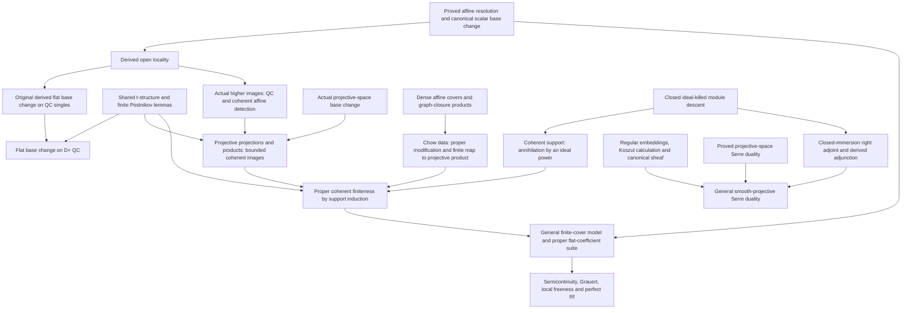

# Cohomology development plan

The current development targets canonical affine module base change and flat
base change with arbitrary quasicoherent coefficients, first for separated
schemes and then for qcqs morphisms. Projective finiteness, Serre duality and
proper cohomology and base change develop alongside that route, sharing the
same native objects and lower prerequisites.

The starting source is Aglib `bdee1b16373d721dbec6f93fae39690c4f8c36ae`,
Lean 4.34.1 and Mathlib `d13f23b723b8a846827a245b89c10fc7d3f11612`.
Work is isolated on `codex/cohomology-foundations`. Existing theorem-family
inputs remain explicit until the complete quantified statement has a proof.

## Relative duality and canonical bundle checkpoint

The current sources complete the relative projective and chosen smooth-embedding
duality route below. Their actual maps, hypotheses and proof dependencies are
recorded in the [relative family](../Aglib/AlgebraicGeometry/Cohomology/Duality/Projective/Relative/README.md).
The broader base-change and proper-direct-image targets in this plan remain
separate.

1. [Trace](../Aglib/AlgebraicGeometry/Cohomology/Duality/Projective/Relative/Trace.lean)
   glues the original affine differential trace over a separated base for every
   quasicoherent coefficient N, then reconstructs the arrow from the installed
   derived pushforward to single_n N. Its checked affine formula and the
   original affine residue, unit and coefficient-naturality laws give the
   prescribed normalization. Neither Noetherianity nor coefficient flatness
   is used in this construction.
2. [Coherent](../Aglib/AlgebraicGeometry/Cohomology/Duality/Projective/Relative/Coherent.lean)
   proves bijectivity and structural-scalar linearity of that same comparison
   for all natural Ext degrees over a Noetherian separated base, with a native
   affineLocallyFiniteType source and arbitrary quasicoherent N. The proof
   transports the actual affine map to open direct images, uses a finite affine
   cover and its locally split coefficient sequence, and applies the signed
   long exact rows. Each induction step proves injectivity uniformly in N
   before surjectivity. The projective presentation ring need not be Noetherian.
3. [ClosedEmbedding/Linear](../Aglib/AlgebraicGeometry/Cohomology/Duality/Projective/Relative/ClosedEmbedding/Linear.lean)
   transfers this linear equivalence through the installed closed-immersion
   right adjoint and native derived-pushforward composition. Its coefficient
   object is the actual Ri!W(N); its forward map is the original comparison.
4. [Canonical](../Aglib/AlgebraicGeometry/Cohomology/Duality/Projective/Canonical.lean)
   identifies the actual ambient canonical right-adjoint value with the single
   in integer degree n-d of the smooth source's top differential module.
   The proof uses the original regular-sequence class, normal-first determinant,
   generator/frame changes, common refinements and ordinary Hom descent.
   It works over arbitrary bases without separation or Noetherianity and
   includes zero rings, empty sources and dimension zero.
5. [Smooth/Trace](../Aglib/AlgebraicGeometry/Cohomology/Duality/Projective/Relative/Smooth/Trace.lean)
   transports the original unit-coefficient comparison through that actual
   canonical isomorphism and proves its all-degree single-trace formula.
   [Smooth](../Aglib/AlgebraicGeometry/Cohomology/Duality/Projective/Relative/Smooth.lean)
   gives the coherent linear equivalence over a Noetherian separated base:
   its forward arrow is derived pushforward followed by that one trace.
   Native shift transport handles integer target degrees, and the actual local
   dimension equation proves the source empty when n<d; no global d<=n premise
   is added.

Singular bases retain higher Ext; there is no general Ext>n vanishing claim.
Arbitrary coefficients retain Ri!W(N), without arbitrary-coefficient purity.
General proper f!, embedding independence and perfect direct images remain
separate targets. Compilation experience from this route is recorded in
[PERFORMANCE](PERFORMANCE.md).

Final incremental validation passed for the six public roots, `AuditSupport`
and the three affected `AglibTest` consumers. Declaration and text-style lint
passed. The scoped axiom audit loaded all 235 implementation-module origins
and checked 6,140 declarations against `propext`, `Classical.choice` and
`Quot.sound`; the three consumer modules contain anonymous examples rather
than retained kernel declarations. Generated imports, layout, source policy
and placeholder checks passed. No aggregate library build or full dependency
replay is claimed.

## Mathematical targets and acceptance

1. **Affine module base change.** For affine `f : X ⟶ S`, quasicoherent
   `M : X.Modules` and arbitrary `g : T ⟶ S`, prove that the existing
   `Scheme.Modules.moduleBaseChangeMap f g M` is invertible. No flatness,
   finiteness or Noetherian hypothesis is admitted. Identify its affine tensor
   formula and adjunction-unit/counit normalization; supply the existing
   `AffineModuleBaseChange` family without an additional mathematical input.
2. **Separated flat base change.** For a quasi-compact separated morphism `f`,
   flat `g` and arbitrary quasicoherent `M`, prove canonical base change in
   every nonnegative degree. First work over affine bases `Spec A`, `Spec B`,
   with arbitrary commutative rings and a flat map `A → B`. Preserve the actual
   `Sheaf.H`, structural scalar action, coefficient naturality and canonical
   tensor/geometric map. Recover the existing field/structure-sheaf theorem as
   a specialization, without assuming cohomological finiteness.
3. **Qcqs flat base change.** Extend the preceding theorem to qcqs `f` using
   finite affine unions and Mayer–Vietoris. Supply quasicoherence and affine
   computation of the actual higher direct images. Relate the resulting
   isomorphism to the existing `derivedFlatBaseChangeMap` on bounded-below
   complexes with quasicoherent cohomology; arbitrary module complexes are
   not covered merely by constructing that map.
4. **Projective finiteness.** For Noetherian `A`, projective `X → Spec A` and
   coherent `M`, prove `Module.Finite A Hⁿ(X,M)` for every `n`. Use Mathlib's
   actual `Proj`, standard affine charts, actual twisting module sheaves and
   their Cech cohomology. Establish finite twist presentations and coherence
   of kernels, then use long exact sequences and descending degree induction.
   Prove Serre vanishing with the same infrastructure. Extend to coherence of
   higher direct images over locally Noetherian bases by affine localization.
5. **Proper finiteness.** Extend projective finiteness through Chow's lemma,
   coherent devissage/Noetherian induction and Leray comparisons. The target is
   coherence of `Rⁿf_* M` for proper `f` over a locally Noetherian base, hence
   the complete existing `ProperModuleCohomologyFinite` family over fields.
   A projective special case is useful progress but does not discharge it.
6. **Projective, then proper cohomology and base change.** First let `A` be Noetherian,
   `X → Spec A` projective and `M` coherent and flat over `A`. Construct a bounded
   finite-projective complex computing the cohomology after every `A → B`,
   and identify the canonical derived base-change map. This target includes
   upper semicontinuity of every fibre-cohomology dimension, local constancy
   of the Euler characteristic, Grauert's theorem with its precise
   reduced-base hypotheses, pointwise surjectivity/base-change criteria and
   local-freeness criteria for individual higher direct images. Constant
   fibre dimensions alone on a nonreduced base do not supply local freeness.

   Perfect **direct image** `Rf_*` is a separate explicit endpoint: proper
   perfect morphisms over a Noetherian base preserve perfect complexes;
   more generally retain the
   relative-perfectness hypotheses needed for a perfect direct image. Derived
   base change along a classical fibre square retains Tor independence, unless
   the coefficient-flat situation proves the needed Tor vanishing. Arbitrary
   base change for an arbitrary perfect coefficient cannot be inferred merely
   from projectivity or properness. The flat-coefficient complex model above
   proves its own all-base-change assertion on the actual ordinary fibre
   product.

   Prove these geometric versions for projective morphisms before taking on
   the Chow/devissage extension to general proper morphisms. For arbitrary bases,
   retain proper finite presentation and a finitely presented relatively flat
   coefficient; supply the needed approximation or relative-perfectness
   theorem before claiming the full `LocalFreeCohomologyBaseChange` family.
7. **Serre duality.** Start with projective space: compute twists, construct
   trace and the Yoneda pairing, and prove duality and naturality. Extend to
   smooth projective schemes over a field, of pure dimension `d`, and coherent `M`, with
   `Hⁱ(X,M)ᵛ ≃ Ext^(d-i)(M,ω)` for `0 ≤ i ≤ d`. Finite locally free
   coefficients give the dual-tensor cohomology formula. Prove the comparison
   between O-linear Ext and additive `Sheaf.H`. Identifying `ω` with the top
   exterior power of differentials also needs the actual smooth differential
   rank theorem. General proper, possibly singular schemes require a
   dualizing complex and remain a separate, explicit extension target.

   **Canonical-bundle identification is a required proved endpoint.** On a
   pure-d-dimensional smooth field scheme, prove local freeness and actual
   rank d of the native differential sheaf, construct its actual top exterior
   line bundle, and identify the duality sheaf omega naturally with that line.
   The projective-space case must identify the same top differential line
   with the actual twist `O(-N-1)`. In the relative smooth case retain a fixed
   relative dimension, or work on the open components of constant rank.
   The comparison must include coordinate changes and the original trace;
   choosing the name omega for a top exterior power alone does not prove its
   relation with the constructed duality object.

The projective/proper base-change suite is accepted only when its geometric
endpoints are available on the original objects, with the following checks.

| Endpoint | Required original interface and hypotheses |
| --- | --- |
| Coherent direct images | Actual `Rⁱf_* M`, projective/proper over a locally Noetherian base and coherent `M` |
| Flat base change | The original tensor/geometric mate, arbitrary quasicoherent coefficients, qcqs `f` and flat base change |
| Flat-coefficient base change | A universal bounded finite-projective model under the precise Noetherian/finite-presentation and relative-flatness conditions |
| Semicontinuity | Upper semicontinuity of `s ↦ dim κ(s) Hⁱ(Xₛ,Mₛ)` and locally constant alternating sum, derived from that actual model |
| Grauert | Local freeness and arbitrary base-change compatibility, with reducedness or the stronger pointwise criterion retained as required |
| Pointwise criterion | Surjectivity of the original residue-field base-change map, its neighbourhood consequence, and the adjacent-degree local-freeness criterion |
| Perfect direct image | Actual `Rf_* E` perfect under proper-perfect/Noetherian or proper-flat-finite-presentation/relative-perfect hypotheses |
| Compatibility | Coefficient maps, open restriction, composition of base changes, and comparison with the existing derived map |

A lower finite-complex theorem is a prerequisite for this table, not a
replacement for a geometric endpoint. The first implementation may use
projective `f`; the extension from projective to proper remains explicit.

## Shared prerequisites and proof routes

The affine section/tilde equivalence and canonical affine tensor comparison
feed both module base change and Cech coefficient base change. Structural
scalars must be generalized below the field specializations, preserving their
existing definitions by explicit comparisons rather than parallel cohomology.

The finite-family coefficient comparison already avoids any assumption that
tensor preserves infinite products. The current full-tuple Cech complex is
unbounded even for a finite cover. Bounded ordered/alternating Cech comparison,
or a proved finite-cover cohomological bound via Mayer–Vietoris, must precede
the finite-amplitude arguments. Its terms are not generally finite over the
base ring. Proper finiteness and finite Tor amplitude, rather than finite
cover size alone, provide the finite-projective model.

The selected bounded-flat route retains the full native tuple complex. For
relatively flat coefficients its terms are flat over the base, and the
finite-cover cohomological bound holds after every base-ring map. Applying
this also to square-zero extensions proves the needed tensor exactness for
every base module. Purity and kernel-flatness then prove that the terminal
cycle of a good truncation is flat. An exact unbounded tail of flat modules
alone is insufficient for that step. Noetherian cohomological finiteness and
the resulting finite Tor amplitude supply the finite-projective replacement.

Projective geometry uses general arbitrary-dimensional constructions; curve
degree, genus, Riemann–Roch and K/G/Q/S applications stay downstream. New
constructions extend native mathematical namespaces with precise lower imports.
Generic complex/perfectness lemmas belong below scheme cohomology.

## Derived-method review

The review paused new proofs while comparing the alternatives. The current source already uses
native bounded-below derived categories, actual derived units and genuine
finite-projective models. The recommended next architecture adds focused
derived bridges to those constructions; a full unbounded duality theory
has substantially more prerequisites in the pinned libraries.

For flat base change, retain the proved affine injective-resolution
producer. Assemble open locality using exact restriction, its preservation
of injectives, the original ordinary restriction isomorphism and the native
derived-composition isomorphisms. Use the installed
`derivedFlatBaseChangeMap` as the sole canonical derived map. Its current
source constructs the map and its unit equation, but does not prove it
invertible. Its homology on quasicoherent single objects still needs
identification with the proved scalar cohomology map. A later finite
Postnikov argument can extend this to bounded-below complexes with
quasicoherent cohomology. Injective or Godement terms must not be treated
as quasicoherent merely from their acyclicity.

For the perfect-direct-image object, exactness of tilde permits direct
transport of the existing derived global-section isomorphism through
`tilde.rightDerivedFunctorPlus`, using its invertible native units. This
can remove K-projective representative selection from the object-level
source and arbitrary-base-change constructions. Existing actual chain-map
versions remain useful for their explicit normalization formulas. This is
a proposed simplification; the present compiled implementation is retained.
For arbitrary perfect coefficients, relative finite Tor amplitude,
derived tensor and the corresponding projection formula still need
integration with the actual coefficient and direct-image interfaces.
The newly inspected local Aglib `f87a691` already constructs
`Scheme.Modules.derivedPullbackMinus` for arbitrary morphisms using actual
bounded-above flat replacements. This removes a proposed construction
from the missing-interface list; its native ownership moves must be
reconciled before admitting the larger dependency group here.
General nonflat derived tensor does not preserve
D+: it may have unbounded negative homology. A proposed interface must
retain appropriate bounded-above, perfect or finite-Tor restrictions.

For general smooth projective Serre duality, the smaller candidate route
uses only the right adjoint of a closed immersion and its bounded-below
right-derived functor. If `i : X → P^N` is regular of codimension `c`, the
required calculation is `Ri!(omega_P) ≅ omega_X[-c]`. Then the derived
adjunction identifies actual `Ext_X^j(M,omega_X)` with
`Ext_P^(j+c)(i_*M,omega_P)`, so the existing projective-space duality and
original pushforward cohomology comparison give the desired result.
For coherent single objects this does not first require extending
projective-space Serre duality to every bounded coherent complex.

Exact closed-immersion pushforward, native D+ right derivation and the
generic `Adjunction.derived` exist. The actual closed-immersion ordinary right adjoint is now constructed,
with its original affine coinduction formula and unit/counit normalization.
The native pointwise K-injective Hom adjunction is already usable at every
bounded-below injective target: the actual right-adjoint image's K-injectivity
is proved from exact closed pushforward. The global D+ derived-adjunction
wrapper remains delayed until needed by another consumer. The current
`Adjunction.extEquiv` assumes both ordinary functors exact and cannot be
used for a merely left-exact right adjoint. Major additional geometric
prerequisites are regular embeddings, Koszul calculations and the
conormal/determinant identification with top differential forms.
The actual fixed-dimension field-scheme smooth-rank theorem is now proved
in `Modules/Differentials/SmoothRank`. The relative affine comparison already
allows arbitrary commutative ring maps; the global general-base differential
construction remains a separate missing interface. Smooth local-ring
regularity and dimension are already proved and should be reused.
See [closed-immersion duality](https://stacks.math.columbia.edu/tag/0A9X)
and the [regular-immersion calculation](https://stacks.math.columbia.edu/tag/0BR0).

General proper coherent finiteness is now proved: `Proper/Finiteness`
contains internal closed-support induction over every Noetherian affine
base, and `DirectImage/Proper/Coherent` descends it to every locally
Noetherian target using the original open comparison. Original large-universe
cohomology keeps its structural scalar action. The perfect-image theorem
then additionally requires its relative Tor hypotheses; properness alone
does not supply them. The existing native derived-pushforward composition
already supplies the Leray comparison needed by the Chow/devissage route.
See [proper perfect-image construction](https://stacks.math.columbia.edu/tag/08EV)
and the [finite-complex flat-coefficient proof](https://stacks.math.columbia.edu/tag/07VJ).
The full right-adjoint construction via unbounded D(QCoh), compact
generation and representability is a larger separate project; see
[Stacks 48.3.1](https://stacks.math.columbia.edu/tag/0A9E).

## New source review and completed shared gates

During the initial source comparison, fetched `origin/main` was `e3f6c75`
and local main advanced through `f87a691` to `40af743`. Those source
snapshots remain distinct from the integrated checkpoints recorded below. Six exact generic leaves from that local revision have been
admitted and compiled individually: homological-complex and homotopy
adjunctions, and native K-injective Hom, representatives, mapped Hom and
pointwise derived Hom adjunction. The public independent-universe consumer
retains their literal chain-adjoint maps. Exact bytes and provenance are
recorded in `migration/upstream-derived.json`. The larger bounded-above flat
replacement, derived pullback and perfect-object groups remain reviewed
sources, pending their single-owner path reconciliation.

The additional `40af743` review supplies the actual field-scheme smooth
rank gate: `differentialSheaf_hasRank_of_smooth` has no theorem-family
premise, over every field and fixed relative dimension, including the
empty scheme. Its canonical affine differential/tilde comparison retains
localization seeds. Exactly four direct leaves were imported and compiled
separately, followed by an independent public consumer; the unused empty Properties
path is retired in favor of the actual proof owners. Exact bytes and receipts are
recorded in `migration/upstream-smooth-differentials.json`. The unrelated
finite-presentation/rank owner migrations were not needed for this cut.
The general relative-base differential interface has since been constructed;
its actual affine algebraic comparison and D2--D5 retain the boundaries in
the current status below.

The user-supplied Motivic archive uses the same Lean and Mathlib pins.
Its generic finite Koszul resolution is selected for native
`ChainComplex.Koszul` ownership, with the elementwise short-complex criterion
under `CategoryTheory.ShortComplex`. Preserve source headers and exact
source/destination hashes in `migration/motivic-koszul.json`; only a
successfully compiled leaf is recorded as passing. All eighteen selected source leaves and the independent native consumer
have now passed. The genuine quotient augmentation, signed differential and
regular-sequence resolution are the immediate Serre-purity inputs. Its exterior-coefficient tensor comparison does not supply wedge
powers, determinants or change-of-generators compatibility.
Its open tilde base change assumes an open immersion, and its affine
coordinate-complex comparison assumes every term quasicoherent. Neither
replaces the existing arbitrary-complex affine counit quasi-isomorphism
or proves general coherent-cohomology flat base change.

The following shared gates now have focused source and public-consumer
checks; this is not a claim that the final proper or general duality
theorem is complete.

| Gate | Proved native interface | Remaining immediate consumer |
| --- | --- | --- |
| U | `rightDerivedSingleHomologyIso`, original affine higher-image sections/H comparison and naturality | Normalize homology of the actual derived base-change map |
| L | `derivedOpenBaseChangeIso` with original unit, `higherDirectImageOpenRestrictionIso`, actual qcqs higher-image quasicoherence | General-target base change and projective coherent images |
| T | Installed RF lower bounds, normalized single-homology reconstruction, finite homology-layer devissage and lower-bound-preserving D+ comparison | Discharge geometric single-object comparisons and coherent-property extension closure |
| Shift | Native `rightDerivedDesc` commutes with shifts from its defining unit square | Apply it to the installed geometric base-change transformation |
| K | Closed pushforward fully faithful on all module sheaves; original unit invertible exactly for ideal-killed coefficients | Ordinary right adjoint and coherent thickening descent |
| S | Actual affine support and compact finite-cover maximum give one positive power; Noetherian coherent coefficients descend to the actual thickening via original pullback/unit | Transfer the smaller-support derived images into the proper induction |
| Chow geometry | Internally constructed proper surjective modification, finite map to an actual projective product, dense-open isomorphism and original closed pair map | Projective projections' bounded coherent images, then support induction |

The actual flat-base-change endpoint has now passed on every base:
`derivedFlatBaseChangeMap_isIso_of_quasicoherent_homology` in
`BaseChange/Derived/Locality` applies to the existing installed comparison,
flat base change, a qcqs original morphism, and QC original homology on any
bounded-below object. `Derived/Restriction` proves pasting of that same map;
ordinary affine-open descent supplies the global step. No extra truncation
or derived-category theory is introduced for that descent. The literal
higher-direct-image map is now proved in `BaseChange/HigherDirectImage`,
with its exact H-of-original-map formula, coefficient naturality and QC
isomorphism theorem in every natural degree.

`Proper/Field` now supplies the retained all-field
`ProperModuleCohomologyFinite` and `ProperStructureCohomologyFinite`
interfaces from this proof, with unchanged field scalars. Its global-section
corollary uses the original H0 map. These suppliers take no finiteness-family
premise, and existing parameterized application bridges can consume them.

The projective-product cohomology suppliers and actual Chow modification
now feed `Proper/Finiteness` without an IH or cohomology-family premise.
`DirectImage/Proper/Coherent` is the corresponding arbitrary locally
Noetherian-target theorem; it has no target quasi-compactness or relative-flat
coefficient assumption. The finite-affine-cover model is being moved to its
sole generic owner for proper relatively flat coefficients.

Actual semilinear exterior maps, module-presheaf exterior powers and their
compatible-alternating-family universal property, and the sheafified exterior
functor/universal wedge have passed over general ringed sites with independent
universes. Top-degree determinant frames, conormal comparison and relative
Serre duality remain explicit consumers. The final general-base descent is
kept as a short locality step once those affine relative theorems are proved.

Coherent extension closure in the ambient category of all module sheaves
now has proved lower suppliers. Actual affine sections exactness when the
left coefficient is QC, exact tilde and the original counit give QC/finite-type
extension closure; the generic helpers have been moved below scheme
cohomology with the old names retained as import wrappers. The native
`coherentHomologyObjects X` property uses exact-five devissage for kernels
and cokernels of maps between known coherent objects. It imposes no target
upper bound or representative-term condition, and does not assert closure
of QC under arbitrary ambient subobjects or quotients.

## Unified implementation dependency graph

Checkpoint `b0f205d` contains the proved affine/projective results above.
The next work is one dependency graph with shared lower implementations.
The derived and projective-to-proper routes must not introduce separate
copies of restriction, homology-layer induction, closed descent or the
canonical base-change map.

### Shared lower tiers

| ID | Sole provider / proposed focused leaves | Precise product and immediate consumers |
| --- | --- | --- |
| U | Affine worker: `DerivedCategory/RightDerivedFunctorPlus/SingleHomology`, `DirectImage/Affine/Cohomology` | Natural comparison of actual `R^n F` with homology of installed `RF(M[0])`, normalized on every supplied injective resolution. Identify actual affine higher-image sections with unchanged `Sheaf.H`. Arbitrary additive F is allowed; the additional `R^0 F = F` comparison retains left exactness. |
| L | Affine worker: `Cohomology/DirectImage/Restriction` | Actual D+ open-restriction isomorphism for every morphism, with its original unit; actual higher-image restriction. Used by general-target flat base change, projective coherence and the proper modification cone. No QC assumption on a chosen injective term. |
| T | Integrator: `DerivedCategory/RightDerivedFunctorPlus/TStructure`, `DerivedCategory/Plus/Postnikov` | Lower cohomological bounds for the installed right-derived functor; finite homology-layer induction for bounded objects, plus fixed-degree truncation for D+. Used by bounded coherent images, support cones and D+ QC base change. Reuse the existing term-bounded comparison where it applies. |
| K | Proper worker: `Modules/ClosedImmersion/Killed`, `Modules/ClosedImmersion/Descent` | For the actual closed subscheme of an ideal sheaf, characterize invertibility of the original `M → i_*i^*M` by annihilation by that ideal. Work first with actual arbitrary module sheaves, then specialize QC/coherence. Used by support induction and the closed right adjoint. |
| S | Proper worker: focused coherent support leaves below cohomology | A coherent module whose support lies in `V(J)` is killed by a finite power of `J`, on a Noetherian scheme; descend it to the actual `(J^m).subscheme`. This is not descent to the reduced closed set and does not require a global prime filtration. |
| G | Geometry worker: `ProjectiveSpace/BaseChange` and focused chart helpers | Actual projective-space Cartesian square for an arbitrary base-ring map, with original chart maps and structural factorization. First prove the scheme comparison needed for projections; twist pullback formulas are a later consumer, not a finiteness premise. |
| M | Proper worker: `Cohomology/FiniteModel`, specialized by `Proper/FiniteModel` | The sole generic model, original base-change comparisons, derived-object transport, strict-perfect model, fibers and local criteria are proved. Old projective names are transparent specializations/thin interfaces. Numerical methods are being moved one at a time with unchanged old consumers before proper specialization. |

Paths omit their existing `Aglib/AlgebraicGeometry/` or
`Aglib/Algebra/Homology/` prefix. A proposed leaf may be replaced by a
better existing owner after inspection, but each shared declaration keeps
one implementation and one assigned writer.

### Flat base change and actual higher direct images

1. **L1: derived open locality.** Start from the original
   `Complex.ordinaryOpenRestrictionIso`. Restriction is exact and preserves
   injectives. Use the existing right-derived composition comparisons
   before/after restriction and the original functor isomorphism. Prove
   the installed-unit equation, coefficient naturality and agreement with
   the original restriction/pullback comparison.
2. **L2: higher images.** Use the existing native resolution/D+ homology
   comparisons to take homology of L1. Localize the proved affine
   `moduleHigherDirectImageAffineIso`, obtaining quasicoherence of actual
   `R^n f_*M` for qcqs `f` and QC `M` over a general scheme. Keep the exact
   structural action and the original right-derived functor.
3. **B1: QC single-object derived base change.** Identify homology of the
   installed `derivedFlatBaseChangeMap` on `M[0]` with the proved original
   scalar cohomology base-change map on affine opens. Apply the qcqs flat
   supplier and actual open-local reflection. The source coefficient is
   QC; the terms of a resolution are not assumed QC. Take homology to
   obtain the actual higher-direct-image base-change theorem.
4. **T/B2: D+ extension.** Prove shift compatibility of the original
   transformation, and use lower bounds and a finite Postnikov segment
   for each fixed output degree. Extend B1 to D+ objects with QC
   homology. A termwise bounded or termwise QC theorem is not substituted
   for this statement. No infinite totalization or unproved generation
   family is admitted.

L1 can unblock proper work before B2 is complete. Generic t-structure
lemmas are supplied by T rather than re-proved in the geometric branch.

### Projective-to-proper finiteness

The first target is arbitrary coherent coefficients over a Noetherian
affine base, without a relative-flatness premise. General locally
Noetherian targets follow through L and affine coherent detection.

1. **P1: projective projections.** Combine G, L2 and the proved original
   projective finiteness theorem to prove coherence of the actual higher
   images of a projective-space projection over a locally Noetherian
   base. The fixed standard-coordinate dimension gives a uniform upper amplitude.
   Use T to extend this to bounded objects with coherent homology.
2. **P2: products and closed embeddings.** Iterate actual projective-space
   projections and the existing `derivedPushforwardPlusCompIso`.
   Closed-immersion pushforward is already exact and preserves coherence.
   Deduce bounded coherent direct images for a closed embedding into a
   finite product of projective spaces over the displayed base. Apply
   the same theorem over `Spec R` to get finite original cohomology for
   a coherent module on that product. No general proper theorem is used.
   General properness over a non-quasi-compact locally Noetherian target
   is not, by itself, a global uniform-amplitude assertion; retain the
   actual uniform bound or work affine locally.
3. **C1: dense affine covers.** For a scheme with finitely many irreducible
   components, enlarge an original affine open to contain every generic
   point. Use native finite disjoint-union affineness; no separation
   hypothesis is needed for this all-components version. With compactness
   obtain a finite affine
   cover `U_i` whose common intersection contains every generic point and
   is dense. Neither integrality nor reducedness is required. The needed
   affine finite-type immersions and individual graph closures are already
   proved. See [suitable affine opens](https://stacks.math.columbia.edu/tag/01ZU).
4. **C2: modification without an initial Segre embedding.** For each
   immersion `U_i → P_i`, use its actual graph closure `Z_i ⊂ X ×_R P_i`.
   Form their finite fibre product over X. Prove that `pi : Y → X` is
   proper and surjective and is an isomorphism over the common dense U.
   The original closed embeddings give `Y ⊂ X ×_R product(P_i)`. On
   `pi^-1(U_i)`, the i-th coordinate recovers X, so the map
   `q : Y → product(P_i)` is locally an immersion. For proper X/R, q is
   proper and locally quasi-finite, hence finite by native Zariski's Main
   Theorem. The common U need not be dense in all of Y, and no
   scheme-theoretic dominance assertion is added.
5. **C3: establish both independent cohomology inputs.** P2 applied over
   X proves bounded coherent images for pi. Finite q and P2 over R prove
   finite cohomology on Y. These are established before the induction
   step; neither is supplied by assuming the proper endpoint being proved.
6. **F1: Noetherian support induction.** Fix an ambient Noetherian proper
   X/R. For a closed set Z, the induction assertion quantifies over every
   actual closed immersion `i : W → X` with image in Z and every coherent
   module on W: every native homology sheaf of `R(f|W)_*(M[0])` is coherent
   on `Spec R`. If its image is smaller than Z, apply induction directly.
   Otherwise use C2 on W and form the actual cone of
   `M[0] → R pi_*(pi^* M)[0]`. L1 makes this cone vanish on U; C3 makes
   its homology bounded and coherent. Its homology support is contained
   in the boundary, whose closed image T is strictly smaller than Z.
   By S and K, each homology module descends to an actual thickening of
   that boundary. Apply the induction hypothesis there and the native
   derived-composition comparison for the exact closed pushforward.
   T and the distinguished triangle then give coherence of every native
   homology sheaf of `R(f|W)_*(M[0])`. The target property here needs no
   global output bound. The induction and composition stay in actual
   D+ module-sheaf categories; no new R-Gamma composition theorem is
   needed. The affine U comparison converts to original finite `Sheaf.H`
   once, at the public endpoint.
   No reduction to an integral source or global annihilator-sheaf
   construction is needed before this induction.
7. **F2: public endpoints.** Transfer the result to the unchanged
   structural `Sheaf.H` in every degree, and through L2 to coherent actual
   `R^n f_*M` for proper f over a locally Noetherian base. Supply the
   complete existing `ProperModuleCohomologyFinite` family only after its
   all-field/all-universe consumer passes. All induction hypotheses are
   discharged internally. The standard proof is recorded in
   [Stacks 30.19](https://stacks.math.columbia.edu/tag/02O3); the cone
   organization above is the selected derived implementation.

This route delays Segre, general relative Serre vanishing and twist
base-change normalization. They remain useful geometric results, but the
first finiteness proof does not depend on them.

### Proper base change and perfect direct image after finiteness

1. Extract M while preserving the original projective public interfaces.
   For proper X/Spec R, choose a finite affine cover and use the proved
   bounded-flat truncation, universal tensor comparison and F2 finiteness.
   Apply the existing finite-projective replacement to construct the
   universal model internally for coherent relatively flat M.
2. The original linear comparison square with `moduleCohomologyBaseChangeMap`
   now transfers semicontinuity, intrinsic Euler local constancy, nonreduced
   local criteria and reduced-base Grauert to proper f. Original residue-field
   surjectivity is identified with the actual outgoing-cokernel free locus;
   its basic-open theorem gives every original composite base-change map.
   This affine suite passed independent ordinary review against digest
   `71c03da9b1c5a4bc40f2a9bd07106316e086a332e16705f6e815b93bcce8af23`.
   The actual general-point fibre and its affine-coordinate comparison are
   also proved. Upper semicontinuity of the intrinsic point-fibre dimension
   and local constancy of its intrinsic Euler characteristic now hold over
   arbitrary locally Noetherian targets. On reduced locally
   Noetherian targets, local constancy of that dimension gives finite local
   freeness of the literal higher direct image, without target
   quasi-compactness. The general nonflat sheaf-valued comparison is now
   constructed by module-Hom descent. Its proper consumers prove arbitrary
   base change under reduced-base local constancy, and the actual residue-map
   epimorphism criterion with its neighbourhood and global consequences,
   without reducedness in the latter two cases. Neighbourhood freeness retains
   its adjacent-degree condition.
3. Obtain the actual sheaf-valued perfect Rf through exact tilde transport
   and the proved original counit. The same model handles all ordinary
   pulled coefficients after arbitrary ring maps. Preserve actual chain
   normalizations as separate consumers rather than choosing new
   representatives for every object-level endpoint.
4. General perfect coefficients require the additional relative finite-Tor,
   derived tensor/pullback and projection-formula tier. Prove the proper
   perfect-morphism/Noetherian endpoint with those hypotheses. Arbitrary
   bases additionally require actual approximation/spreading results;
   these are a later explicit gate for the full retained
   `LocalFreeCohomologyBaseChange` family.

### Serre duality branch and its shared inputs

The differential/determinant side of this branch has the following explicit
acceptance sequence, including the user's smooth canonical-bundle request.

| Step | Original object and theorem to prove | Dependency and normalization |
| --- | --- | --- |
| D1 | Native relative differential sheaf is finite locally free for a smooth morphism; its rank is the actual fixed relative dimension | Arbitrary-base fixed-dimension case now proved by `relativeDifferentialSheaf_hasRank_of_smooth`, using native standard-smooth charts and original open comparisons; no field, Noetherian or family premise. Variable-dimension components remain a separate interface |
| D2 | Actual top exterior power is a line bundle and satisfies the determinant formula for the conormal sequence | Use the same differential sheaves, their original maps and the locally split exact sequence; track basis changes |
| D3 | On projective space, the top differential line is the actual `O(-N-1)` | Normalize through original affine polynomial coordinates and transition functions; preserve the coordinate orientation used by the existing trace |
| D4 | The sole nonzero homology of `Ri!omega_P` is the determinant-normalized canonical line of a smooth regular closed source | Relate the actual Koszul top Ext class under change of regular equations to D2; use the shared normalized single-homology reconstruction |
| D5 | Smooth Serre omega is naturally the canonical bundle, with the original pairing and trace | Consume D3/D4 and the original projective-space duality; include the relative fixed-dimension version as its own precise interface |

The D3 implementation should use the actual relative Euler sequence
`0 -> Omega -> O(-1) tensor pi*V -> O -> 0`, where V is the module of
polynomial degree-one generators. The coordinate formula and exactness must
be proved on the original standard charts; the source describes them in
[Stacks 50.11](https://stacks.math.columbia.edu/tag/0FMG). Taking determinants
with the quotient convention for [projective bundles](https://stacks.math.columbia.edu/tag/01OA)
gives the planned coordinate-free line `O(-n-1) tensor pi*det(V)`; this is a
deduction from the Euler sequence and the [determinant exact-sequence rule](https://stacks.math.columbia.edu/tag/0B37).
Only the selected ordered polynomial basis trivializes det(V). Its determinant
factor must therefore be retained under coordinate changes and matched with
the original residue orientation. An unqualified GL-equivariance claim for
O(-n-1) alone would lose that factor. Dimension zero needs its own checked
normalization. The actual evaluation, its epimorphism and the original
polynomial-chart differential frames are now proved in
`ProjectiveSpace/Differentials/Euler`. The actual left arrow on these charts
and its zero composite with evaluation are also proved (source
`1792141554330768000-64003`, public consumer
`1792141770904737000-65539`). The complete actual chart sequence is now
short exact with an explicit splitting, over every commutative ring and
arbitrary coordinate type. Its literal original homogeneous-fraction
formula is checked, including the empty complementary basis in dimension
zero. The unchanged public entry now imports four precise owners:
`Euler/Basic`, `PolynomialChart`, `MiddleFrame` and `LocalExact`.
The final local closure and literal-fraction consumer passed
`1792144773088804000-94914` and `1792145085352001000-97575`.
Overlap compatibility and global gluing are the next cell. They share the
actual InternalHom restriction/gluing adapters with general base change.
Global Euler exactness and the determinant formula remain proof
obligations, not new suppliers.

None of D1--D5 is discharged by inserting a differential-rank or purity
supplier as a new mathematical assumption. The rank, conormal, exterior,
determinant and trace comparisons remain individually checked obligations.

The general-base objective is not the field theorem with its scalars
renamed. There are two precise later gates:

- Over a Noetherian base, proper duality compares
  `Rf_* RHom_X(K, f!M)` with `RHom_S(Rf_* K, M)` for the appropriate native
  bounded-above coherent and bounded-below QC complexes. Perfect coefficients
  are a constructive first interface, not a claimed mathematical necessity
  for this full Noetherian statement. Smooth pure relative dimension identifies
  `f!M` with `Lf*M` tensor the actual top differential line shifted by `d`.
  The scope and shift are checked against [Stacks 0AU3](https://stacks.math.columbia.edu/tag/0AU3).
- For arbitrary qcqs bases, construct the actual relative differential sheaf,
  then its smooth local frames, determinant line, relative trace and descent.
  The proper flat finite-presentation relative-dualizing setup is checked
  against [Stacks 0E2Z](https://stacks.math.columbia.edu/tag/0E2Z). It is a
  separate general-base gate, not an inferred corollary of field duality.

The actual affine relative differential comparison now allows arbitrary
commutative ring maps, preserves both original principal-open differential
formulas, and identifies the original sheaf with the native Kahler tilde.
The sole relative differential sheaf for every scheme morphism is now
constructed in `Modules/Differentials/Relative/Basic`, with its universal
property against every module sheaf and the literal differential on `f.c`.
Its affine and open comparisons and fixed-dimension smooth frames are proved.
Exterior powers and determinant transitions belong to
general module presheaves and sheaves on ringed sites, so this new layer can
serve the global relative construction. General-base Serre acceptance requires
all of these maps and their base-change/trace normalization, not just a line
bundle with the right fibre rank. These source statements guide the formal
proof obligations; their imported mathematical conclusions are not assumed.

1. The selected construction of the ordinary right adjoint uses the
   native special adjoint functor theorem after comparing it with explicit
   ideal-annihilated descent from K:
   closed pushforward preserves all colimits, and the Grothendieck
   module category has the required generator and well-poweredness
   infrastructure. Preservation of all small colimits and ordinary
   existence now have compiled proofs on all module sheaves:
   `Modules/Pushforward/ClosedImmersion/Colimits` and
   `Modules/ClosedImmersion/RightAdjoint`. The single selected right adjoint
   is additive, preserves limits and preserves injectives, without QC,
   Noetherianity or finiteness. Its computation still needs the actual
   ideal-annihilator local formula for later computation. Do not build
   two right-adjoint implementations. Prove its original
   adjunction, linearity and localization. The affine coinduction formula and
   original unit/counit/Hom-adjoint equations now have checked suppliers for
   arbitrary target sheaves. For ordinary open locality, use the existing
   extension-by-zero adjunction and its actual inside/off-image stalk formulas:
   the original open-pushforward mate gives an exchange map
   `b_* ; j_! → a_! ; i_*`, whose original restricted map is invertible;
   closed and open stalk comparisons prove the same map invertible globally.
   This original exchange is now proved invertible in
   `Modules/Restriction/ExtensionByZero/ClosedImmersion`. Native conjugation
   gives open restriction of this sole `i!` in
   `Modules/ClosedImmersion/RightAdjoint/Restriction`, with its original
   unit, counit and Hom-adjoint equations. `Cohomology/ClosedImmersion/RightAdjoint`
   derives the same ordinary comparison and retains its exact installed-unit
   equation on all bounded-below complexes. No unproved internal-Hom/stalk
   interchange is used. Keep ordinary existence on
   arbitrary module sheaves separate from QC preservation, which needs
   the appropriate finite-presentation/Noetherian conditions.
2. First consume the new upstream K-injective Hom adjunction at the
   actual single source and the original injective resolution of omega_P
   (and its shifts). Exactness of i_* makes its ordinary right adjoint
   preserve injective objects; bounded-below injective complexes are
   natively K-injective. Discharge both target K-injectivity conditions,
   preserve the original chain-adjoint equations, and normalize the
   installed right-derived object using the existing resolution iso.
   Prove the structural scalar and Yoneda compatibility on that same
   map. A global D+ derived-adjunction wrapper can be delayed until it
   has an additional consumer. `Adjunction.extEquiv` is not used outside
   its two-exact-functor hypotheses.
3. Admit the selected native regular-sequence Koszul complex, its actual
   quotient augmentation and finite projective resolution from the supplied
   archive, one compiled lower leaf at a time. Then prove its actual
   duality calculation and localize/glue it for a regular closed
   immersion. Prove the needed smooth regular-embedding criterion,
   conormal finite local freeness, smooth differential rank supplier and
   top exterior/determinant adjunction. Reuse proved smooth regularity
   and dimension. Identify omega on projective space with its actual top
   differential form before claiming the same formula on X.
   For purity, compute the homology of the one native Ri! object locally,
   normalize its sole nonzero homology by the Koszul determinant class,
   and apply T's concentrated-homology isomorphism. A separate gluing
   theory for arbitrary derived morphisms is not required for this step.
   On an affine chart `Spec A`, compute this using the original injective
   resolution of omega: exact tilde is left adjoint to sections, so sections
   sends those injectives to injective A-modules; QC of omega supplies
   exactness of its sections resolution. Ordinary adjunction identifies
   sections of the closed right-adjoint complex with `Hom_A(B, Γ_A I)`.
   No resolution term is assumed QC. The selected Koszul resolution then
   computes native Ext. The first actual calculation is now proved in
   `Koszul/Single/Ext`: its linear degree-one quotient equivalence uses the
   original multiplication-resolution cocycle, commutes with native Yoneda
   coefficient maps, and proves concentration in degree one when the scalar
   is regular on both ring and coefficient. The source and independent public
   consumer passed with only the standard three axioms. This is a
   codimension-one module-quotient calculation, not general regular-list
   purity. The original Ext restriction/localization map,
   quotient B-action and determinant normalization must all be proved
   before the concentrated-homology reconstruction is applied.
4. For an actual pure-d-dimensional smooth projective embedding
   `i : X → P^N`, compute `Ri!(omega_P) ≅ omega_X[-(N-d)]`. Apply the
   derived adjunction directly to coherent M in degree zero. The existing
   projective-space Serre duality and original pushforward cohomology
   comparison then give the full original Ext/H pairing, trace, naturality
   and dimension-zero normalization on X. No prior all-bounded-complex
   projective-space duality extension is required.
5. A general proper dualizing-complex/right-adjoint theory is a subsequent
   endpoint with its own existence and local-coherence proof. It is not
   inferred from the Chow finiteness argument and is not a prerequisite
   for the coherent proper base-change suite.

### Relative Serre duality over an affine Noetherian base

The first relative target uses actual Hom in D(R):
`Ext_X^i(M, omega) = Hom_D(R)(RΓ(M), R[i-n])` for coherent M on Pn_R.
No flatness or perfectness of M is imposed. This derived Hom target retains
the higher base-ring Ext terms that an ordinary cohomology dual would lose.
The first checkpoint does not require a full internal-RHom bifunctor.

1. Construct the actual derived trace `RΓ(omega) -> R[-n]` by the shared
   concentrated-homology reconstruction. Prove that its Hn map is exactly
   the original R-linear Laurent residue trace. Map the original native Ext
   arrow through the installed RΓ and its CommShift comparison, then compose
   with that trace. Preserve original coefficient naturality and connecting
   maps. A generic RF-linearity framework is optional: Ext scalars act by
   postcomposition on omega, and trace compatibility with this endomorphism
   is detected on Hn of the concentrated trace source.
2. Put `F_i(M) = Hom_D(R)(RΓ(M), R[i-n])`. The bound `RΓ(M) <= n` makes
   negative i vanish and identifies F0 with `Hom_R(Hn(M), R)`. Check that
   the degree-zero comparison is the already proved canonical top-Hom
   duality, including the original map. For a finite sum P of sufficiently
   negative twists O(-N), `RΓ(P)` is finite free concentrated in degree n.
   Consequently every positive F_i(P) vanishes. Existing negative-twist
   Ext vanishing gives the same effacement for `Ext_X^i(P, omega)`.
   The uniform finite negative presentations, coherent kernels and the
   native exact rows therefore prove the canonical comparison bijective
   by induction on i. Dimension zero and all i are included; no vanishing
   of Ext above n is inferred over a singular base ring.
3. The independent twist-pairing seed still needs the original Hom-section
   and tensor-counit normalization. Its R-linear equivalence and coefficient
   naturality are proved. This seed is useful for direct residue formulas,
   but its pending concrete section conversion is not a prerequisite for
   steps 1--2.
4. For an arbitrary base module J, compute the original twist tensor
   coefficient using its same bounded flat finite-Cech model. Endpoint
   single/model quasi-isomorphisms have bounded-above flat cones, so native
   `Flat/BoundedAcyclic.universally_lTensor_exact_of_acyclic` applies without
   flatness, finiteness or injectivity of J. The unbounded full Cech complex
   cannot replace that bounded model. Normalize the actual tensor map and
   trace into J; extend canonical top-Hom duality to J. Repeating step 2
   with `Hom_D(R)(RΓ(M), J[i-n])` then avoids the field-only exact-dual
   argument. The negative-twist source is finite free over R, so it kills
   positive base Ext for every J, not only injective J.
   For the planned top-Hom_J step, use two successive finite negative-twist
   presentations Q -> P -> M. The cohomological upper bound makes
   Hn(Q) -> Hn(P) -> Hn(M) right exact, while both Hom(-, omega_J) and
   Hom_R(-, J) give the matching kernel rows. Once the actual negative-twist
   comparisons into J and their coefficient/trace normalization are proved,
   those rows recover the comparison for M without assuming J injective.
   The bounded native tensor comparison and all-twist bounded-flat terms
   are proved without a Flat J premise. The actual tilde tensor isomorphism
   and arbitrary-scheme quasicoherence of tensor are proved in
   `Modules/QuasiCoherent/Tensor` (source `1792143533976032000-81965`, public
   consumer `1792143753178286000-84082`).
   `Modules/Tensor/AffineSections` proves invertibility of the original
   `moduleTensorSectionLinear` for arbitrary quasicoherent inputs on an
   affine open, retaining the literal pure-section formula (source
   `1792145645342597000-2816`, public consumer
   `1792146083875700000-5405`). The actual Cech coefficient comparison,
   trace_J and coefficient-J duality remain proof obligations.
5. Extend to D+ base complexes by finite brutal truncations of an actual
   bounded-below representative. For a fixed shift the upper bound on RΓM
   makes both tail Hom groups vanish; the exact smooth pullback and omega
   tensor give the corresponding bound on X. Finite triangles reduce to
   step 4. Bounded coherent sources follow by the shared Postnikov method.
   A full bounded-above coherent source theorem still needs the matching
   native Rf domain; a D+ implementation does not establish that endpoint.
6. General-base descent must concern an actual sheaf/derived-object or
   mapping-complex comparison. Global derived Hom groups are not Zariski
   sheaves, so affine Hom-group isomorphisms alone do not complete that
   step. The concentrated trace can glue through ordinary homology sheaves;
   retain the separate internal-RHom/localization interface for the full
   Noetherian general-base statement. Once that actual comparison exists,
   use open restriction and local isomorphism detection.

For smooth relative regular embeddings over a singular base, do not reuse
absolute regular-local arguments for smooth field schemes. The relative
proof uses fibre regular sequences and successive regularity/flat-quotient
lifting, then conormal/differential ranks to count the codimension. Current
`Flat/PrincipalQuotient/Local` supplies the Noetherian local residue criterion;
`Fibrewise.regular_and_flat_of_fibre_regular` requires all residue fibres.
These native inputs shorten the bridge without being an already proved
regular-embedding or purity supplier. The purity and relative-duality branches
share the original Ext actions, finite models, determinant and trace.

### Parallel batches and acceptance gates

The first batch has four disjoint write owners: affine worker on U and then L1;
proper worker on K; geometry worker on C1 and then C2; integrator on T
and native K-injective adjunction integration. They exchange precise providers
before writing shared consumers. G/P1 can begin when the geometry and
affine suppliers are available. K/S and C1/C2 proceed independently, and
F1 starts only after P2/C3, S and T have compiled suppliers. The numerical
proper model and general smooth-projective duality then share those lower
results without making either endpoint a premise of the other.

Each leaf is edited, compiled and repaired before its owner advances.
Every milestone has a focused external consumer for original-map
normalization, coefficient naturality and exact hypotheses/universes, plus
standard-axiom inspection. Refresh only affected leaf dependencies; keep
one guarded frontend. Update family guides with proved results and
remaining conditions. Generated enrollment and source checks run at
checkpoints; an aggregate build is not part of this workflow.

## Initial parallel ownership

| Workstream | Initial write ownership | Immediate product |
| --- | --- | --- |
| Affine base change | `Modules/BaseChange/Affine.lean` and focused helper leaves under `Modules/BaseChange/Affine/`; that family's README | Canonical affine base-change theorem and its retained-family supplier |
| Flat cohomology and integration | General-ring scalar/cohomology leaves; general-coefficient base-change leaves; `doc/`; aggregate enrollment and shared interface documentation | Separated, then qcqs flat base change; canonical-map integration |
| Projective and duality | New leaves under `AlgebraicGeometry/ProjectiveSpace/`, `Cohomology/Projective/`, `Cohomology/Duality/`; their family guides | Actual projective/twist/Cech results, then finiteness and trace/duality |
| Proper base change | New generic leaves under `Algebra/Homology/FiniteProjective/`, new `Cohomology/Proper/` leaves and their guides | Finite-complex algebra and relative-flat/base-change prerequisites, then the proper endpoints |

Paths above are relative to `Aglib/AlgebraicGeometry/` unless a full family is
given. Owners request additional existing files before modifying them. Only the
integrator changes common facades, `doc/INTERFACES.md`, `doc/README.md` and this
plan. No worker changes dependency pins or Git state. Small proved prerequisites
are integrated as soon as they have their own precise statement and consumer;
an intermediate result never changes an endpoint's completion status.

## Incremental verification

- Edit one Lean leaf, compile it, repair diagnostics, and only then advance to
  the next leaf. Preserve all compatible copied build artifacts.
- Mathematical/source work runs in parallel; Lean frontends run through one
  shared build lock. Each guarded invocation names one explicit module or probe.
- Use `scripts/build_serial.py` for the changed leaf and strictly necessary
  prerequisites. If a target unexpectedly expands into a broad rebuild, stop
  and inspect cache identity/imports instead of allowing it to continue.
- Do not run `lake build Aglib`, `lake build AglibTest`, an unqualified build,
  the full integration script, cache cleaning, or a dependency upgrade.
- Use meaningful focused consumers to check canonical-map normalization,
  public visibility, generality and scalar compatibility. Run applicable
  source/enrollment/style checks on settled files without a full library build.
- Update the owning family guide with proved declarations, exact conditions,
  canonical maps and remaining inputs. Record successful commands and relevant
  failures once; do not repeat a passed build without changed inputs.
- No placeholders, custom axioms, circular theorem-family inputs, or weakened
  endpoints. Kernel acceptance of a leaf is distinct from completing a retained
  mathematical family.

## Primary mathematical references

- [Stacks 30.5.1–2](https://stacks.math.columbia.edu/tag/02KE): affine and flat base change.
- [Stacks 30.8](https://stacks.math.columbia.edu/tag/01XS): projective-space cohomology.
- [Stacks 30.16](https://stacks.math.columbia.edu/tag/0B5S): projective finiteness and vanishing.
- [Stacks 30.19](https://stacks.math.columbia.edu/tag/02O3): proper coherent direct images.
- [Stacks 30.22](https://stacks.math.columbia.edu/tag/07VJ): proper flat-coefficient base change.
- [Stacks 36.30.4](https://stacks.math.columbia.edu/tag/0B91): arbitrary-base perfect direct images.
- [Stacks 37.61.13](https://stacks.math.columbia.edu/tag/0B6G): proper perfect direct images over a Noetherian base.
- [Stacks 36.35.10](https://stacks.math.columbia.edu/tag/0DJT): flat proper finite-presentation and relative-perfect direct images.
- [Stacks 36.32.4](https://stacks.math.columbia.edu/tag/0D4E): fibre cohomology and finite-complex criteria.
- [Stacks 36.22](https://stacks.math.columbia.edu/tag/08ET): Tor-independent derived base change.
- [Stacks 48.27](https://stacks.math.columbia.edu/tag/0FVU): proper-field duality and trace.

## Current status

Checkpoint `e04f09d` was fast-forwarded from `55b439b` to main and pushed.
It includes all-degree derived Serre duality on polynomial projective space
over Noetherian affine bases, proper Grauert and intrinsic numerical
descent over locally Noetherian targets, and arbitrary-base smooth
differential rank. This follow-on checkpoint contains local Euler exactness
and coordinate transitions, unique gluing of actual module morphisms,
affine higher-image restriction normalization, and native regular-principal
purity with its original Ext action, coefficient maps and resolution
independence. Its precise proved scope and remaining consumers are below.

Affine module base change and general flat base change are proved on the
original installed maps. The separated and qcqs affine-ring endpoints allow
arbitrary quasicoherent coefficients. `BaseChange/Derived/Locality` proves
invertibility of the actual derived map over arbitrary schemes for qcqs f,
flat change of base and every D+ object with quasicoherent original homology.
Its independent public consumer passed `1792123092673396000-53359` with only
the standard three axioms. `BaseChange/HigherDirectImage` exports the original
native higher-image map, its exact homology formula, and the general-base QC
isomorphism theorem; consumer `1792123356895699000-56376` passed. The final
general-base proof is ordinary affine-open descent using the proved original
pasting equation, open-restriction comparison and local detection of isomorphisms.
There is no remaining general-base flat-base-change gap in this D+ scope.

Proper coherent finiteness is proved over every Noetherian affine base by
closed-support induction. The actual Chow modification and finite-projective
product are chosen internally, before all coefficients and shifts. The
modification cone retains its possible degree-minus-one homology and descends
by a positive power of its boundary ideal. The native endpoint has no Chow,
support-induction or cohomology-family premise. Its public consumer passed
`1792122531862399000-47043`. The actual coherent higher-image theorem descends
to every locally Noetherian target, without quasi-compactness of the target or
relative flatness of the coefficient; consumer `1792122962874399000-51531`
passed. `Proper/Field` supplies the retained field-valued module and structure
finiteness interfaces, with their original scalar actions; consumer
`1792125024204305000-77105` passed.

The sole `FiniteCechCohomologyModel` now belongs to `Cohomology/FiniteModel`.
Its original all-ring base-change comparisons, native derived-global-section
model and strict-perfect sheaf model have the same one-model normalization.
Old projective names remain transparent specializations/thin interfaces, and
unchanged projective consumers pass after each extraction. `Proper/FiniteModel`
constructs this same model internally for proper f and a coherent relatively
flat coefficient over a Noetherian affine base. The same bounded finite
projective complex, extended by each ring map, computes every ordinary pulled
coefficient and its actual native Rf. Consumer `1792125770637031000-82528`
passed. This does not prove perfect direct image for arbitrary perfect
complexes, nor identify an ordinary pullback with derived pullback when only
the coefficient is relatively flat.

The proper nonreduced local base-change and freeness criteria are proved on
the original maps. Residue-field surjectivity gives arbitrary original base
change. Given the degree-(q+1) surjectivity condition, freeness in that degree
is equivalent to residue surjectivity in degree q; degree zero is handled by
the actual strict lower model bound. The generic and proper public consumers
passed the recorded focused receipts in `Proper/LocalCriterion`'s guide
(final public consumer `96264`). No reducedness premise is inserted.
Proper upper semicontinuity is also proved, using the same model and original
fiber-cohomology dimension; its final public consumer is `99293`. The proper intrinsic Euler local-constancy statement is also proved on the
original alternating sum (public consumer `1911`). Reduced-base Grauert is
proved for proper coherent relatively flat coefficients over Noetherian rings.
Local constancy of the original fibre dimension gives finite projectivity of
original cohomology and invertibility of every original base-change map;
freeness retains the additional local-ring hypothesis. No flatness or
Noetherianity is imposed on the target ring. Generic, projective and proper
interfaces were rechecked on `55b439b`, including their original-map consumers.
The native residue-surjectivity/free-locus comparison and basic-open geometric
base-change theorem are also proved without reducedness. The proper wrapper
internally supplies the same finite model. The literal point fibre and
its affine-coordinate comparison are now constructed. General-target
Grauert proves finite local freeness of the actual higher direct image over
every reduced locally Noetherian target, without quasi-compactness
(source `1792140336680841000-53608`, public consumer
`1792140410407561000-54151`). Intrinsic point-fibre dimensions are upper
semicontinuous over any locally Noetherian target, without reducedness
(source `1792140900129246000-58710`, public consumer
`1792140956057537000-59264`, final dependency basis
`1792141471821185000-63632`). The intrinsic point-fibre Euler characteristic
is locally constant over the same arbitrary locally Noetherian targets
(source `1792141410627337000-63173`, combined original-point/finsum/empty-base
consumer `1792141554003098000-63986`). Nonflat higher-image sheaf comparison and neighbourhood
freeness with its adjacent-degree condition remain explicit obligations.

On polynomial projective space, actual twists, polynomial sections, all-ring
finite-free twist cohomology, original Laurent residue trace, Noetherian
coherent finiteness and uniform Serre vanishing are proved. Full coherent
Serre Ext/cohomology duality over fields is proved with the original pairing,
naturality and dimension-zero normalization. Top Hom/cohomology duality holds
over Noetherian rings. The arbitrary-ring twist Ext/cohomology equivalence is
now R-linear with unchanged underlying additive equivalence and original
coefficient naturality. Its concrete Hom-section/counit normalization remains
an independent residue-formula obligation. The active relative route uses the
installed derived global sections and original connecting maps; it does not
wait for that independent normalization. The arbitrary-base-module extension
is detailed above.
The module-coefficient derived-Hom duality on polynomial projective space over
an affine Noetherian base is now proved as detailed below. Arbitrary base
coefficients/complexes, general-base descent and general smooth
projective/proper duality remain separate extensions.

The sole relative differential sheaf now exists for every scheme morphism,
with its universal property against every coefficient module sheaf and the
literal original differential of f.c. Generic sheafification and scheme
consumers passed `1792126614365656000-90330` and
`1792126811001944000-92123`. The affine-base derivation/sheaf comparison is proved for arbitrary f and
arbitrary coefficient sheaves, without QC (public consumer
`1792127797400441000-2580`). The actual Spec-map/tilde comparison is proved
for every commutative-ring map, with both principal-open differential formulas
and unconditional quasicoherence. Its original-map consumer passed
`1792134390210630000-74751`. The arbitrary-ring affine localization and
differential implementations have sole lower owners; old field imports are
transparent compatibility entries. Open restriction and general commuting
open-square comparisons preserve the original differentials. The actual
relative differential sheaf has rank n and is finite locally free for every
native smooth morphism of fixed relative dimension n over an arbitrary base.
No field, Noetherian, QC or theorem-family premise is inserted. The fixed
D1 closure passed independent ordinary review against digest
`8e812a7cc8e316c15a46bd55ea7dd2558a727f4a34d05ff7830737575247b42a`.
The earlier field-scheme rank theorem remains compatible. Actual exterior powers, restriction,
finite-free determinant coordinates and top exterior line bundles are also
proved. The global Euler sequence, conormal determinant sequence, top forms
on projective space and trace-normalized canonical-bundle identification
remain separate consumers. D1 alone does not identify a Serre dualizing
coefficient with the canonical line.

The actual local Euler arrows and local split exactness now retain literal
original homogeneous fractions and work over every commutative ring. The
new `Euler/Overlap` proves the original ratio and inverse-twist transitions,
the relative quotient derivation formula, the identical kernel-vector
transition, and the original chart differential formula on every chart open.
It passed `1792148719332682000-21639`; public consumer
`1792148829367539000-22198` checks these maps and degree zero with five
standard-axiom lists. Native overlap-arrow equality and global exactness are
the remaining Euler gluing gates; no determinant or canonical identification
is asserted by these local formulas alone.

`DirectImage/ResolutionSections/Derived` identifies homology of installed D+
global sections on the original coefficient single with original additive
cohomology, linearly for the specified structural ring map. The derived unit,
resolution-cycle class, coefficient naturality and resolution independence
are retained, with no QC, flatness, Noetherian or finiteness premise. The native
Ext-to-D+ lift preserves the original shifted morphism, Yoneda composition
and unsigned extension boundary. The top-edge Hom equivalence needs only an
upper cohomological bound and retains actual homology and truncation maps.

`Duality/Projective/Derived/Trace` constructs the actual installed derived
trace over every commutative ring, including dimension zero. Its top homology
is exactly the original Laurent residue trace, through every supplied
injective resolution, and it respects original scalar endomorphisms.
`Derived/Comparison` uses that trace to construct the canonical R-linear
Ext-to-derived-Hom map for every module coefficient and degree, with the
original Yoneda law, coefficient naturality and unsigned connecting arrow.
Its degree-zero homology formula is the original `projectiveTopSerreMap`.
Bijectivity is proved for every nonnegative degree and every original coherent
coefficient over a Noetherian affine base. `projectiveDerivedSerreDuality`
retains that same comparison as its forward map. Actual negative-twist
presentations, coherent kernels and both source/target effacements feed the
native unsigned exact rows. No coefficient flatness, perfectness or base
regularity is added; dimension zero retains higher base-ring Ext. The coherent
source and public consumer passed `1792139000781404000-34811` and
`1792139145456042000-38028`. The fixed complete closure passed independent complex ordinary review against
digest `6cfd5290970d78da6302d5a0aebc8241f367f73f2484fa3ad6e371d2b8076280`.
This acceptance covers that precise affine-base module-coefficient endpoint;
internal RHom, general-base descent and canonical identification remain distinct.

The original module Hom sheaf now provides exact open-restriction
comparisons and unique gluing of actual module morphisms through native
pullback-overlap comparisons. Its index universe is independent, empty
covers on empty schemes are supported, and no QC or finiteness premise is
used. The restriction and gluing leaves passed `1792147083619050000-12766`
and `1792148218709248000-19035`; their public consumers passed
`1792147215734347000-13537` and `1792148266102614000-19285`. This shared
lower interface is consumed by global Euler and general nonflat base-change
map gluing. It does not turn global Ext groups into Zariski sheaves.

The actual affine higher-image/cohomology comparison now commutes with
original open restriction. `moduleHigherDirectImageAffineSectionsLinearEquiv_openRestriction`
retains both the literal native restriction-unit section and the original
`moduleCohomologyMapAlong` arrow. It needs only qcqs f, QC M, the supplied
cartesian affine-open square and original resolutions; target qcqs follows
internally. There is no finite-H, Noetherian, reducedness, relative-flatness
or base-flatness premise. The unchanged generic native resolution
normalization has the sole lower owner `DirectImage/Restriction/Resolution`
(source `1792150006885800000-32883`, public
`1792150040061228000-33096`). The affine consumer imports that lower owner,
with source `1792150061769229000-33227` and production-only public consumer
`1792150222927379000-34988` (four standard-axiom lists, all q and degree zero).
Generic open pasting and the actual affine nonflat comparison now supply
`BaseChange/HigherDirectImage/Nonflat`. Internally proved common-refinement
compatibility glues the original affine arrows; the actual chart formula
gives uniqueness and coefficient naturality for qcqs `f`, QC coefficients,
and arbitrary base change. The native affine normalization and original
scalar criteria are proved. `DirectImage/Proper/BaseChange` supplies the three
general-base proper endpoints: reduced-base local constancy implies all-base
invertibility; one epic actual residue comparison gives an all-base-change
open neighbourhood; everywhere epic residue comparisons imply all-base
invertibility without reducedness. These proper endpoints retain a locally
Noetherian original base, proper `f`, coherent and relatively flat coefficients;
the new base has no flatness, Noetherianity or quasi-compactness condition.
The comparison also satisfies the original arbitrary-open composition formula.
For flat base change, its affine normalization and global uniqueness identify
it with the original `higherDirectImageFlatBaseChangeMap` component, without
coherence, Noetherianity or target quasi-compactness hypotheses.

The sole closed right adjoint i! exists on all module sheaves. Its affine
coinduction comparison and original unit/counit are proved, as are ordinary
and native D+ open restriction. Native scalar coinduction now also
composes through the original right-adjoint comparison. Its installed D+
right-derived functors compose because the same coinduction preserves
injectives. The comparison retains the original cochain arrow and both
installed units, for independent ring and derived-category universes,
without commutativity or flatness assumptions. The ordinary and derived
leaves passed `1792140329491573000-53466` and
`1792141014746584000-59763`; the combined public consumer
`1792141388265718000-63068` checked the original maps and standard axioms.
`Coinduction/Ext` now gives an additive equivalence from homology of the
actual installed derived coinduction to the unchanged native Ext group,
using its actual Hom complex and any supplied injective resolution
(source `1792142067048567000-68407`, public consumer
`1792142200367839000-69227`). The common ring/module carrier universe is
retained, with independent Ext and derived sizes. Its native cycle
comparison now preserves the original linear maps and target-ring action.
The original homology projection gives exactly the original
injective-resolution Ext class (source `1792145518226095000-1614`, public
consumer `1792145827305212000-4124`). Target-ring scalar multiplication
also agrees with native Yoneda source multiplication for both original R^n
and the actual installed D+ functor (source `1792146354600396000-7346`).
No commutativity, regularity, flatness or finiteness premise is added.
The same owner now proves literal coefficient-cocycle postcomposition,
native Yoneda coefficient naturality for original higher coinduction and
installed D+ homology, and independence of both comparisons from the supplied
injective resolution (source `1792149290569566000-26194`, public consumer
`1792149367685045000-27013`, six standard-axiom lists and independent sizes).
`Coinduction/Quotient` now transports that same additive comparison to the
existing native quotient-ring Ext module, with no change of its underlying
map. It is linear over `R/I` for every ideal, coefficient and natural degree
(final source `1792149718119709000-30321`, public consumer
`1792150146467176000-34212`, five standard-axiom lists). Original coefficient
naturality and resolution independence are retained. `Coinduction/Principal` now normalizes the
one-equation derived object by the original Koszul class. Ring regularity
alone gives the upper bound one, coefficient regularity alone gives the
lower bound one, and both give the actual D+ single of the coefficient
quotient in degree one. For the ring coefficient its target is the actual
ring quotient `R/(a)` in degree one, with the original quotient comparison.
The homology equations retain the same maps (source
`1792149988379734000-32635`, public consumer
`1792150144251703000-34185`, thirteen standard-axiom lists). All three
comparisons are independent of the supplied resolution. Iteration of the
native derived composition and determinant normalization are the next gates.
Ordered regular equations must match the top Koszul class and its
determinant change before any geometric purity assertion.
The imported actual finite Koszul resolution
bounds projective dimension for every weakly regular list. Its original
one-element Ext class gives a coefficient-natural linear quotient equivalence
and concentration in degree one when the scalar is regular on both ring and
coefficient. The actual principal ideal quotient and native quotient-ring
Ext action are proved; that action is exactly original Yoneda source
multiplication. The full degree-one calculation now uses the actual ring quotient and is
linear over its quotient ring, with the original cocycle and Yoneda action;
its independent consumer `1792127830785831000-2948` passed with only the
standard three axioms. General-list lower vanishing, localization, determinant
change of generators and geometric purity remain load-bearing obligations.

Every source check remains leaf-local under the serialized compiler lock.
Independent public consumers inspect original maps, hypotheses, scalar
actions and supported universes and report only propext, Classical.choice
and Quot.sound. No aggregate Lean build or full replay is claimed. Generated
imports and the source-only integration suite passed for merged checkpoint
`55b439b` at 1112 production modules and 23 Lean test modules, with all 99
Python regressions passing. The following merged and pushed checkpoint
`e04f09d` passed the generated-import, layout, source-token and source-policy
checks at 1144 production modules and 23 Lean test modules, with all 99
Python regressions passing. The following settled-source batch passed
generated-import, layout, source-token and source-policy checks at 1159
production modules and 23 Lean test modules, with all 99 Python regressions
passing. Its mathematical sources and public consumers have the focused
checks above. No aggregate Lean compilation or full replay is claimed.
No scratch, build cache or experimental output belongs in a source checkpoint.
