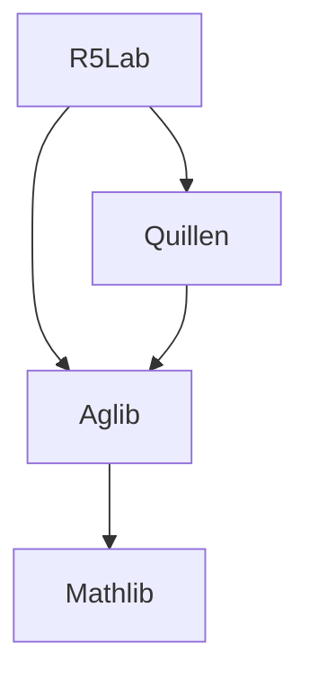

# Quillen and R5Lab integration

Aglib's standalone client checks pass. The original Quillen and R5Lab packages still contain their general implementations; they have not yet switched to Aglib. This plan concerns that subsequent integration, while keeping curve, projective-line, K/G/Q/S and other applications in their current packages.

## Dependency and release order

Imports should follow this dependency graph:

Migrate Quillen first, then R5Lab. Pin a verified Aglib commit, retain Lean 4.34.1 and Mathlib `d13f23b723b8a846827a245b89c10fc7d3f11612`, and update each Lake manifest through its dependency workflow. R5Lab currently pins Quillen `83629578a3d70787d41ec631f5234af8758716af`, while the inspected Quillen source is `189a8e779f0c68b2dfc6f8195daebb3e684a5905`. Moving R5Lab to the migrated Quillen commit is an explicit dependency update requiring application verification.

Aglib and Quillen are public; R5Lab is private. Quillen can resolve its Aglib dependency without private repository credentials. Pin the verified published Aglib revision before publishing Quillen's dependency switch, then pin that Quillen revision in R5Lab.

## Inspected scope

These are source-import counts at the source revisions above, using the [migration records](migration/latest-quillen.json), [module map](module-map.json) and [namespace map](namespace-map.json). Import dependence does not assert that every imported declaration is referenced.

| Package | Extracted source owners | Retained direct consumers | Important boundary |
| --- | --- | --- | --- |
| Quillen | 272 source modules, mapped to 283 Aglib destinations | 310 implementation files and 23 positive-test modules | 222 whole-source replacement candidates; 50 mixed sources retain declarations or applications |
| R5Lab | 123 extraction entries from 100 source modules | 131 local modules importing extracted R5Lab or Quillen owners | Curve, finite-etale, Grayson, Quillen and elliptic applications remain in R5Lab |

Quillen's retained transitive implementation closure contains 2613 files. For R5Lab's extracted owners alone, another 680 local modules are reached transitively. The exact replacement set must follow declaration correspondence, rather than treating these counts as file-deletion lists.

## Transition contract

- Keep one implementation of every migrated general declaration, in Aglib. Entirely transferred owners may temporarily import precise Aglib leaves. Mixed owners remove only the transferred declarations and keep their application remainder.
- Native objects and instances must be shared. In particular, replace Quillen's old exact structures/functors with `CategoryTheory.ExactCategory` objects, and use the canonical scheme module, coherent and invertible-sheaf objects. Do not recreate structures, quotient relations or registered instances to preserve an old spelling.
- Refactor retained consumers to precise Aglib imports and native names. Transparent abbreviations or theorem aliases may stage a batch with exact types, universes and premises, but remove them and vacated general source modules once their consumers are migrated. A type abbreviation alone does not recreate old projection, method or theorem namespaces.
- Preserve modern public imports and intended reduction visibility. Keep adapters in the original consumer packages; Aglib must not import them.
- Preserve all explicit mathematical inputs. Importing Aglib does not provide standard comparison, cohomology finiteness, flatness, local-freeness or other supplied assumptions.

## Quillen batches

1. Add the pinned Aglib dependency. Pilot `Quillen/CategoryTheory/ExactCategory/Basic.lean` and a real immediate consumer such as `Quillen/KTheory/Basic.lean`. Make QCategory, KSpace and K use the canonical exact structure.
2. Continue through exact functors, subcategories and small models. Retain Q-compatible functors, Q/K maps and their laws in mixed files. Migrate independent ring, module and ordinary homology leaves alongside this chain.
3. Switch general sheaf, quasicoherent and cohomology producers. Keep finite-type quasicoherence separate from the locally Noetherian coherent specialization. Retain G groups and G maps in the application files, using the canonical lower functors.
4. Replace general cuts inside perfect-complex, projective-line and Waldhausen files at their recorded declaration ranges. Preserve strict/perfect K maps, cylinder applications and other retained content.
5. Update remaining imports and names, remove unused adapters, and regenerate aggregates with Quillen's own generator. Build the complete `Quillen` and `QuillenTest` surfaces and real application clients.

## R5Lab batches

1. Pin Aglib and the verified migrated Quillen commit together. R5Lab still has 45 distinct direct Quillen imports outside the extraction map, so its Quillen dependency remains necessary.
2. Switch independent ring/length/descent and homology/sheaf leaves first. Preserve the application part of Grayson `Cycle/LocalLength.lean`.
3. Switch geometry foundations: Base/FScheme, generic curve-container predicates, stalks, etale/smooth/normal properties, field extensions, rank and Picard prerequisites. Keep the remaining contents of mixed `PointedCover`, `Core`, `Genus`, `Degree/Basic` and `SmoothIntegral` owners.
4. Follow the actual dependency graph for cohomology and differentials. Structure-sheaf results require Base/FScheme; relative cohomology requires `Degree/SheafRank`; generic differentials depend on cohomological pullback. A family-wide geometry-before-cohomology ordering is insufficient. Replace only the general blocks in `CurveEuler.lean`.
5. Update retained consumers: curve Picard/degree/Riemann-Roch, finite-etale descent, arithmetic surfaces, Grayson/Quillen applications, elliptic scalar extension and the elliptic-integral essays. Keep their mathematical scope in R5Lab and preserve existing user work.

## Acceptance and publication

Use isolated adaptation branches or worktrees. For each batch, compile the changed producers and at least one real application consumer. Check canonical type/instance identity, maps and retained premises; inspect the actual diagnostics before introducing compatibility names.

Finish each package with its complete production/test roots, source enrollment, style and axiom/control checks, and a standalone consumer. Use bounded exact-module replay where the owning workflow requires additional replay. Prune obsolete outputs so old compiled modules cannot mask missing imports. Record pre-existing failures separately from migration regressions.

Downstream package changes and publication are separate from Aglib's completed first extraction. No downstream build or migration acceptance is claimed by the static census above.
