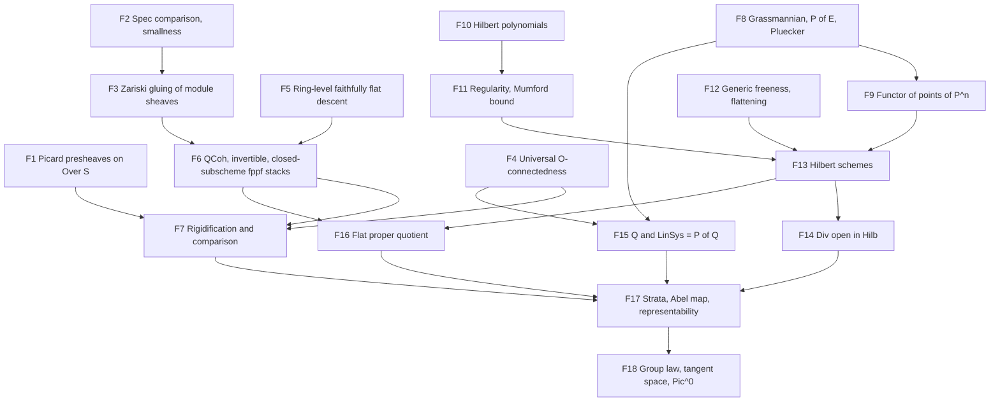

# Picard scheme development plan

This plan targets the relative Picard functor, the descent theory it needs,
representability of the fppf Picard functor by a scheme, and its basic
properties. It follows Grothendieck's theorem in Kleiman's exposition: projective
flat morphisms with geometrically integral fibres over a Noetherian base, proved
through Hilbert schemes of divisors and a quotient by a flat proper equivalence
relation. The generality is chosen for current and expected consumers. Excluded
generalizations are listed with the reason, so that later extensions start from
an explicit boundary rather than from a weakened endpoint.

The starting source is Aglib `e03da44bd8b139e3c0763cff7c555abcc770ddfd`
(R5Lab currently pins `197ca07`, which differs only by performance refactors of
unrelated cohomology leaves), Lean 4.34.1 and Mathlib
`d13f23b723b8a846827a245b89c10fc7d3f11612`. Locators below were inspected at
these revisions. Literature locators use the arXiv numbering of the cited
versions; the FGA Explained book numbering (chapter prefix) was not checked.

## Mathematical targets and acceptance

Throughout, `f : X → S` is a morphism of schemes and `X_T = X ×_S T`. The
functors are defined on all `S`-schemes. Representability, strata and
Hilbert-scheme statements quantify over locally Noetherian test schemes `T`,
nonreduced ones included. This is the convention of Kleiman and Nitsure, and it
was adopted for this plan on 2026-10-17. The downstream uses examined below only
evaluate on schemes locally of finite type over a field. Extending the final
theorem to all test schemes needs Noetherian approximation (F19) and is deferred.

1. **Picard functors.** The base and family presheaves `T ↦ Pic(T)`,
   `T ↦ Pic(X_T)` on `Over S`, the absolute relative functor
   `P_{X/S}(T) = Pic(X_T) / Pic(T)`, its fppf sheafification
   `Pic_{X/S,(fppf)}`, and, for a section `e : S → X`, the
   normalized functor `ker(e_T^*)` and the rigidified functor of pairs
   `(L, e_T^*L ≅ O_T)`. All maps are the actual Aglib pullbacks; group laws come
   from the existing additive pullback.
2. **Cohomological flatness in dimension zero.** If `S` is locally Noetherian and
   `f` is proper, flat, with geometrically integral fibres, then
   `O_T → f_{T*} O_{X_T}` is an isomorphism for every `T` (Kleiman, Ex. 3.11,
   p. 25, which allows geometrically reduced connected fibres).
3. **Descent.** Isomorphism and invertibility of quasi-coherent sheaves descend
   along faithfully flat maps; quasi-coherent sheaves, invertible sheaves and
   closed subschemes satisfy effective descent along fppf coverings; open
   subschemes descend along fppf coverings. The stack statements use Mathlib's
   `Pseudofunctor.IsStack` for `Scheme.fppfTopology` (Vistoli, Thm 4.23, p. 86,
   for the fpqc case; Stacks 023T, 05B2; Nitsure, Lemma 6.7). The fpqc topology
   is not needed: every covering the route uses is fppf.
4. **Comparison.** Under target 2, `P_{X/S} → Pic_{(fppf)}` is injective; with a
   section it is an isomorphism and agrees with the normalized and rigidified
   functors (Kleiman, Thm 2.5 with Lemmas 2.7, 2.9, 2.10, pp. 18–20; Stacks
   0B9N).
5. **Representability.** Let `S = Spec A` with `A` Noetherian and let `X` be a
   closed subscheme of Aglib's `ProjectiveSpace A (Fin (n+1))`, flat over `A`
   with geometrically integral fibres. Then, on locally Noetherian test
   schemes, `Pic_{X/S,(fppf)}` is represented by a separated `S`-scheme locally
   of finite type. It is the disjoint union of open and closed subschemes
   `Pic^φ` indexed by Hilbert polynomials, and each `Pic^φ` is an increasing
   union of quasi-projective open subschemes `Pic^φ_m` (Kleiman, Thm 4.8,
   pp. 27–30, with the stratum repair under Representability below). No section
   is assumed. Gluing to locally Noetherian nonaffine `S` with `f` projective
   Zariski-locally over `S` is an optional extension, added when a consumer
   needs a nonaffine base.
6. **Basic properties.** Commutative group scheme structure from the
   group-valued functor; base change `Pic_{X_T/T} ≅ Pic_{X/S} ×_S T` (Kleiman,
   Ex. 4.4, p. 27); the Hilbert-polynomial decomposition; with a section, the
   normalized functor is represented by the same scheme; over a field,
   `T_0 Pic_{X/k} ≅ H^1(X, O_X)` (Thm 5.11, p. 42); over a field the identity
   component `Pic^0` is an open and closed subgroup scheme of finite type
   (Lemma 5.1, Prop. 5.3, pp. 36–37). Optional, without a current consumer:
   `dim Pic_{X/k} ≤ h^1(O_X)` (Cor. 5.13, p. 44) and `Pic_{P^n_S/S} ≅ ℤ_S`
   (Ex. 4.15, p. 33). The smoothness criterion `dim = h^1` needs further
   group-scheme input and is deferred.

Each endpoint is accepted only on the original objects: actual line-bundle
classes and pullbacks, the actual Mathlib topologies and sheafification, and
a natural bijection with `Hom_S(T, P)` for the stated functor on the stated
test-scheme class (locally Noetherian `S`-schemes for target 5). A
representability theorem for a smaller class of test schemes, or for a functor
defined by a different construction without a proved comparison, does not
discharge target 5.

## Generality decision

| Aspect | Included | Deferred or excluded, and why |
| --- | --- | --- |
| Base | Noetherian affine `Spec A` | Nonaffine locally Noetherian bases by gluing are optional until a consumer needs them. Non-Noetherian bases need limit arguments throughout the Hilbert-scheme construction; Kleiman calls them standard but they double the surface. |
| Morphism | Closed subscheme of `P^n_A` | Zariski-local projectivity over a nonaffine base comes with the optional gluing. Proper non-projective morphisms need Murre's criterion or Artin's theorem (Kleiman 4.18.3, 4.18.6, stated without proof there). |
| Test schemes | Locally Noetherian, possibly nonreduced | All test schemes need Noetherian approximation of line bundles (F19); deferred. |
| Fibres | Flat, geometrically integral | Geometrically reduced and connected fibres are not enough: for Mumford's conic `x² + y² = t` over `ℝ[[t]]` the functor is not representable, and after `ℂ[[t]]` it is represented by a nonseparated scheme (Kleiman Ex. 4.14, pp. 31–33). Mumford's variant for reduced fibres with geometrically irreducible components (Kleiman 4.18.1, p. 33, stated without proof) and general reducible fibres, which need algebraic spaces, are excluded. |
| Topology | fppf functor and fppf descent | Zariski sheafification is not formalized separately. fpqc descent is unnecessary. The étale functor agrees with the fppf one with a section, or after étale-local sections of smooth surjections (EGA IV₄ 17.16.3(ii)); that theorem is an optional later extension. |
| Representing object | Schemes | Algebraic spaces (Artin; Stacks 0D2C) are excluded. |
| Sections | Not assumed by target 5 | The Kleiman proof uses no section, so the field case without a rational point needs no Galois descent. |
| Properties | Group law, separatedness, local finite type, strata, tangent space, `Pic^0` over fields | `Pic^τ` (Kleiman §6), properness/projectivity of `Pic^0` (Thm 5.4), smoothness from `H^2 = 0` (Prop. 5.19) and Cartier's theorem (Cor. 5.14) are later extensions. |

## Existing foundations

Paths are relative to the respective `Aglib/` or `Mathlib/` source root.

| Input | Owner and locator | Use |
| --- | --- | --- |
| Ring Picard group | Mathlib `RingTheory/PicardGroup.lean`: `Module.Invertible` (77), `CommRing.Pic` (429), local rings (536), `Pic.functor` (604) | Affine comparison, local triviality |
| Module sheaves | Mathlib `AlgebraicGeometry/Modules/Sheaf.lean`: `Scheme.Modules` (36), pullback/pushforward (165–188), `Scheme.Modules.pseudofunctor` (319) | Descent pseudofunctor |
| Topologies | Mathlib `AlgebraicGeometry/Sites/BigZariski.lean` (57), `Sites/Fpqc.lean`: precoverages (40), fpqc/fppf subcanonical (87, 97), effective epimorphisms (114, 123); `CategoryTheory/Sites/Over.lean` (240) | Representables are sheaves; quotients |
| Sheafification | Mathlib `CategoryTheory/Sites/LeftExact.lean` (313): `HasSheafify J (Type (max u v))`, hence values in `Type (u+1)` on `Over S` | `Pic_{(fppf)}` |
| Zariski representability | Mathlib `AlgebraicGeometry/Sites/Representability.lean` (208), for `Sheaf zariskiTopology (Type u)` | Gluing `Pic^φ_m` |
| Descent formalism | Mathlib `CategoryTheory/Sites/Descent/`: `DescentData` (59), `IsStack` (49), `IsStack.of_precoverage` (`Precoverage.lean` 410); no concrete stack instance | Target 3 |
| Ring descent | Mathlib `Algebra/Category/ModuleCat/Descent.lean` (59): extension of scalars along a faithfully flat map is comonadic; effectivity is a TODO there. Aglib `RingTheory/Descent`: algebra descent data and faithfully flat invariants | Target 3 |
| Morphism descent | Mathlib `AlgebraicGeometry/Morphisms/LocalFlatDescent.lean` (35–47), `FlatDescent.lean` | Properties of `Pic` |
| Closed immersions | Mathlib `AlgebraicGeometry/ZariskisMainTheorem.lean`: `IsFinite.of_isProper_of_locallyQuasiFinite` (373), `IsClosedImmersion.iff_isProper_and_mono` (393) | Quotient theorem |
| Line bundles | Aglib `AlgebraicGeometry/Modules/Invertible`: `LineBundle` (`Basic` 47), `PicardGroup` (`Dual` 221), `PullbackTensor.Local.pullbackHom` (78), `UnitCocycle` gluing (`Gluing/Sections` 54, `Gluing` 95) | Target 1 |
| Divisors | Aglib `Modules/Invertible/ZeroLocus/Fibrewise.lean` (50): for flat locally finitely presented `f`, a geometric-fibre-regular map from a line bundle to `O` is mono with flat zero scheme. Its header records native proof validation as pending a coordinated build | Div open in Hilb |
| Cohomology and base change | Aglib `Cohomology/FiniteModel/Basic.lean` (48), `Proper/FiniteModel.lean` (46, 63, 102), `Proper/LocalCriterion.lean` (46), `Proper/Semicontinuity.lean` (40, 53), `Proper/EulerCharacteristic.lean` (39, 53), `Proper/Grauert/Global.lean` (45, 62), `Proper/Finiteness.lean` (136, 147) | Targets 2, 5 |
| Constants | Aglib `Geometrically/Integral/GlobalSections.lean` (111): constants of a proper geometrically integral field scheme | Target 2 |
| Projective space | Aglib `ProjectiveSpace`: `Proj` of `MvPolynomial`, charts, base change, `twistingSheaf` (`Twisting` 113, 122), `Hom.Sections`; `Cohomology/Projective/SerreVanishing.lean` (63), `ClosedImmersion.lean` (109, 135) | Hilbert schemes |

R5Lab already consumes these interfaces. `R5Lab/AlgebraicGeometry/Curves/RelativePicard.lean`
(42–140) defines the base, family and normalized functors on `Over S` with values
in `Type (u+1)`. `RelativePicard/Representability.lean` retains
`DegreeZeroPicardRepresentability`: for a curve over a field with a rational
origin, the normalized geometric-fibre-degree-zero functor is representable. About
ten K-theory and elliptic-curve modules carry it as a parameter.
`Curves/Picard/EtaleDescent.lean` (63–92) retains `EtaleLineBundleDescent`,
the étale stack property of line bundles. `Curves/Picard/LocalRing.lean` (38)
proves that line bundles on the spectrum of a local ring are trivial.

## Missing foundations

Weights are rough Lean-size classes calibrated against Aglib families
(`Cohomology/BaseChange` is about 5.6k lines, `Cohomology/Projective` about
5.1k): S < 1.5k, M 1.5–4k, L 4–8k, XL > 8k. They are planning estimates, not
commitments.

| ID | Foundation | Status | Weight |
| --- | --- | --- | --- |
| F1 | Picard presheaves on `Over S` (migrated from R5Lab), group structure, base and family maps | proved: `Picard/Presheaf`, `Picard/Normalized`, `Picard/Fppf` (namespace `Scheme.RelativePicard`), including the sheafified-family comparison | S |
| F2 | `PicardGroup (Spec A) ≃+ CommRing.Pic A`; local triviality; `Small.{u} (PicardGroup X)` | proved: `Modules/Invertible/Affine`, `LocalRing`, `ChartCocycle` | M |
| F3 | Zariski gluing of module sheaves with cocycle data (stack for `zariskiTopology`) | proved: `Descent/Modules` (`isStack_pullbackPseudofunctor_zariskiTopology`, `isStack_quasicoherentPseudofunctor_zariskiTopology`, `isStack_lineBundlePseudofunctor_zariskiTopology`) | M |
| F4 | Target 2: universal `O_T ≅ f_{T*}O_{X_T}` from the local criterion, the constants theorem and flat base change | proved: `Cohomology/Proper/StructureSheaf` | M |
| F5 | Ring-level effective faithfully flat descent of modules in descent-data form; descent of invertibility and isomorphism | proved: `Algebra/Category/ModuleCat/Descent` (`isStackFor_moduleCatExtendScalarsPseudofunctorOpOp_singleton`, for Mathlib's descent data on `CommRingCatᵒᵖ`) and `RingTheory/Descent/FinitePresentation`, `Invertible` | M |
| F6 | Quasi-coherent, invertible and closed-subscheme fppf stacks on schemes; descent of open subschemes along fppf coverings (saturated opens are preimages, since fppf morphisms are open) | partial: closed-subscheme descent along one flat, surjective, quasi-compact morphism (`Descent/IdealSheaf`, Nitsure 6.7(2)), with 6.7(1) from Mathlib's `EffectiveEpi`; the fppf `IsStack` forms are in progress (`Descent/Modules/Fppf`) | L |
| F7 | Rigidified pairs, their automorphisms, comparison theorem (target 4) | absent | M |
| F8 | Grassmannian of rank-`r` quotients of a finite locally free module: charts, gluing, functor of points; `P(E) = Gr(E,1)`; Plücker closed embedding | partial: for free `R^n` over `Spec R`, `Grassmannian/Representability` (`representableIso`, Mathlib's `Module.Grassmannian.functor` on `R`-algebras) and `Grassmannian/FunctorOfPoints` (the extension to all test schemes); open: locally free `E`, the locally free quotient description, `P(E)`, Plücker | L |
| F9 | Functor of points of `ProjectiveSpace A`, comparison with `Gr(A^{n+1},1)`, quasi-projective morphisms | absent | M |
| F10 | Hilbert polynomial of coherent sheaves on `P^n` over a field, local constancy in flat families | partial: field case (`Cohomology/Projective/HilbertPolynomial`); local constancy in flat families open | M |
| F11 | Castelnuovo–Mumford regularity and Mumford's bound (Nitsure, Lemma 2.1, Thm 2.3, pp. 10–11) | partial: m-regularity, coordinate generation and commuting coordinate multiplications (`Cohomology/Projective/Regularity`) | L |
| F12 | Generic freeness (Nitsure, Lemma 4.1, p. 18; Stacks 051R), generic flatness (Thm 4.2, p. 19) and flattening stratification on `P^n_A` (Thm 4.3, p. 19) | partial: generic freeness (`RingTheory/GenericFreeness`) and generic flatness (`Modules/Flat/Generic`) proved; flattening stratification open (needs Fitting ideals, Nitsure Lemmas 3.1–3.2, base change of `relativeFlat`, F10) | L |
| F13 | Hilbert schemes on locally Noetherian test schemes: `Hilb^Φ` of closed subschemes of `P^n_A` represented by a locally closed subscheme of a Grassmannian (Nitsure, proof of Thm 5.2/5.3 up to the flattening step, pp. 24–26), and its open subfunctors for locally closed `X ⊂ P^N_A` (Thm 6.1 with trivial bundles, p. 28). Projectivity of `Hilb^Φ` uses the DVR valuative criterion (pp. 26–27), which Mathlib lists as future work (`AlgebraicGeometry/ValuativeCriterion.lean`, "Future projects"); the route does not need it | absent | XL |
| F14 | Relative effective Cartier divisors, fibrewise criterion and `Div` open in `Hilb` (Kleiman, Lemma 3.4, Thm 3.7, pp. 22–24) | partial | M |
| F15 | The module `Q` with `Hom(Q,N) ≅ f_*(L ⊗ f^*N)` in the locally free regime; `LinSys = P(Q)` (Kleiman 3.10, Thm 3.13, pp. 24–26) | partial (finite model) | M |
| F16 | Quotient of a strongly quasi-projective scheme by a flat proper equivalence relation (Nitsure, Thm 6.9, p. 35, by the proof of Thm 6.8, pp. 33–35, with Thm 6.1 and Lemma 6.7) | absent | M |
| F17 | Strata `Pic^φ`, `Pic^φ_m`, the Abel map and assembly of target 5 | absent | L |
| F18 | Tangent space via square-zero thickenings and Čech `H^1`; identity component of a group scheme locally of finite type over a field (open and closed, finite type, geometrically irreducible). Optional: Krull dimension of a local ring bounded by its embedding dimension (not checked in Mathlib), `Pic(P^n_K) ≅ ℤ` for fields `K` | absent | M |
| F19 | Deferred. Noetherian approximation: for `X` of finite type over `A` and `B = colim B_i` a filtered colimit of finitely generated `A`-algebras, every line bundle on `X_B` comes from some `X_{B_i}`, uniquely up to enlarging `i` (standard limit argument; source locator not yet checked) | absent; Mathlib has `Scheme.preservesColimit_yoneda` (`AlgebraicGeometry/AffineTransitionLimit.lean` 1339) for the representing side | M |

Mathlib PRs that overlap these rows were open on 2026-10-17: #24434 (effectiveness
of descent, draft), #14686 (Grassmannian scheme, draft), #44200 (Picard group in
algebraic geometry), #39989 (pullback of quasi-coherent sheaves). They are not
in the pinned snapshot. Design F5, F6 and F8 to the same Mathlib interfaces, so a
later coordinated pin update can retarget them.

## Proof route

### Functor layer and comparison

The functors of target 1 live on `Over S` with values in `Type (u+1)`, because
`PicardGroup X` is a quotient of objects of `SheafOfModules.{u}`; R5Lab already
uses `Functor.RepresentableBy` for such functors. `Small.{u} (PicardGroup X)`
(local trivializations and unit cocycles) gives `Type u` models wherever a Mathlib
lemma requires them. `Pic_{(fppf)}` is Mathlib's sheafification for
`Scheme.fppfTopology.over S`; the existing instance gives values in `Type (u+1)`.

Target 2 follows from the proved local criterion: for a local Noetherian ring
`R` and a proper flat `X → Spec R` with geometrically integral closed fibre, the
constants theorem makes the degree-zero residue comparison surjective. The
criterion then gives base-change isomorphisms after every ring map and makes
`H^0(X, O_X)` free; its closed-fibre rank is one, so the structure map
`R → H^0(X, O_X)` is an isomorphism by Nakayama. Localization and flat base change
pass to Noetherian affine bases and arbitrary affine test schemes, and Zariski
locality to all `T`. The retained `LocalFreeCohomologyBaseChange` family is not a
premise of this route.

Target 4 follows Kleiman's proof (pp. 18–20). Injectivity uses the projection
formula (Lemma 2.7), flat base change and descent of properties only: if
`L_{T'}` comes from `T'` after an fppf covering, then `f_*L` is invertible and
`f^*f_*L → L` is an isomorphism, both checked after faithfully flat base change.
Surjectivity with a section uses rigidified pairs without automorphisms (Lemmas
2.9, 2.10) and effective descent of invertible sheaves.

### Descent

Effective faithfully flat descent of modules over rings is proved from Mathlib's
comonadicity. Its form is `Pseudofunctor.IsStackFor` of Mathlib's
extension-of-scalars pseudofunctor for the singleton presieve of `f.op` in
`CommRingCatᵒᵖ` (F5). F6 still needs two things. First, a comparison of
quasi-coherent sheaves on affine schemes with this `ModuleCat` pseudofunctor,
through the tilde construction. Second, the transfer of `IsStackFor` from
`CommRingCatᵒᵖ` to `Scheme`, where descent data range over all test schemes.
Build the quasi-coherent pseudofunctor from `Scheme.Modules.pseudofunctor`, as
R5Lab's `Picard.EtaleDescent.modules` already does for all module sheaves;
first check whether Aglib already proves that pullback preserves
quasi-coherence. Prove `IsStack` for `Scheme.fppfTopology` with
`IsStack.of_precoverage`, reducing an fppf family to Zariski gluing (F3) and one
faithfully flat morphism of affine schemes (the argument of Vistoli 4.23 and
Stacks 023T, without the fpqc quasi-compactness bookkeeping).
Invertibility descends (`Module.Invertible.iff_invertible_tensorProduct_of_faithfullyFlat`;
compare Vistoli Ex. 4.19 and Stacks 05B2), so line bundles form a substack. Closed
subschemes descend as quasi-coherent quotients of `O` (Nitsure, Lemma 6.7); the
quotient theorem uses this, so effective quasi-coherent descent, or a direct
proof for ideals, is on the representability path. Open subschemes descend along
fppf coverings because fppf morphisms are open; the strata use this. The
étale stack statement retained in R5Lab follows, since étale coverings are fppf
coverings. Descent of affine or polarized schemes (Vistoli 4.33, 4.38) and
Galois descent are not needed by this plan.

### Projective toolkit

The Grassmannian `Gr(E, r)` of rank-`r` locally free quotients of a finite
locally free module is the single projective-bundle implementation. Build it
from affine charts and gluing (Nitsure pp. 7–8; Stacks 089T) and prove its
functor of points on all test schemes; set `P(E) := Gr(E, 1)` and construct the
Plücker closed embedding. Aglib's `ProjectiveSpace A (Fin (n+1))` keeps its role
as the owner of twisting sheaves and cohomology. A single comparison
`Gr(A^{n+1}, 1) ≅ ProjectiveSpace A (Fin (n+1))` supplies the functor of points of
projective space; do not construct a second twisting sheaf. Polynomiality of
`n ↦ χ(F(n))` on `P^n` over a field needs its own argument (hyperplane exact
sequences, or Serre vanishing with the Hilbert polynomial of the graded section
module); local constancy in flat families is Aglib's Euler local constancy.

### Hilbert schemes

Follow Nitsure over a Noetherian base, on locally Noetherian test schemes:
regularity (Lemma 2.1) and Mumford's bound (Thm 2.3) give a uniform `m` for ideal
sheaves with Hilbert polynomial `Φ`; cohomology and base change (Thms 3.3–3.7,
largely in Aglib) embed the Hilbert functor into `Gr(Sym^m(A^{n+1}), Φ(m))`; the
flattening stratification (Thms 4.2, 4.3) makes the image a locally closed
subscheme representing `Hilb^Φ`. The route needs only this strongly
quasi-projective representation, its closed-subscheme restriction and the open
subfunctors for locally closed `X ⊂ P^N_A` (Thm 6.1 with trivial bundles and
`E = O`). Projectivity of `Hilb^Φ` (the valuative step, pp. 26–27) and Quot
schemes are not needed. Mumford's bound uses general hyperplane sections, so it
passes to an infinite field extension with Aglib's field base change.

### Representability

The steps follow the proof of Kleiman's Theorem 4.8 (pp. 28–30), adapted to the
fppf functor.

1. Work over `S = Spec A` with `A` Noetherian and `X ⊂ P^n_A` closed. The
   optional nonaffine extension uses that representability of a Zariski sheaf
   is local on `S` (Kleiman p. 28).
2. Strata follow Kleiman's convention. `Pic^φ` is the open and closed
   subfunctor where `χ(X_t, L_t^{-1}(n)) = φ(n)`; this fixes the Hilbert
   polynomial `θ(n) = χ(O_{X_t}(n)) − φ(n)` of every divisor `D` with
   `O(D) ≅ L`. `Pic^φ_m ⊂ Pic^φ` is the open subfunctor where
   `H^i(X_t, L_t(n)) = 0` for `i ≥ 1`, `n ≥ m`, and `H^0(X_t, L_t(m)) ≠ 0`. On
   the vanishing locus `h^0(L_t(m)) = χ(L_t(m))` is locally constant, so the
   last condition is open and closed. The `Pic^φ_m` increase with `m` (multiply
   by a nonzero section of `O(1)` on integral fibres) and cover `Pic^φ` by Serre
   vanishing. Twisting by `O(m)` identifies `Pic^φ_m` with `Pic^{φ₀}_0` for
   `φ₀(n) = φ(n − m)`. The nonvanishing condition is necessary: on `P^1`,
   `O(−1)` satisfies the vanishing for `m = 0` and has no sections. Kleiman's
   proof (p. 30) omits this condition, and his twist formula on p. 29 reads
   `φ(m + n)`; the independent review of 2026-10-17 found both.
3. `Z := Pic^{φ₀}_0 ×_Pic Div` is open in `Div^θ ⊂ Hilb^θ`. `Hilb^θ` is
   locally closed in a Grassmannian, which the Plücker embedding places in a
   projective space, so `Z` is strongly quasi-projective.
4. At locally Noetherian test schemes, `Z → Pic^{φ₀}_0` is fppf-locally
   surjective. Locally `L` is a line bundle and `f_*L` is locally free of
   positive rank, compatible with base change. A local basis vector is
   fibrewise nonzero, hence fibrewise injective on geometrically integral
   fibres, and its zero scheme lies in `Z` by Aglib's fibrewise criterion.
   Zariski-local sections suffice; étale-local sections of smooth maps are not
   needed.
5. `R := Z ×_Pic Z` is represented over `Z` by `P(Q')` for the universal
   divisor bundle (Kleiman 3.13), proper and flat. That bundle is pulled back
   from the Noetherian scheme `Z`, so Aglib's base change after arbitrary ring
   maps gives this on all test schemes. `R → Z ×_S Z` is a proper monomorphism,
   hence a closed immersion (Mathlib `IsClosedImmersion.iff_isProper_and_mono`).
   Nitsure's Theorem 6.9 then gives a strongly quasi-projective quotient
   `Z → Q`, faithfully flat and strongly projective, with `R ≅ Z ×_Q Z`.
6. The class of the universal divisor bundle in `Pic_(fppf)(Z)` has equal
   pullbacks to `R`, so it descends along the fppf covering `Z → Q`. This
   defines `h_Q → Pic^{φ₀}_{0,(fppf)}` on all test schemes. At locally
   Noetherian `T` the map is injective. The two `T`-points lift to `Z`
   fppf-locally. Lifts with equal classes in the sheafification have
   fppf-locally equal classes in
   `P_{X/S}`, so they are fppf-locally related by `R`. They are then related by
   `R` itself, because `h_R` is an fppf sheaf and `R → Z ×_S Z` is a
   monomorphism. Target 4 injectivity is not needed here, and for the same
   reason `R ≅ Z ×_{Pic_(fppf)} Z`. It is surjective: step 4 lifts a class fppf-locally to `Z`, and the
   local preimages glue, because `h_Q` is an fppf sheaf and injectivity holds on
   the overlaps. Fppf coverings of a locally Noetherian scheme are locally
   Noetherian, so the argument stays in that class.
7. Glue the quasi-projective opens `Pic^φ_m` with Mathlib's Zariski
   representability. Separatedness holds because any two points lie in a common
   separated open of the increasing union; local finite type comes from the
   quasi-projective pieces.
8. The divisor, Hilbert and stratum functors are represented only on locally
   Noetherian test schemes. This suffices inside the quotient theorem, whose
   conclusions concern the locally Noetherian schemes `R`, `Z` and `Q`, and for
   the final endpoint under the adopted convention. Extending step 6 to all test
   schemes would use F19 with `Scheme.preservesColimit_yoneda`; it is deferred.

Properties then use the representing scheme `P`. Over a locally Noetherian base,
`S`-schemes locally of finite type are locally Noetherian and closed under fibre
products, and `P` is one of them. Yoneda in that full subcategory, through
Mathlib's `CommGrpObj.ofRepresentableBy` once the subcategory carries its
cartesian monoidal structure, gives the commutative group law on `P` as
morphisms of `S`-schemes. For the tangent space over a field `k`, the exact
sequence `0 → O_X → O_{X[ε]}^* → O_X^* → 1` and Čech `H^1` give an injective
`k`-linear map `H^1(X, O_X) → T_0`, using target 4 injectivity. After base change
to the residue field of a closed point, where a section exists, it becomes the
comparison isomorphism, by target 4 and base change of `P`. A finite, possibly
inseparable, extension suffices. The optional `Pic_{P^n_S/S} ≅ ℤ_S` needs
`Pic(P^n_K) ≅ ℤ` for fields `K` and cohomology and base change.

## Dependency graph

## Milestones and parallel ownership

| Milestone | Products | Starts after | Exit criterion |
| --- | --- | --- | --- |
| M0 interface checks | Focused `AglibTest` probes: fppf sheafification on `Over S` in `Type (u+1)`, `RepresentableBy` for such functors, Zariski-local representability on `Over S`, quasi-coherent pullback | none | Each probe elaborates; failures change the design before M1. A scratch probe on 2026-10-17 (R5Lab environment, Aglib `197ca07`, same Mathlib) already elaborated `HasSheafify (Scheme.fppfTopology.over S)` for `Type (u+1)` and `AddCommGrpCat.{u+1}`, `RepresentableBy` for `Type (u+1)`-valued presheaves on `Over S`, and `PicardGroup X : Type (u+1)`. Mathlib's Zariski theorem is stated for `Sheaf Scheme.zariskiTopology (Type u)` on absolute schemes, so the `Over S` adapter and smallness remain |
| M1 functor layer | F1, F2, F4 | M0 | Functors with additive maps; target 2 on the original structure map |
| M2 descent and comparison | F3, F5, F6, F7 | F1 | Target 3 as `IsStack` instances; target 4; R5Lab `EtaleLineBundleDescent` supplied |
| M3 projective toolkit | F8, F9, F10 | M0 | Grassmannian and `P^n` functors of points on all test schemes; Plücker embedding |
| M4 Hilbert schemes | F11–F14 | M3 (F11, F12 may start at M0) | `Hilb^Φ` represented on locally Noetherian test schemes by a locally closed subscheme of a Grassmannian; `Div^θ` open in it |
| M5 representability | F15–F17 | M2, M4 | Target 5 for the actual `Pic_{(fppf)}` on locally Noetherian test schemes |
| M6 properties and consumers | F18, normalized representability, R5Lab retargeting | M5 (tangent-space algebra may start after M2) | Target 6; R5Lab parameter supplied or reduced to curve-specific inputs |

M1, M3 and the commutative algebra of F11 and F12 have disjoint write scopes
and can run in parallel. Write ownership is by family:
`AlgebraicGeometry/Picard/` for F1, F7, F15, F17 and F18;
`AlgebraicGeometry/Descent/Modules/` and `Algebra/Category/ModuleCat/Descent/`
for F3, F5 and F6, with `AlgebraicGeometry/Descent/IdealSheaf/` and
`RingTheory/Descent/Ideal` for closed-subscheme descent; `AlgebraicGeometry/Grassmannian/` and
`AlgebraicGeometry/ProjectiveSpace/` for F8 and F9; `AlgebraicGeometry/Hilbert/`
for F13, F14 and F16, with `RingTheory/GenericFreeness/` and
`AlgebraicGeometry/Modules/Flat/Generic/` for F12 and new subfamilies of
`AlgebraicGeometry/Cohomology/Projective/` for F10 and F11. Paths are proposals relative to `Aglib/`; final names
follow [NAMING.md](NAMING.md) after inspecting neighbours. Only the integrator
changes common facades, `doc/INTERFACES.md`, `doc/README.md` and this plan.

Verification follows the cohomology plan's incremental rules. Build one leaf at a
time with its strictly necessary prerequisites. Give each milestone a focused
external consumer that checks the original maps, exact hypotheses and universes,
and inspect standard axioms. Update the family guide with proved statements and
remaining conditions. An intermediate result never changes an endpoint's
completion status.

## Consumers and migration

R5Lab's `Curves.RelativePicard` functors move to Aglib with native names, and
R5Lab retargets its imports in the same change that pins the accepted Aglib
revision. `EtaleLineBundleDescent` is supplied by M2.

`DegreeZeroPicardRepresentability` quantifies over all test schemes. The
representing scheme and equivalence are used only in `GenusOneGroupLaw`,
`Abel/Morphism` and `Abel/Inverse`; the K-theory modules pass the parameter on.
Those uses need the functor on schemes locally of finite type over the field:
the Abel morphism is evaluated at the curve, and the group law can come from
Yoneda in that subcategory, which is closed under finite products. Weakening the
parameter to locally Noetherian test schemes is therefore a downstream R5Lab
change, not a reason to strengthen Aglib's endpoint. This was traced from the
declarations that use the parameter, not re-proved. After M5
the weakened parameter reduces to curve-specific inputs: a curve with
`CurveProperties` is projective, and on curves the degree-zero condition is a
Hilbert-polynomial stratum by Riemann–Roch. An open and closed subfunctor of a
representable functor is then representable. Research uses of
Picard varieties over fields and of `Pic_{X/O_v}` with geometrically integral
fibres fall under targets 5 and 6. Néron models, `Pic^τ` and the abelian
variety `Pic^0_red` remain later extensions.

## Risks and design decisions

- **Universes.** Values in `Type (u+1)` match R5Lab and the existing sheafification
  instance. Mathlib's Zariski representability theorem is stated for `Type u`
  sheaves on `Scheme.{u}`; F2 smallness and an `Over S` adapter are checked in M0.
- **Test schemes.** Endpoints quantify over locally Noetherian test schemes, the
  convention of the sources, adopted on 2026-10-17. Functors stay defined on all
  of `Over S`, so a later F19 extension changes no definition. Statements must
  name the test-scheme class explicitly; a representability claim on all
  `S`-schemes is a different endpoint.
- **Sheafification as data.** If the fppf sheafification on `Over S` is unusable,
  characterize the representing scheme by local injectivity and local
  surjectivity of the map from `P_{X/S}`, which avoids constructing it.
- **Two projective models.** `Proj` owns cohomology and twists; `Gr(E, r)` owns
  functors of points. One comparison isomorphism joins them.
- **Hilbert-scheme size.** F13 is the largest item. Restrict it to what the route
  uses: closed subschemes of `P^n_A`, represented by a locally closed subscheme
  of a Grassmannian, with closed-subscheme and locally closed variants. Record
  Quot schemes and projectivity of `Hilb^Φ` as out of scope.
- **Plücker is load-bearing.** The quotient theorem applies the Hilbert scheme to
  `Z ⊂ Hilb^θ`, which needs `Hilb^θ` embedded in projective space.
- **Upstream overlap.** Reconcile with Mathlib PRs #24434, #14686, #44200 and
  #39989 at the next coordinated pin update.

## Primary mathematical references

- S. Kleiman, *The Picard scheme*, arXiv:math/0504020v1 (FGA Explained ch. 9):
  §2 (Thm 2.5, Lemmas 2.7, 2.9, 2.10, Remark 2.11), §3 (Lemma 3.4, Thm 3.7, 3.10, Ex.
  3.11, Thm 3.13), §4 (Thm 4.8, Lemma 4.9, Ex. 4.4, 4.14, 4.15, Prop. 4.17), §5
  (Lemma 5.1, Prop. 5.3, Thm 5.11, Cor. 5.13).
- N. Nitsure, *Construction of Hilbert and Quot schemes*, arXiv:math/0504590v1:
  Lemma 2.1, Thm 2.3, Thms 3.3–3.7, Lemma 4.1, Thms 4.2–4.3, Thms 5.2–5.3, Thm 6.1,
  Lemma 6.7, Thms 6.8–6.9.
- A. Vistoli, *Notes on Grothendieck topologies, fibered categories and descent
  theory*, arXiv:math/0412512v4: Thm 2.55, Ex. 4.19, Thm 4.21, Thm 4.23.
- [Stacks 023T](https://stacks.math.columbia.edu/tag/023T) (fpqc descent of
  quasi-coherent sheaves), [023N](https://stacks.math.columbia.edu/tag/023N)
  (descent of modules along faithfully flat ring maps),
  [03C4](https://stacks.math.columbia.edu/tag/03C4) (descent of finite presentation),
  [051R](https://stacks.math.columbia.edu/tag/051R) (generic freeness),
  [05B2](https://stacks.math.columbia.edu/tag/05B2) (descent of local freeness), [0B9N](https://stacks.math.columbia.edu/tag/0B9N)
  (rigidified comparison), [089T](https://stacks.math.columbia.edu/tag/089T)
  (Grassmannian), [0D2C](https://stacks.math.columbia.edu/tag/0D2C) (the excluded
  algebraic-space route).
- J. S. Milne, *Jacobian Varieties* (2021), Thm 1.1: the source of R5Lab's retained
  curve parameter.

## Current status

Status on branch `claude/picard-scheme`, 2026-10-18. F5, F3 and the closed-subscheme
descent of F6 are also on Aglib `main` (9819d40, d4202b1, 8fc143f).

- **M0 done.** The probes are in `AglibTest/AlgebraicGeometry/Picard/Interfaces.lean`.
  Aglib already proves quasi-coherent pullback along arbitrary morphisms
  (`Scheme.Modules.quasicoherent_pullback`).
- **M1 done.**
  - F1: `Picard/Presheaf`, `Picard/Normalized` and `Picard/Fppf`, including
    `fppfFamilyPicardSheafIso`.
  - F2: `Modules/Invertible/LocalRing`, `Affine` and `ChartCocycle`.
  - F4 (target 2): `Cohomology/Proper/StructureSheaf`, with endpoint
    `isIso_c_pullback_snd_of_isProper_of_flat_of_geometricallyIntegral`.
  - An independent statement and source-correspondence review on 2026-10-17
    found every checked definition and statement corresponding. Its
    documentation repairs are applied.
  - Open from M1: small values of the fppf sheafification, which the Zariski
    representability adapter needs. Generic helpers to move to lower owners:
    `Split.quotientEquiv`, `Scheme.Modules.isIso_of_forall_bijective_app` and
    the module helpers of `StructureSheaf/Coefficient`.
- **M2 in progress.**
  - F5 done: effective descent of modules along faithfully flat ring maps for
    Mathlib's descent data on `CommRingCatᵒᵖ`, plus descent of finite
    presentation and invertibility. An independent statement review found it
    corresponding; its documentation repairs are applied.
  - F3 done: module sheaves, quasi-coherent sheaves and line bundles form stacks
    for `Scheme.zariskiTopology` (unconditional instances in `Descent/Modules`).
    An independent statement review, which recompiled the frozen copy, found it
    corresponding.
  - F6, closed subschemes: Nitsure Lemma 6.7(2) for one flat, surjective,
    quasi-compact morphism, in ideal-sheaf form (`Descent/IdealSheaf`, with the
    ring-level `RingTheory/Descent/Ideal`). An independent statement review found
    it corresponding.
  - F7 first slice: rigidified pairs, Kleiman Lemmas 2.9 and 2.10, and the
    reduction of injectivity of `toFppfPicardSheaf` (Thm 2.5(1)) to an
    equivalent named premise.
    - Kleiman's proof of that premise uses flat base change. Stacks 0B9M avoids
      it, using O-connectedness on global units (F4), effective fppf descent of
      invertible sheaves, and full faithfulness of descent (F6).
    - The premise is not on the path of target 5 (step 6 above). The target-6
      tangent-space step uses target-4 injectivity.
    - With a section, Thm 2.5(2) follows by showing that the rigidified
      functor is an fppf sheaf (Stacks 0B9N). This uses Lemma 2.10 at every
      test scheme and F6 for line bundles on `X_T`, with full faithfulness of
      descent along the covering of `T`. Kleiman's own proof of Part 2 uses
      Part 1 instead.
- **M4 in progress.**
  - F12, first half, done: generic freeness (Nitsure Lemma 4.1, Stacks 051R) and
    generic flatness (Thm 4.2). An independent statement review found it
    corresponding.
  - F10, field case, done: `χ(O(m) ⊗ F)` is a polynomial in `m ∈ ℤ` for every
    coherent `F` on `P^n_k` over a field (Stacks 08AC), with its
    `projectiveHilbertPolynomial`. An independent statement review found it
    corresponding; its repairs are applied. Local constancy in flat families is
    open: it needs the pullback formula for twisting sheaves, transport of
    cohomology dimensions along `ProjectiveSpace.baseChangeIso`, and relative
    flatness of twists.
  - F11 started: the m-regularity predicate (Nitsure p. 9), the coordinate
    epimorphism `∐ᵢ O(0) ⊗ F → O(1) ⊗ F` and commuting coordinate
    multiplications. Nitsure Lemma 2.1 (a)–(c) and Thm 2.3 are open.
  - The flattening stratification needs Fitting ideals, a new foundation.
- **M3 in progress.**
  - Done for the free module `R^n` over `Spec R`:
    - Grassmannian charts, chart representability on `Over (Spec R)`, and the
      chart gluing as a `Scheme.GlueData`;
    - `representableIso`: representability of Mathlib's
      `Module.Grassmannian.functor` on `R`-algebras;
    - `localFunctorIso`: its extension to all test schemes.
  - The values of Mathlib's `map` use the formula class `BaseChangeMkQFormula`,
    because Mathlib does not expose `baseChangeMkQ`. The instance is supplied by
    `RingTheory/Grassmannian/BaseChangeFormula`. That leaf is the only one
    allowed a private `import all`, as a one-file exception in
    `scripts/check_library_layout.py`. Remove both once Mathlib exposes
    `baseChangeMkQ`.
  - An independent statement review found the slice corresponding; its
    documentation repairs are applied.
  - Open:
    - the description of the functor of points by locally free quotients of
      `O_T^n`, which needs module sheaves;
    - `Gr(E, r)` for locally free `E`;
    - `P(E)`;
    - the Plücker embedding (F9).
- **Next.**
  - M2: F6, then the remaining parts of F7 (Thm 2.5 via Stacks 0B9M and 0B9N).
  - The `Over S` Zariski-representability adapter: shrink the values, pass to
    the total presheaf on schemes through `overEquivPresheafCostructuredArrow`,
    then apply `Scheme.LocalRepresentability.isRepresentable`.
