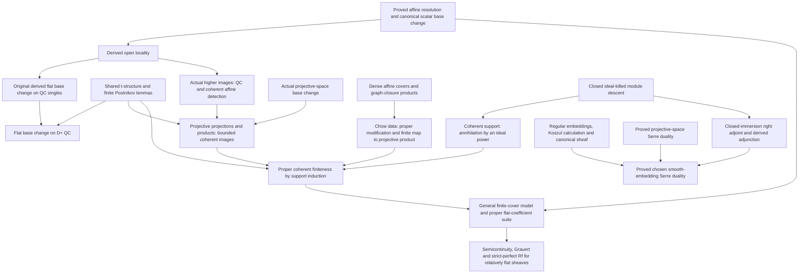

# Cohomology development plan

Canonical affine module base change, qcqs flat base change, proper coherent
finiteness and the Noetherian flat-coefficient finite-model suite are proved
on the original native objects and maps. Projective-space Serre duality also
has field-valued, arbitrary-base-module affine and Noetherian separated-base
relative endpoints. Global Euler exactness, the projective determinant and
the chosen smooth-embedding canonical/trace comparison are proved. The remaining
work includes general proper duality, embedding independence, coefficient
complexes, nonflat sheaf-valued base change and the broader perfect-coefficient tier.

The investigation began at Aglib
`bdee1b16373d721dbec6f93fae39690c4f8c36ae` on the historical
`codex/cohomology-foundations` branch. Lean 4.34.1 and Mathlib
`d13f23b723b8a846827a245b89c10fc7d3f11612` remain the pinned toolchain.
Checkpoint hashes, branch names and receipt identifiers below record that
investigation's provenance; they are not the current write assignment or a
claim that every later revision was rebuilt.

| Current source endpoint | Conditions and owner |
| --- | --- |
| Affine module base change | Affine `f`, quasicoherent `M`, arbitrary base change; original counit mate in [Modules/BaseChange](../Aglib/AlgebraicGeometry/Modules/BaseChange/README.md) |
| Flat base change | Qcqs `f`, flat base change and QC coefficients; arbitrary-base D+ comparison for QC original homology in [BaseChange/Derived](../Aglib/AlgebraicGeometry/Cohomology/BaseChange/Derived/README.md), with the actual higher-image map |
| Proper coherent finiteness | Proper `f` and coherent coefficients over every locally Noetherian target; [DirectImage/Proper](../Aglib/AlgebraicGeometry/Cohomology/DirectImage/Proper/README.md) and the retained [field suppliers](../Aglib/AlgebraicGeometry/Cohomology/Proper/Field/README.md) |
| Proper finite model and numerical criteria | Proper `f` over a Noetherian affine base, coherent relatively flat coefficient; one model for every ring base change in [Proper/FiniteModel](../Aglib/AlgebraicGeometry/Cohomology/Proper/FiniteModel/README.md), with reduced-base Grauert and separate residue-surjectivity criteria |
| Projective-space Serre duality | Complementary-degree coherent duality over fields; all-degree duality for coherent sources and every native base module over a Noetherian affine base in [Derived](../Aglib/AlgebraicGeometry/Cohomology/Duality/Projective/Derived/README.md); coherent relative duality for arbitrary QC coefficients over a Noetherian separated base in [Relative](../Aglib/AlgebraicGeometry/Cohomology/Duality/Projective/Relative/README.md) |
| Euler and canonical comparison | Global Euler exactness for arbitrary coordinate types, determinant/twist comparison with the ordered coefficient frame, and the arbitrary-base smooth closed-immersion canonical isomorphism; chosen smooth-embedding duality retains one original trace |
| Differential rank and top exterior line | Arbitrary-base fixed-dimension smooth rank in [Differentials/Relative](../Aglib/AlgebraicGeometry/Modules/Differentials/Relative/README.md); top exterior line from the actual rank witness in [ExteriorPower](../Aglib/AlgebraicGeometry/Modules/ExteriorPower/README.md) |

The full `LocalFreeCohomologyBaseChange` family is still an explicit input.
The detailed [current status](#current-status) distinguishes the other live
obligations from the completed proof routes recorded below.

## Relative duality and canonical bundle checkpoint

The current sources complete the relative projective and chosen smooth-embedding
duality route below. Their actual maps, hypotheses and proof dependencies are
recorded in the [relative family](../Aglib/AlgebraicGeometry/Cohomology/Duality/Projective/Relative/README.md).
The broader base-change and proper-direct-image targets in this plan remain
separate.

1. [Trace](../Aglib/AlgebraicGeometry/Cohomology/Duality/Projective/Relative/Trace.lean)
   glues the original affine differential trace over a separated base for every
   quasicoherent coefficient N, then reconstructs the arrow from the installed
   derived pushforward to single_n N. Its checked affine formula and the
   original affine residue, unit and coefficient-naturality laws give the
   prescribed normalization. Neither Noetherianity nor coefficient flatness
   is used in this construction.
2. [Coherent](../Aglib/AlgebraicGeometry/Cohomology/Duality/Projective/Relative/Coherent.lean)
   proves bijectivity and structural-scalar linearity of that same comparison
   for all natural Ext degrees over a Noetherian separated base, with a native
   affineLocallyFiniteType source and arbitrary quasicoherent N. The proof
   transports the actual affine map to open direct images, uses a finite affine
   cover and its locally split coefficient sequence, and applies the signed
   long exact rows. Each induction step proves injectivity uniformly in N
   before surjectivity. The projective presentation ring need not be Noetherian.
3. [ClosedEmbedding/Linear](../Aglib/AlgebraicGeometry/Cohomology/Duality/Projective/Relative/ClosedEmbedding/Linear.lean)
   transfers this linear equivalence through the installed closed-immersion
   right adjoint and native derived-pushforward composition. Its coefficient
   object is the actual Ri!W(N); its forward map is the original comparison.
4. [Canonical](../Aglib/AlgebraicGeometry/Cohomology/Duality/Projective/Canonical.lean)
   identifies the actual ambient canonical right-adjoint value with the single
   in integer degree n-d of the smooth source's top differential module.
   The proof uses the original regular-sequence class, normal-first determinant,
   generator/frame changes, common refinements and ordinary Hom descent.
   It works over arbitrary bases without separation or Noetherianity and
   includes zero rings, empty sources and dimension zero.
5. [Smooth/Trace](../Aglib/AlgebraicGeometry/Cohomology/Duality/Projective/Relative/Smooth/Trace.lean)
   transports the original unit-coefficient comparison through that actual
   canonical isomorphism and proves its all-degree single-trace formula.
   [Smooth](../Aglib/AlgebraicGeometry/Cohomology/Duality/Projective/Relative/Smooth.lean)
   gives the coherent linear equivalence over a Noetherian separated base:
   its forward arrow is derived pushforward followed by that one trace.
   Native shift transport handles integer target degrees, and the actual local
   dimension equation proves the source empty when n<d; no global d<=n premise
   is added.

Singular bases retain higher Ext; there is no general Ext>n vanishing claim.
Arbitrary coefficients retain Ri!W(N), without arbitrary-coefficient purity.
General proper f!, embedding independence and perfect direct images remain
separate targets. Compilation experience from this route is recorded in
[PERFORMANCE](PERFORMANCE.md).

Final incremental validation passed for the six public roots, `AuditSupport`
and the three affected `AglibTest` consumers. Declaration and text-style lint
passed. The scoped axiom audit loaded all 235 implementation-module origins
and checked 6,140 declarations against `propext`, `Classical.choice` and
`Quot.sound`; the three consumer modules contain anonymous examples rather
than retained kernel declarations. Generated imports, layout, source policy
and placeholder checks passed. No aggregate library build or full dependency
replay is claimed.

## Mathematical targets and acceptance

1. **Affine module base change.** For affine `f : X ⟶ S`, quasicoherent
   `M : X.Modules` and arbitrary `g : T ⟶ S`, prove that the existing
   `Scheme.Modules.moduleBaseChangeMap f g M` is invertible. No flatness,
   finiteness or Noetherian hypothesis is admitted. Identify its affine tensor
   formula and adjunction-unit/counit normalization; supply the existing
   `AffineModuleBaseChange` family without an additional mathematical input.
2. **Separated flat base change.** For a quasi-compact separated morphism `f`,
   flat `g` and arbitrary quasicoherent `M`, prove canonical base change in
   every nonnegative degree. First work over affine bases `Spec A`, `Spec B`,
   with arbitrary commutative rings and a flat map `A → B`. Preserve the actual
   `Sheaf.H`, structural scalar action, coefficient naturality and canonical
   tensor/geometric map. Recover the existing field/structure-sheaf theorem as
   a specialization, without assuming cohomological finiteness.
3. **Qcqs flat base change.** Extend the preceding theorem to qcqs `f` using
   finite affine unions and Mayer–Vietoris. Supply quasicoherence and affine
   computation of the actual higher direct images. Relate the resulting
   isomorphism to the existing `derivedFlatBaseChangeMap` on bounded-below
   complexes with quasicoherent cohomology; arbitrary module complexes are
   not covered merely by constructing that map.
4. **Projective finiteness.** For Noetherian `A`, projective `X → Spec A` and
   coherent `M`, prove `Module.Finite A Hⁿ(X,M)` for every `n`. Use Mathlib's
   actual `Proj`, standard affine charts, actual twisting module sheaves and
   their Cech cohomology. Establish finite twist presentations and coherence
   of kernels, then use long exact sequences and descending degree induction.
   Prove Serre vanishing with the same infrastructure. Extend to coherence of
   higher direct images over locally Noetherian bases by affine localization.
5. **Proper finiteness.** Extend projective finiteness through Chow's lemma,
   coherent devissage/Noetherian induction and Leray comparisons. The target is
   coherence of `Rⁿf_* M` for proper `f` over a locally Noetherian base, hence
   the complete existing `ProperModuleCohomologyFinite` family over fields.
   A projective special case is useful progress but does not discharge it.
6. **Projective, then proper cohomology and base change.** First let `A` be Noetherian,
   `X → Spec A` projective and `M` coherent and flat over `A`. Construct a bounded
   finite-projective complex computing the cohomology after every `A → B`,
   and identify the canonical derived base-change map. This target includes
   upper semicontinuity of every fibre-cohomology dimension, local constancy
   of the Euler characteristic, Grauert's theorem with its precise
   reduced-base hypotheses, pointwise surjectivity/base-change criteria and
   local-freeness criteria for individual higher direct images. Constant
   fibre dimensions alone on a nonreduced base do not supply local freeness.

   Perfect **direct image** `Rf_*` is a separate explicit endpoint: proper
   perfect morphisms over a Noetherian base preserve perfect complexes;
   more generally retain the
   relative-perfectness hypotheses needed for a perfect direct image. Derived
   base change along a classical fibre square retains Tor independence, unless
   the coefficient-flat situation proves the needed Tor vanishing. Arbitrary
   base change for an arbitrary perfect coefficient cannot be inferred merely
   from projectivity or properness. The flat-coefficient complex model above
   proves its own all-base-change assertion on the actual ordinary fibre
   product.

   Prove these geometric versions for projective morphisms before taking on
   the Chow/devissage extension to general proper morphisms. For arbitrary bases,
   retain proper finite presentation and a finitely presented relatively flat
   coefficient; supply the needed approximation or relative-perfectness
   theorem before claiming the full `LocalFreeCohomologyBaseChange` family.
7. **Serre duality.** Start with projective space: compute twists, construct
   trace and the Yoneda pairing, and prove duality and naturality. Extend to
   smooth projective schemes over a field, of pure dimension `d`, and coherent `M`, with
   `Hⁱ(X,M)ᵛ ≃ Ext^(d-i)(M,ω)` for `0 ≤ i ≤ d`. Finite locally free
   coefficients give the dual-tensor cohomology formula. Prove the comparison
   between O-linear Ext and additive `Sheaf.H`. Identifying `ω` with the top
   exterior power of differentials also needs the actual smooth differential
   rank theorem. General proper, possibly singular schemes require a
   dualizing complex and remain a separate, explicit extension target.

   **Canonical-bundle identification is a required proved endpoint.** On a
   pure-d-dimensional smooth field scheme, prove local freeness and actual
   rank d of the native differential sheaf, construct its actual top exterior
   line bundle, and identify the duality sheaf omega naturally with that line.
   The projective-space case must identify the same top differential line
   with the actual twist `O(-N-1)`. In the relative smooth case retain a fixed
   relative dimension, or work on the open components of constant rank.
   The comparison must include coordinate changes and the original trace;
   choosing the name omega for a top exterior power alone does not prove its
   relation with the constructed duality object.

The projective/proper base-change suite is accepted only when its geometric
endpoints are available on the original objects, with the following checks.

| Endpoint | Required original interface and hypotheses |
| --- | --- |
| Coherent direct images | Actual `Rⁱf_* M`, projective/proper over a locally Noetherian base and coherent `M` |
| Flat base change | The original tensor/geometric mate, arbitrary quasicoherent coefficients, qcqs `f` and flat base change |
| Flat-coefficient base change | A universal bounded finite-projective model under the precise Noetherian/finite-presentation and relative-flatness conditions |
| Semicontinuity | Upper semicontinuity of `s ↦ dim κ(s) Hⁱ(Xₛ,Mₛ)` and locally constant alternating sum, derived from that actual model |
| Grauert | Local freeness and arbitrary base-change compatibility, with reducedness or the stronger pointwise criterion retained as required |
| Pointwise criterion | Surjectivity of the original residue-field base-change map, its neighbourhood consequence, and the adjacent-degree local-freeness criterion |
| Perfect direct image | Actual `Rf_* E` perfect under proper-perfect/Noetherian or proper-flat-finite-presentation/relative-perfect hypotheses |
| Compatibility | Coefficient maps, open restriction, composition of base changes, and comparison with the existing derived map |

A lower finite-complex theorem is a prerequisite for this table, not a
replacement for a geometric endpoint. The implemented projective and proper
flat-sheaf suppliers cover their stated Noetherian hypotheses; they do not
replace the broader perfect-coefficient and arbitrary-base endpoints.

## Shared prerequisites and proof routes

The affine section/tilde equivalence and canonical affine tensor comparison
feed both module base change and Cech coefficient base change. Structural
scalars must be generalized below the field specializations, preserving their
existing definitions by explicit comparisons rather than parallel cohomology.

The finite-family coefficient comparison already avoids any assumption that
tensor preserves infinite products. The current full-tuple Cech complex is
unbounded even for a finite cover. Bounded ordered/alternating Cech comparison,
or a proved finite-cover cohomological bound via Mayer–Vietoris, must precede
the finite-amplitude arguments. Its terms are not generally finite over the
base ring. Proper finiteness and finite Tor amplitude, rather than finite
cover size alone, provide the finite-projective model.

The selected bounded-flat route retains the full native tuple complex. For
relatively flat coefficients its terms are flat over the base, and the
finite-cover cohomological bound holds after every base-ring map. Applying
this also to square-zero extensions proves the needed tensor exactness for
every base module. Purity and kernel-flatness then prove that the terminal
cycle of a good truncation is flat. An exact unbounded tail of flat modules
alone is insufficient for that step. Noetherian cohomological finiteness and
the resulting finite Tor amplitude supply the finite-projective replacement.

Projective geometry uses general arbitrary-dimensional constructions; curve
degree, genus, Riemann–Roch and K/G/Q/S applications stay downstream. New
constructions extend native mathematical namespaces with precise lower imports.
Generic complex/perfectness lemmas belong below scheme cohomology.

## Derived-method review

The architectural review compared the alternatives before further proofs. The current source uses
native bounded-below derived categories, actual derived units and genuine
finite-projective models. The recommended next architecture adds focused
derived bridges to those constructions; a full unbounded duality theory
has substantially more prerequisites in the pinned libraries.

Flat base change uses the proved affine injective-resolution producer,
exact open restriction and native derived-composition comparisons.
`BaseChange/Derived/Locality` proves invertibility of the installed
`derivedFlatBaseChangeMap` for qcqs morphisms and D+ objects with
quasicoherent original homology. Its affine resolution normalization and
single-object comparison feed the proved shift/Postnikov extension; the
actual higher-image map is exported by `BaseChange/HigherDirectImage`.
Injective or Godement terms are not treated as quasicoherent merely from
their acyclicity.

For the perfect-direct-image object, `DirectImage/Affine/DerivedModel` and
`FiniteModel/Perfect` transport the derived global-section isomorphism
through exact tilde and its invertible native units. This constructs the
object-level source and all-ring base-change comparisons without selecting
another chain representative. Existing chain-map versions retain their
explicit normalization formulas; equality with the object-transport maps
is a separate obligation.
For arbitrary perfect coefficients, relative finite Tor amplitude,
derived tensor and the corresponding projection formula still need
integration with the actual coefficient and direct-image interfaces.
`Modules/DerivedCategory/Minus` constructs
`Scheme.Modules.derivedPullbackMinus` for arbitrary morphisms using actual
bounded-above flat replacements, with native factorization and
identity/composition comparisons. This is an implemented lower interface;
its guide retains the separate pentagon, triangulatedness and
perfectness-preservation obligations.
General nonflat derived tensor does not preserve
D+: it may have unbounded negative homology. A proposed interface must
retain appropriate bounded-above, perfect or finite-Tor restrictions.

The chosen smooth-embedding Serre route is now implemented with the single
closed-immersion right adjoint, its original affine coinduction formula and
the pointwise native K-injective Hom adjunction. The original regular-list
class, conormal determinant and compatible frame changes give
`smoothClosedImmersionCanonicalIso`: for closed `i : X ⟶ P`, smooth
`p : P ⟶ Y` of relative dimension n and smooth `i ≫ p` of dimension d,
`Ri!(∧ⁿ Ω_p)` is the actual top differential single in integer degree n-d.
The base is arbitrary, without separation, Noetherianity or a global d≤n
premise. This is the ambient canonical coefficient, not arbitrary-coefficient
purity.

For a supplied projective-space square and chosen closed embedding,
`Relative/Smooth/Trace` transports that same comparison into one original
trace over a separated base. `Relative/Smooth` proves the coherent linear
equivalence over a Noetherian separated base. These statements do not
require a separate all-bounded-complex projective-space theorem or an
incorrect use of `Adjunction.extEquiv` for a merely left-exact right adjoint.
General proper f!, coefficient-complex/internal-RHom extensions and embedding
independence remain separate.

General proper coherent finiteness is now proved: `Proper/Finiteness`
contains internal closed-support induction over every Noetherian affine
base, and `DirectImage/Proper/Coherent` descends it to every locally
Noetherian target using the original open comparison. Original large-universe
cohomology keeps its structural scalar action. The perfect-image theorem
then additionally requires its relative Tor hypotheses; properness alone
does not supply them. The existing native derived-pushforward composition
already supplies the Leray comparison needed by the Chow/devissage route.
See [proper perfect-image construction](https://stacks.math.columbia.edu/tag/08EV)
and the [finite-complex flat-coefficient proof](https://stacks.math.columbia.edu/tag/07VJ).
The full right-adjoint construction via unbounded D(QCoh), compact
generation and representability is a larger separate project; see
[Stacks 48.3.1](https://stacks.math.columbia.edu/tag/0A9E).

## Source-review provenance and completed shared gates

During the initial source comparison, fetched `origin/main` was `e3f6c75`
and local main advanced through `f87a691` to `40af743`. Those source
snapshots remain distinct from the integrated checkpoints recorded below. Six exact generic leaves from that local revision have been
admitted and compiled individually: homological-complex and homotopy
adjunctions, and native K-injective Hom, representatives, mapped Hom and
pointwise derived Hom adjunction. The public independent-universe consumer
retains their literal chain-adjoint maps. Exact bytes and provenance are
recorded in `migration/upstream-derived.json`. The bounded-above flat
replacement and derived-pullback groups now have their native owners in
`Modules/Complex/Flat` and `Modules/DerivedCategory/Minus`. The canonical
perfect-complex core is `Modules/PerfectComplexes`; the old `Modules/Perfect`
paths reexport it and retain the unique affine model helpers.

The additional `40af743` review supplies the actual field-scheme smooth
rank gate: `differentialSheaf_hasRank_of_smooth` has no theorem-family
premise, over every field and fixed relative dimension, including the
empty scheme. Its canonical affine differential/tilde comparison retains
localization seeds. Exactly four direct leaves were imported and compiled
separately, followed by an independent public consumer; the unused empty Properties
path is retired in favor of the actual proof owners. Exact bytes and receipts are
recorded in `migration/upstream-smooth-differentials.json`. The unrelated
finite-presentation/rank owner migrations were not needed for this cut.
The general relative-base differential interface has since been constructed;
its actual affine algebraic comparison and D2--D5 retain the boundaries in
the current status below.

The user-supplied Motivic archive uses the same Lean and Mathlib pins.
Its generic finite Koszul resolution is selected for native
`ChainComplex.Koszul` ownership, with the elementwise short-complex criterion
under `CategoryTheory.ShortComplex`. Preserve source headers and exact
source/destination hashes in `migration/motivic-koszul.json`; only a
successfully compiled leaf is recorded as passing. All eighteen selected source leaves and the independent native consumer
have now passed. The genuine quotient augmentation, signed differential and
regular-sequence resolution are the immediate Serre-purity inputs. Its exterior-coefficient tensor comparison does not supply wedge
powers, determinants or change-of-generators compatibility.
Its open tilde base change assumes an open immersion, and its affine
coordinate-complex comparison assumes every term quasicoherent. Neither
replaces the existing arbitrary-complex affine counit quasi-isomorphism
or proves general coherent-cohomology flat base change.

The following shared gates have focused source and public-consumer checks.
They do not discharge the broader perfect-coefficient direct-image or
general duality endpoints.

| Gate | Proved native interface | Consumers |
| --- | --- | --- |
| U | `rightDerivedSingleHomologyIso`, original affine higher-image sections/H comparison and naturality | Normalize homology of the actual derived base-change map |
| L | `derivedOpenBaseChangeIso` with original unit, `higherDirectImageOpenRestrictionIso`, actual qcqs higher-image quasicoherence | General-target base change and projective coherent images |
| T | Installed RF lower bounds, normalized single-homology reconstruction, finite homology-layer devissage and lower-bound-preserving D+ comparison | Discharge geometric single-object comparisons and coherent-property extension closure |
| Shift | Native `rightDerivedDesc` commutes with shifts from its defining unit square | Apply it to the installed geometric base-change transformation |
| K | Closed pushforward fully faithful on all module sheaves; original unit invertible exactly for ideal-killed coefficients | Ordinary right adjoint and coherent thickening descent |
| S | Actual affine support and compact finite-cover maximum give one positive power; Noetherian coherent coefficients descend to the actual thickening via original pullback/unit | Transfer the smaller-support derived images into the proper induction |
| Chow geometry | Internally constructed proper surjective modification, finite map to an actual projective product, dense-open isomorphism and original closed pair map | Projective projections' bounded coherent images, then support induction |

The actual flat-base-change endpoint has now passed on every base:
`derivedFlatBaseChangeMap_isIso_of_quasicoherent_homology` in
`BaseChange/Derived/Locality` applies to the existing installed comparison,
flat base change, a qcqs original morphism, and QC original homology on any
bounded-below object. `Derived/Restriction` proves pasting of that same map;
ordinary affine-open descent supplies the global step. No extra truncation
or derived-category theory is introduced for that descent. The literal
higher-direct-image map is now proved in `BaseChange/HigherDirectImage`,
with its exact H-of-original-map formula, coefficient naturality and QC
isomorphism theorem in every natural degree.

`Proper/Field` now supplies the retained all-field
`ProperModuleCohomologyFinite` and `ProperStructureCohomologyFinite`
interfaces from this proof, with unchanged field scalars. Its global-section
corollary uses the original H0 map. These suppliers take no finiteness-family
premise, and existing parameterized application bridges can consume them.

The projective-product cohomology suppliers and actual Chow modification
now feed `Proper/Finiteness` without an IH or cohomology-family premise.
`DirectImage/Proper/Coherent` is the corresponding arbitrary locally
Noetherian-target theorem; it has no target quasi-compactness or relative-flat
coefficient assumption. `Cohomology/FiniteModel` is now the sole generic
finite-affine-cover model owner, with proper relatively flat suppliers in
`Proper/FiniteModel` and transparent projective specializations.

Actual semilinear exterior maps, module-presheaf exterior powers and their
universal property, and sheafified exterior powers are proved over general
ringed sites with independent universes. `Modules/ExteriorPower/LocallyFree`
constructs determinant frames and top exterior lines. The conormal determinant,
localization and change-of-frame comparisons used in the smooth closed route
are now implemented, as are the global projective Euler and determinant maps.
The relative trace is an actual sheaf/derived arrow, not an inference from
affine Hom-group isomorphisms. Its coherent scheme-base comparison and the
chosen smooth-embedding endpoint have the bounds in the checkpoint above.

Coherent extension closure in the ambient category of all module sheaves
now has proved lower suppliers. Actual affine sections exactness when the
left coefficient is QC, exact tilde and the original counit give QC/finite-type
extension closure; the generic helpers have been moved below scheme
cohomology with the old names retained as import wrappers. The native
`coherentHomologyObjects X` property uses exact-five devissage for kernels
and cokernels of maps between known coherent objects. It imposes no target
upper bound or representative-term condition, and does not assert closure
of QC under arbitrary ambient subobjects or quotients.

## Unified implementation dependency graph

Checkpoint `b0f205d` contained the first affine/projective results.
The graph records the shared dependencies of the completed flat/proper
routes and the remaining duality/perfect-coefficient work.
The derived and projective-to-proper routes must not introduce separate
copies of restriction, homology-layer induction, closed descent or the
canonical base-change map.

### Shared lower tiers

| ID | Sole provider / proposed focused leaves | Precise product and immediate consumers |
| --- | --- | --- |
| U | `DerivedCategory/RightDerivedFunctorPlus/SingleHomology`, `DirectImage/Affine/Cohomology` | Natural comparison of actual `R^n F` with homology of installed `RF(M[0])`, normalized on every supplied injective resolution. Actual affine higher-image sections identify with unchanged `Sheaf.H`. Arbitrary additive F is allowed; the additional `R^0 F = F` comparison retains left exactness. |
| L | `Cohomology/DirectImage/Restriction` | Actual D+ open-restriction isomorphism for every morphism, with its original unit; actual higher-image restriction. Used by general-target flat base change, projective coherence and the proper modification cone. No QC assumption on a chosen injective term. |
| T | `DerivedCategory/RightDerivedFunctorPlus/TStructure`, `DerivedCategory/Plus/Postnikov` | Lower cohomological bounds for the installed right-derived functor; finite homology-layer induction for bounded objects, plus fixed-degree truncation for D+. Used by bounded coherent images, support cones and D+ QC base change. |
| K | `Modules/ClosedImmersion/Killed`, `Modules/ClosedImmersion/Descent` | For the actual closed subscheme of an ideal sheaf, invertibility of the original `M → i_*i^*M` is characterized by annihilation by that ideal, first on all module sheaves and then under QC/coherence. Used by support induction and the closed right adjoint. |
| S | `Modules/ClosedImmersion/CoherentSupport` | A coherent module whose support lies in `V(J)` is killed by a finite power of `J`, on a Noetherian scheme; it descends to the actual `(J^m).subscheme`. This is not descent to the reduced closed set and does not require a global prime filtration. |
| G | `ProjectiveSpace/BaseChange` and focused chart helpers | Actual projective-space Cartesian square for an arbitrary base-ring map, with original chart maps and structural factorization. The scheme comparison supplies projections; twist pullback formulas are a separate consumer, not a finiteness premise. |
| M | `Cohomology/FiniteModel`, specialized by `Proper/FiniteModel` | The sole generic model, original base-change comparisons, derived-object transport, strict-perfect model, fibres and numerical/local criteria are proved. Old projective names are transparent specializations/thin interfaces; proper suppliers construct the same model internally. |

Paths omit their existing `Aglib/AlgebraicGeometry/` or
`Aglib/Algebra/Homology/` prefix. A proposed leaf may be replaced by a
better existing owner after inspection, but each shared declaration keeps
one implementation and one assigned writer.

### Implemented flat base-change route and actual higher direct images

The following steps record the proof dependency order. The source endpoints
are proved, as summarized above; the imperative formulations describe that
route rather than pending assignments.

1. **L1: derived open locality.** Start from the original
   `Complex.ordinaryOpenRestrictionIso`. Restriction is exact and preserves
   injectives. Use the existing right-derived composition comparisons
   before/after restriction and the original functor isomorphism. Prove
   the installed-unit equation, coefficient naturality and agreement with
   the original restriction/pullback comparison.
2. **L2: higher images.** Use the existing native resolution/D+ homology
   comparisons to take homology of L1. Localize the proved affine
   `moduleHigherDirectImageAffineIso`, obtaining quasicoherence of actual
   `R^n f_*M` for qcqs `f` and QC `M` over a general scheme. Keep the exact
   structural action and the original right-derived functor.
3. **B1: QC single-object derived base change.** Identify homology of the
   installed `derivedFlatBaseChangeMap` on `M[0]` with the proved original
   scalar cohomology base-change map on affine opens. Apply the qcqs flat
   supplier and actual open-local reflection. The source coefficient is
   QC; the terms of a resolution are not assumed QC. Take homology to
   obtain the actual higher-direct-image base-change theorem.
4. **T/B2: D+ extension.** Prove shift compatibility of the original
   transformation, and use lower bounds and a finite Postnikov segment
   for each fixed output degree. Extend B1 to D+ objects with QC
   homology. A termwise bounded or termwise QC theorem is not substituted
   for this statement. No infinite totalization or unproved generation
   family is admitted.

L1 supplied proper work independently of B2. Generic t-structure lemmas have
the sole T owners rather than separate proofs in the geometric branch.

### Projective-to-proper finiteness

The implemented route handles arbitrary coherent coefficients over a
Noetherian affine base, without a relative-flatness premise. General
locally Noetherian targets follow through L and affine coherent detection.

1. **P1: projective projections.** Combine G, L2 and the proved original
   projective finiteness theorem to prove coherence of the actual higher
   images of a projective-space projection over a locally Noetherian
   base. The fixed standard-coordinate dimension gives a uniform upper amplitude.
   Use T to extend this to bounded objects with coherent homology.
2. **P2: products and closed embeddings.** Iterate actual projective-space
   projections and the existing `derivedPushforwardPlusCompIso`.
   Closed-immersion pushforward is already exact and preserves coherence.
   Deduce bounded coherent direct images for a closed embedding into a
   finite product of projective spaces over the displayed base. Apply
   the same theorem over `Spec R` to get finite original cohomology for
   a coherent module on that product. No general proper theorem is used.
   General properness over a non-quasi-compact locally Noetherian target
   is not, by itself, a global uniform-amplitude assertion; retain the
   actual uniform bound or work affine locally.
3. **C1: dense affine covers.** For a scheme with finitely many irreducible
   components, enlarge an original affine open to contain every generic
   point. Use native finite disjoint-union affineness; no separation
   hypothesis is needed for this all-components version. With compactness
   obtain a finite affine
   cover `U_i` whose common intersection contains every generic point and
   is dense. Neither integrality nor reducedness is required. The needed
   affine finite-type immersions and individual graph closures are already
   proved. See [suitable affine opens](https://stacks.math.columbia.edu/tag/01ZU).
4. **C2: modification without an initial Segre embedding.** For each
   immersion `U_i → P_i`, use its actual graph closure `Z_i ⊂ X ×_R P_i`.
   Form their finite fibre product over X. Prove that `pi : Y → X` is
   proper and surjective and is an isomorphism over the common dense U.
   The original closed embeddings give `Y ⊂ X ×_R product(P_i)`. On
   `pi^-1(U_i)`, the i-th coordinate recovers X, so the map
   `q : Y → product(P_i)` is locally an immersion. For proper X/R, q is
   proper and locally quasi-finite, hence finite by native Zariski's Main
   Theorem. The common U need not be dense in all of Y, and no
   scheme-theoretic dominance assertion is added.
5. **C3: establish both independent cohomology inputs.** P2 applied over
   X proves bounded coherent images for pi. Finite q and P2 over R prove
   finite cohomology on Y. These are established before the induction
   step; neither is supplied by assuming the proper endpoint being proved.
6. **F1: Noetherian support induction.** Fix an ambient Noetherian proper
   X/R. For a closed set Z, the induction assertion quantifies over every
   actual closed immersion `i : W → X` with image in Z and every coherent
   module on W: every native homology sheaf of `R(f|W)_*(M[0])` is coherent
   on `Spec R`. If its image is smaller than Z, apply induction directly.
   Otherwise use C2 on W and form the actual cone of
   `M[0] → R pi_*(pi^* M)[0]`. L1 makes this cone vanish on U; C3 makes
   its homology bounded and coherent. Its homology support is contained
   in the boundary, whose closed image T is strictly smaller than Z.
   By S and K, each homology module descends to an actual thickening of
   that boundary. Apply the induction hypothesis there and the native
   derived-composition comparison for the exact closed pushforward.
   T and the distinguished triangle then give coherence of every native
   homology sheaf of `R(f|W)_*(M[0])`. The target property here needs no
   global output bound. The induction and composition stay in actual
   D+ module-sheaf categories; no new R-Gamma composition theorem is
   needed. The affine U comparison converts to original finite `Sheaf.H`
   once, at the public endpoint.
   No reduction to an integral source or global annihilator-sheaf
   construction is needed before this induction.
7. **F2: public endpoints.** Transfer the result to the unchanged
   structural `Sheaf.H` in every degree, and through L2 to coherent actual
   `R^n f_*M` for proper f over a locally Noetherian base. Supply the
   complete existing `ProperModuleCohomologyFinite` family only after its
   all-field/all-universe consumer passes. All induction hypotheses are
   discharged internally. The standard proof is recorded in
   [Stacks 30.19](https://stacks.math.columbia.edu/tag/02O3); the cone
   organization above is the selected derived implementation.

This route delays Segre, general relative Serre vanishing and twist
base-change normalization. They remain useful geometric results, but the
first finiteness proof does not depend on them.

### Proper base change and perfect direct image after finiteness

1. M is the sole generic model, with the original projective public interfaces
   retained as specializations. For proper X/Spec R, choose a finite affine cover and use the proved
   bounded-flat truncation, universal tensor comparison and F2 finiteness.
   Apply the existing finite-projective replacement to construct the
   universal model internally for coherent relatively flat M.
2. The original linear comparison square with `moduleCohomologyBaseChangeMap`
   now transfers semicontinuity, intrinsic Euler local constancy, nonreduced
   local criteria and reduced-base Grauert to proper f. Original residue-field
   surjectivity is identified with the actual outgoing-cokernel free locus;
   its basic-open theorem gives every original composite base-change map.
   This affine suite passed independent ordinary review against digest
   `71c03da9b1c5a4bc40f2a9bd07106316e086a332e16705f6e815b93bcce8af23`.
   The actual general-point fibre and its affine-coordinate comparison are
   also proved. Upper semicontinuity of the intrinsic point-fibre dimension
   and local constancy of its intrinsic Euler characteristic now hold over
   arbitrary locally Noetherian targets. On reduced locally
   Noetherian targets, local constancy of that dimension gives finite local
   freeness of the literal higher direct image, without target
   quasi-compactness. The general nonflat sheaf-valued comparison is now
   constructed by module-Hom descent. Its proper consumers prove arbitrary
   base change under reduced-base local constancy, and the actual residue-map
   epimorphism criterion with its neighbourhood and global consequences,
   without reducedness in the latter two cases. Neighbourhood freeness retains
   its adjacent-degree condition.
3. The actual sheaf-valued strict-perfect Rf is supplied through exact tilde
   transport and the proved original counit. The same model handles all ordinary
   pulled coefficients after arbitrary ring maps. Preserve actual chain
   normalizations as separate consumers rather than choosing new
   representatives for every object-level endpoint.
4. General perfect coefficients require the additional relative finite-Tor,
   derived tensor/pullback and projection-formula tier. Prove the proper
   perfect-morphism/Noetherian endpoint with those hypotheses. Arbitrary
   bases additionally require actual approximation/spreading results;
   these are a later explicit gate for the full retained
   `LocalFreeCohomologyBaseChange` family.

### Implemented canonical-bundle and smooth-embedding route

The fixed-dimension smooth canonical-bundle route now has actual suppliers.

| Step | Proved object and normalization | Conditions and owner |
| --- | --- | --- |
| D1 | Actual relative differential sheaf has rank n and finite local bases | `Modules/Differentials/Relative/SmoothRank`, arbitrary base and native `SmoothOfRelativeDimension n` |
| D2 | Top exterior line, normal-first conormal determinant and compatible frame changes used by smooth regular charts | `Modules/ExteriorPower/LocallyFree`, `Modules/Differentials/Relative/Conormal/Determinant` and the actual `Canonical` chart/refinement owners; original regular-list and coefficient maps are retained |
| D3 | Global Euler short exact sequence and actual `∧ⁿ Ω ≅ O(-n-1) ⊗ π*det(V)`; the ordered coefficient frame gives `∧ⁿ Ω ≅ O(-n-1)` | `ProjectiveSpace/Differentials/Euler/Gluing`, `Determinant/Gluing` and `Determinant/Twisting`; arbitrary commutative ring, with `e : ι ≃ Fin(n+1)` for the determinant |
| D4 | Installed `Ri!(∧ⁿ Ω_p)` is `single_(n-d)(∧ᵈ Ω_(i≫p))` with the original local homology maps | `Duality/Projective/Canonical`; closed i and smooth p/i≫p of fixed dimensions n,d over any common base; no separation, Noetherianity or global d≤n premise |
| D5 | The chosen smooth-embedding coherent duality is derived pushforward followed by one original trace | `Relative/Smooth/Trace` constructs the map over a separated base; `Relative/Smooth` proves bijectivity for coherent source over a Noetherian separated base, with the supplied projective square and chosen closed embedding |

The Euler map retains its literal polynomial-chart differential and augmentation.
The determinant target keeps the actual degree-one coefficient determinant
before the displayed ordered frame trivializes it. The order-change equations
retain its determinant sign, so this does not assert coordinate-free
GL-equivariance of `O(-n-1)` after discarding that factor. `DifferentialTrace`
identifies the same original top-form Cech class with the old Laurent residue
class; the relative construction retains its coefficient, unit, residue and
open-restriction laws. Zero rings, empty sources and dimension zero are
included in the corresponding arbitrary-base constructions.

The selected ordinary right adjoint still has one implementation. The actual
ordered weakly regular quotient calculation for a quasicoherent ring-framed
coefficient lives in `ClosedImmersion/RightAdjoint/RegularList/Sheaf`, with
its original localization and counit. Its determinant-normalized smooth
charts feed `Canonical`; no arbitrary-coefficient purity is inferred.

General proper f!, embedding independence, a full internal-RHom comparison
and extensions to coefficient complexes remain separate targets. In
particular, the general closed-embedding theorem for arbitrary QC base
coefficient N retains the actual `Ri!((∧ⁿ Ω_p) ⊗ p*N)`. The smooth trace
formula above is the unit-coefficient specialization.

### Relative Serre duality with base coefficients

`Derived/CoefficientsCoherent` now proves
`projectiveDerivedSerreDualityCoefficients` over a Noetherian affine base
for every native base module J, every coherent source M and every natural
Ext degree i. Its target is literal derived Hom from actual RΓ(M) to
`(single_n J)⟦i⟧ = J[i-n]`. Its coefficient is the actual residue twist
tensored with the pulled tilde of J. No flatness, finiteness, projectivity
or injectivity of J is assumed. The old ring-coefficient comparison is
recovered through its original unitor. Source/coefficient naturality and
the original unsigned boundary formula are retained. This closes the former
coefficient-J construction and effacement route, without a full internal-RHom
bifunctor or any vanishing of higher base-ring Ext.

`Relative/AffineTrace` gives the same normalized top differential trace for
every QC module sheaf on an arbitrary affine base. `Relative/Trace` constructs
its actual derived arrow over a separated scheme base, through the supplied
Cartesian projective-space square, and proves the original affine, coefficient,
unit/residue and open-restriction laws. No Noetherianity or coefficient
flatness is needed for that trace.

`Relative/Coherent` proves bijectivity of this same comparison in all natural
Ext degrees for a coherent source and arbitrary QC coefficient N over a
Noetherian separated base. The presentation ring need not be Noetherian.
Its proof uses actual open direct images and finite affine-cover coefficient
sequences; global derived Hom groups are not treated as Zariski sheaves.
`Relative/ClosedEmbedding/Linear` transfers that structural-scalar equivalence
through the chosen closed embedding and retains the actual right-adjoint
coefficient object. `Relative/Smooth` then applies the actual canonical
unit-coefficient isomorphism, with the single-trace formula described above.

Coefficient-complex and full internal-RHom statements remain separate. An
extension must retain the native boundedness and Rf domains needed for its
truncations; the implemented D+ single-module endpoints do not by themselves
supply an unbounded or full bounded-above coherent-complex duality theory.

### Historical parallel batches

The first batch had four disjoint write owners: affine worker on U and then L1;
proper worker on K; geometry worker on C1 and then C2; integrator on T
and native K-injective adjunction integration. They exchanged precise providers
before writing shared consumers. G/P1 depended on the geometry and affine
suppliers; K/S and C1/C2 proceeded independently. F1 used P2/C3, S and T.
The proper numerical model and general smooth-projective duality share
those lower results without making either endpoint a premise of the other.

The focused consumers cited below record the checks used for those batches,
including original-map normalization, naturality, hypotheses and universes.
They do not impose a new consumer/axiom/replay chain at each handoff. Current
validation follows the incremental rules below and the owning development
guide, reusing compatible evidence.

## Historical initial parallel ownership

This table records the initial division of the investigation. Current writes
follow the exact active assignment and the source family's owner.

| Workstream | Initial write ownership | Immediate product |
| --- | --- | --- |
| Affine base change | `Modules/BaseChange/Affine.lean` and focused helper leaves under `Modules/BaseChange/Affine/`; that family's README | Canonical affine base-change theorem and its retained-family supplier |
| Flat cohomology and integration | General-ring scalar/cohomology leaves; general-coefficient base-change leaves; `docs/`; aggregate enrollment and shared interface documentation | Separated, then qcqs flat base change; canonical-map integration |
| Projective and duality | New leaves under `AlgebraicGeometry/ProjectiveSpace/`, `Cohomology/Projective/`, `Cohomology/Duality/`; their family guides | Actual projective/twist/Cech results, then finiteness and trace/duality |
| Proper base change | New generic leaves under `Algebra/Homology/FiniteProjective/`, new `Cohomology/Proper/` leaves and their guides | Finite-complex algebra and relative-flat/base-change prerequisites, then the proper endpoints |

Paths above are relative to `Aglib/AlgebraicGeometry/` unless a full family is
given. The initial integrator owned the common facades and cross-family
documentation. Small proved prerequisites were integrated with their precise
statements and relevant consumers; an intermediate result does not change an
endpoint's completion status.

## Incremental verification

- Edit one Lean leaf, compile it, repair diagnostics, and only then advance to
  the next leaf. Preserve all compatible copied build artifacts.
- Mathematical/source work may run in disjoint scopes; Lean frontends run through one
  shared build lock. Each guarded invocation names the required changed module.
- Use a focused `lake build` for the changed leaf and strictly necessary
  prerequisites. If a target unexpectedly expands into a broad rebuild, stop
  and inspect cache identity/imports instead of allowing it to continue.
- Do not run `lake build Aglib`, `lake build AglibTest`, an unqualified build,
  the full integration script, cache cleaning, or a dependency upgrade.
- Use focused consumers when needed for a concrete canonical-map,
  public-visibility, generality or scalar-compatibility question. Run applicable
  source/enrollment/style checks on settled files without a full library build;
  documentation edits need only their affected links, claims and changed examples.
- Update the owning family guide with proved declarations, exact conditions,
  canonical maps and remaining inputs. Record successful commands and relevant
  failures once; do not repeat a passed build without changed inputs.
- No placeholders, custom axioms, circular theorem-family inputs, or weakened
  endpoints. Kernel acceptance of a leaf is distinct from completing a retained
  mathematical family.

## Primary mathematical references

- [Stacks 30.5.1–2](https://stacks.math.columbia.edu/tag/02KE): affine and flat base change.
- [Stacks 30.8](https://stacks.math.columbia.edu/tag/01XS): projective-space cohomology.
- [Stacks 30.16](https://stacks.math.columbia.edu/tag/0B5S): projective finiteness and vanishing.
- [Stacks 30.19](https://stacks.math.columbia.edu/tag/02O3): proper coherent direct images.
- [Stacks 30.22](https://stacks.math.columbia.edu/tag/07VJ): proper flat-coefficient base change.
- [Stacks 36.30.4](https://stacks.math.columbia.edu/tag/0B91): arbitrary-base perfect direct images.
- [Stacks 37.61.13](https://stacks.math.columbia.edu/tag/0B6G): proper perfect direct images over a Noetherian base.
- [Stacks 36.35.10](https://stacks.math.columbia.edu/tag/0DJT): flat proper finite-presentation and relative-perfect direct images.
- [Stacks 36.32.4](https://stacks.math.columbia.edu/tag/0D4E): fibre cohomology and finite-complex criteria.
- [Stacks 36.22](https://stacks.math.columbia.edu/tag/08ET): Tor-independent derived base change.
- [Stacks 48.27](https://stacks.math.columbia.edu/tag/0FVU): proper-field duality and trace.

## Current status

Historical checkpoint `e04f09d`, following `55b439b`, included all-degree
derived Serre duality on polynomial projective space
over Noetherian affine bases, proper Grauert and intrinsic numerical
descent over locally Noetherian targets, and arbitrary-base smooth
differential rank. The current source also contains local Euler exactness
and coordinate transitions, unique gluing of actual module morphisms,
affine higher-image restriction normalization, and native regular-principal
purity with its original Ext action, coefficient maps and resolution
independence. Its precise proved scope and remaining consumers are below.

Affine module base change and general flat base change are proved on the
original installed maps. The separated and qcqs affine-ring endpoints allow
arbitrary quasicoherent coefficients. `BaseChange/Derived/Locality` proves
invertibility of the actual derived map over arbitrary schemes for qcqs f,
flat change of base and every D+ object with quasicoherent original homology.
Its independent public consumer passed `1792123092673396000-53359` with only
the standard three axioms. `BaseChange/HigherDirectImage` exports the original
native higher-image map, its exact homology formula, and the general-base QC
isomorphism theorem; consumer `1792123356895699000-56376` passed. The final
general-base proof is ordinary affine-open descent using the proved original
pasting equation, open-restriction comparison and local detection of isomorphisms.
There is no remaining general-base flat-base-change gap in this D+ scope.

Proper coherent finiteness is proved over every Noetherian affine base by
closed-support induction. The actual Chow modification and finite-projective
product are chosen internally, before all coefficients and shifts. The
modification cone retains its possible degree-minus-one homology and descends
by a positive power of its boundary ideal. The native endpoint has no Chow,
support-induction or cohomology-family premise. Its public consumer passed
`1792122531862399000-47043`. The actual coherent higher-image theorem descends
to every locally Noetherian target, without quasi-compactness of the target or
relative flatness of the coefficient; consumer `1792122962874399000-51531`
passed. `Proper/Field` supplies the retained field-valued module and structure
finiteness interfaces, with their original scalar actions; consumer
`1792125024204305000-77105` passed.

The sole `FiniteCechCohomologyModel` now belongs to `Cohomology/FiniteModel`.
Its original all-ring base-change comparisons, native derived-global-section
model and strict-perfect sheaf model have the same one-model normalization.
Old projective names remain transparent specializations/thin interfaces, and
unchanged projective consumers pass after each extraction. `Proper/FiniteModel`
constructs this same model internally for proper f and a coherent relatively
flat coefficient over a Noetherian affine base. The same bounded finite
projective complex, extended by each ring map, computes every ordinary pulled
coefficient and its actual native Rf. Consumer `1792125770637031000-82528`
passed. This does not prove perfect direct image for arbitrary perfect
complexes, nor identify an ordinary pullback with derived pullback when only
the coefficient is relatively flat.

The proper nonreduced local base-change and freeness criteria are proved on
the original maps. Residue-field surjectivity gives arbitrary original base
change. Given the degree-(q+1) surjectivity condition, freeness in that degree
is equivalent to residue surjectivity in degree q; degree zero is handled by
the actual strict lower model bound. The generic and proper public consumers
passed the recorded focused receipts in `Proper/LocalCriterion`'s guide
(final public consumer `96264`). No reducedness premise is inserted.
Proper upper semicontinuity is also proved, using the same model and original
fiber-cohomology dimension; its final public consumer is `99293`. The proper intrinsic Euler local-constancy statement is also proved on the
original alternating sum (public consumer `1911`). Reduced-base Grauert is
proved for proper coherent relatively flat coefficients over Noetherian rings.
Local constancy of the original fibre dimension gives finite projectivity of
original cohomology and invertibility of every original base-change map;
freeness retains the additional local-ring hypothesis. No flatness or
Noetherianity is imposed on the target ring. Generic, projective and proper
interfaces were rechecked on `55b439b`, including their original-map consumers.
The native residue-surjectivity/free-locus comparison and basic-open geometric
base-change theorem are also proved without reducedness. The proper wrapper
internally supplies the same finite model. The literal point fibre and
its affine-coordinate comparison are now constructed. General-target
Grauert proves finite local freeness of the actual higher direct image over
every reduced locally Noetherian target, without quasi-compactness
(source `1792140336680841000-53608`, public consumer
`1792140410407561000-54151`). Intrinsic point-fibre dimensions are upper
semicontinuous over any locally Noetherian target, without reducedness
(source `1792140900129246000-58710`, public consumer
`1792140956057537000-59264`, final dependency basis
`1792141471821185000-63632`). The intrinsic point-fibre Euler characteristic
is locally constant over the same arbitrary locally Noetherian targets
(source `1792141410627337000-63173`, combined original-point/finsum/empty-base
consumer `1792141554003098000-63986`). Nonflat higher-image sheaf comparison and neighbourhood
freeness with its adjacent-degree condition remain explicit obligations.

On polynomial projective space, actual twists, polynomial sections, all-ring
finite-free twist cohomology, original Laurent residue trace, Noetherian
coherent finiteness and uniform Serre vanishing are proved. Full coherent
Serre Ext/cohomology duality over fields is proved with the original pairing,
naturality and dimension-zero normalization. Top Hom/cohomology duality holds
over Noetherian rings. The arbitrary-ring twist Ext/cohomology equivalence is
now R-linear with unchanged underlying additive equivalence and original
coefficient naturality. The direct twist-Ext maps retain their own tensor and
counit normalizations. The derived route uses installed global sections and
the original connecting maps. Its all-degree equivalence is proved for every
native base module J over a Noetherian affine base. The scheme-base trace,
Noetherian separated-base coherent comparison and chosen smooth-embedding
canonical/trace specialization are also proved, with the exact conditions
in the relative checkpoint above. Coefficient complexes, internal RHom,
embedding independence and general proper duality remain separate extensions.

The sole relative differential sheaf now exists for every scheme morphism,
with its universal property against every coefficient module sheaf and the
literal original differential of f.c. Generic sheafification and scheme
consumers passed `1792126614365656000-90330` and
`1792126811001944000-92123`. The affine-base derivation/sheaf comparison is proved for arbitrary f and
arbitrary coefficient sheaves, without QC (public consumer
`1792127797400441000-2580`). The actual Spec-map/tilde comparison is proved
for every commutative-ring map, with both principal-open differential formulas
and unconditional quasicoherence. Its original-map consumer passed
`1792134390210630000-74751`. The arbitrary-ring affine localization and
differential implementations have sole lower owners; old field imports are
transparent compatibility entries. Open restriction and general commuting
open-square comparisons preserve the original differentials. The actual
relative differential sheaf has rank n and is finite locally free for every
native smooth morphism of fixed relative dimension n over an arbitrary base.
No field, Noetherian, QC or theorem-family premise is inserted. The fixed
D1 closure passed independent ordinary review against digest
`8e812a7cc8e316c15a46bd55ea7dd2558a727f4a34d05ff7830737575247b42a`.
The earlier field-scheme rank theorem remains compatible. Actual exterior powers, restriction,
finite-free determinant coordinates and top exterior line bundles are also
proved. Global Euler exactness and projective determinant/top-form comparison
are supplied by `ProjectiveSpace/Differentials/Euler/Gluing` and
`Determinant/Gluing`/`Twisting`. The actual conormal and regular-list chart
comparisons feed `Duality/Projective/Canonical`, which identifies the
installed canonical right-adjoint value over arbitrary bases. D1 is only
the rank input to those additional proved constructions.

The actual local Euler arrows and local split exactness now retain literal
original homogeneous fractions and work over every commutative ring. The
new `Euler/Overlap` proves the original ratio and inverse-twist transitions,
the relative quotient derivation formula, the identical kernel-vector
transition, and the original chart differential formula on every chart open.
It passed `1792148719332682000-21639`; public consumer
`1792148829367539000-22198` checks these maps and degree zero with five
standard-axiom lists. `Euler/Gluing` now proves native overlap-arrow equality,
the original global arrow and global short exactness. The determinant and
differential residue owners retain the original ordered frame and Laurent
trace; their conclusions do not follow from local formulas alone.

`DirectImage/ResolutionSections/Derived` identifies homology of installed D+
global sections on the original coefficient single with original additive
cohomology, linearly for the specified structural ring map. The derived unit,
resolution-cycle class, coefficient naturality and resolution independence
are retained, with no QC, flatness, Noetherian or finiteness premise. The native
Ext-to-D+ lift preserves the original shifted morphism, Yoneda composition
and unsigned extension boundary. The top-edge Hom equivalence needs only an
upper cohomological bound and retains actual homology and truncation maps.

`Duality/Projective/Derived/Trace` constructs the actual installed derived
trace over every commutative ring, including dimension zero. Its top homology
is exactly the original Laurent residue trace, through every supplied
injective resolution, and it respects original scalar endomorphisms.
`Derived/Comparison` uses that trace to construct the canonical R-linear
Ext-to-derived-Hom map for every module coefficient and degree, with the
original Yoneda law, coefficient naturality and unsigned connecting arrow.
Its degree-zero homology formula is the original `projectiveTopSerreMap`.
Bijectivity is proved for every nonnegative degree and every original coherent
coefficient over a Noetherian affine base. `projectiveDerivedSerreDuality`
retains that same comparison as its forward map. Actual negative-twist
presentations, coherent kernels and both source/target effacements feed the
native unsigned exact rows. No coefficient flatness, perfectness or base
regularity is added; dimension zero retains higher base-ring Ext. The coherent
source and public consumer passed `1792139000781404000-34811` and
`1792139145456042000-38028`. The fixed complete closure passed independent complex ordinary review against
digest `6cfd5290970d78da6302d5a0aebc8241f367f73f2484fa3ad6e371d2b8076280`.
Those receipts cover that precise original affine-base endpoint. The
arbitrary-J, scheme-base relative and canonical comparisons have their own
source and validation coverage in the checkpoint above; they are not
attributed to these older receipts. Internal RHom and coefficient complexes
remain separate.

The original module Hom sheaf now provides exact open-restriction
comparisons and unique gluing of actual module morphisms through native
pullback-overlap comparisons. Its index universe is independent, empty
covers on empty schemes are supported, and no QC or finiteness premise is
used. The restriction and gluing leaves passed `1792147083619050000-12766`
and `1792148218709248000-19035`; their public consumers passed
`1792147215734347000-13537` and `1792148266102614000-19285`. This shared
lower interface is consumed by global Euler and general nonflat base-change
map gluing. It does not turn global Ext groups into Zariski sheaves.

The actual affine higher-image/cohomology comparison now commutes with
original open restriction. `moduleHigherDirectImageAffineSectionsLinearEquiv_openRestriction`
retains both the literal native restriction-unit section and the original
`moduleCohomologyMapAlong` arrow. It needs only qcqs f, QC M, the supplied
cartesian affine-open square and original resolutions; target qcqs follows
internally. There is no finite-H, Noetherian, reducedness, relative-flatness
or base-flatness premise. The unchanged generic native resolution
normalization has the sole lower owner `DirectImage/Restriction/Resolution`
(source `1792150006885800000-32883`, public
`1792150040061228000-33096`). The affine consumer imports that lower owner,
with source `1792150061769229000-33227` and production-only public consumer
`1792150222927379000-34988` (four standard-axiom lists, all q and degree zero).
`DirectImage/Restriction/Composition` proves generic pasting of the same
original higher-image open isomorphisms.
Generic open pasting and the actual affine nonflat comparison now supply
`BaseChange/HigherDirectImage/Nonflat`. Internally proved common-refinement
compatibility glues the original affine arrows; the actual chart formula
gives uniqueness and coefficient naturality for qcqs `f`, QC coefficients,
and arbitrary base change. The native affine normalization and original
scalar criteria are proved. `DirectImage/Proper/BaseChange` supplies the three
general-base proper endpoints: reduced-base local constancy implies all-base
invertibility; one epic actual residue comparison gives an all-base-change
open neighbourhood; everywhere epic residue comparisons imply all-base
invertibility without reducedness. These proper endpoints retain a locally
Noetherian original base, proper `f`, coherent and relatively flat coefficients;
the new base has no flatness, Noetherianity or quasi-compactness condition.
The comparison also satisfies the original arbitrary-open composition formula.
For flat base change, its affine normalization and global uniqueness identify
it with the original `higherDirectImageFlatBaseChangeMap` component, without
coherence, Noetherianity or target quasi-compactness hypotheses.

The sole closed right adjoint i! exists on all module sheaves. Its affine
coinduction comparison and original unit/counit are proved, as are ordinary
and native D+ open restriction. Native scalar coinduction now also
composes through the original right-adjoint comparison. Its installed D+
right-derived functors compose because the same coinduction preserves
injectives. The comparison retains the original cochain arrow and both
installed units, for independent ring and derived-category universes,
without commutativity or flatness assumptions. The ordinary and derived
leaves passed `1792140329491573000-53466` and
`1792141014746584000-59763`; the combined public consumer
`1792141388265718000-63068` checked the original maps and standard axioms.
`Coinduction/Ext` now gives an additive equivalence from homology of the
actual installed derived coinduction to the unchanged native Ext group,
using its actual Hom complex and any supplied injective resolution
(source `1792142067048567000-68407`, public consumer
`1792142200367839000-69227`). The common ring/module carrier universe is
retained, with independent Ext and derived sizes. Its native cycle
comparison now preserves the original linear maps and target-ring action.
The original homology projection gives exactly the original
injective-resolution Ext class (source `1792145518226095000-1614`, public
consumer `1792145827305212000-4124`). Target-ring scalar multiplication
also agrees with native Yoneda source multiplication for both original R^n
and the actual installed D+ functor (source `1792146354600396000-7346`).
No commutativity, regularity, flatness or finiteness premise is added.
The same owner now proves literal coefficient-cocycle postcomposition,
native Yoneda coefficient naturality for original higher coinduction and
installed D+ homology, and independence of both comparisons from the supplied
injective resolution (source `1792149290569566000-26194`, public consumer
`1792149367685045000-27013`, six standard-axiom lists and independent sizes).
`Coinduction/Quotient` now transports that same additive comparison to the
existing native quotient-ring Ext module, with no change of its underlying
map. It is linear over `R/I` for every ideal, coefficient and natural degree
(final source `1792149718119709000-30321`, public consumer
`1792150146467176000-34212`, five standard-axiom lists). Original coefficient
naturality and resolution independence are retained. `Coinduction/Principal` now normalizes the
one-equation derived object by the original Koszul class. Ring regularity
alone gives the upper bound one, coefficient regularity alone gives the
lower bound one, and both give the actual D+ single of the coefficient
quotient in degree one. For the ring coefficient its target is the actual
ring quotient `R/(a)` in degree one, with the original quotient comparison.
The homology equations retain the same maps (source
`1792149988379734000-32635`, public consumer
`1792150144251703000-34185`, thirteen standard-axiom lists). All three
comparisons are independent of the supplied resolution. The selected ordered
regular-list sheaf calculation, its actual localization and counit, and the
determinant-normalized smooth charts are now implemented in
`ClosedImmersion/RightAdjoint/RegularList` and `Duality/Projective/Canonical`.
They retain the original Koszul class rather than assuming a purity family.
The imported actual finite Koszul resolution
bounds projective dimension for every weakly regular list. Its original
one-element Ext class gives a coefficient-natural linear quotient equivalence
and concentration in degree one when the scalar is regular on both ring and
coefficient. The actual principal ideal quotient and native quotient-ring
Ext action are proved; that action is exactly original Yoneda source
multiplication. The full degree-one calculation now uses the actual ring quotient and is
linear over its quotient ring, with the original cocycle and Yoneda action;
its independent consumer `1792127830785831000-2948` passed with only the
standard three axioms. The later ordered weakly regular-list supplier
computes the actual sheaf right adjoint for a quasicoherent ring-framed
coefficient; its local class, localization and determinant changes feed the
proved smooth canonical identification. This does not supply
arbitrary-coefficient purity or a general proper f! theory.

Every source check remains leaf-local under the serialized compiler lock.
Independent public consumers inspect original maps, hypotheses, scalar
actions and supported universes and report only propext, Classical.choice
and Quot.sound. No aggregate Lean build or full replay is claimed. Generated
imports and the source-only integration suite passed for merged checkpoint
`55b439b` at 1112 production modules and 23 Lean test modules, with all 99
Python regressions passing. The following merged and pushed checkpoint
`e04f09d` passed the generated-import, layout, source-token and source-policy
checks at 1144 production modules and 23 Lean test modules, with all 99
Python regressions passing. The following settled-source batch passed
generated-import, layout, source-token and source-policy checks at 1159
production modules and 23 Lean test modules, with all 99 Python regressions
passing. Its mathematical sources and public consumers have the focused
checks above. No aggregate Lean compilation or full replay is claimed.
No scratch, build cache or experimental output belongs in a source checkpoint.
