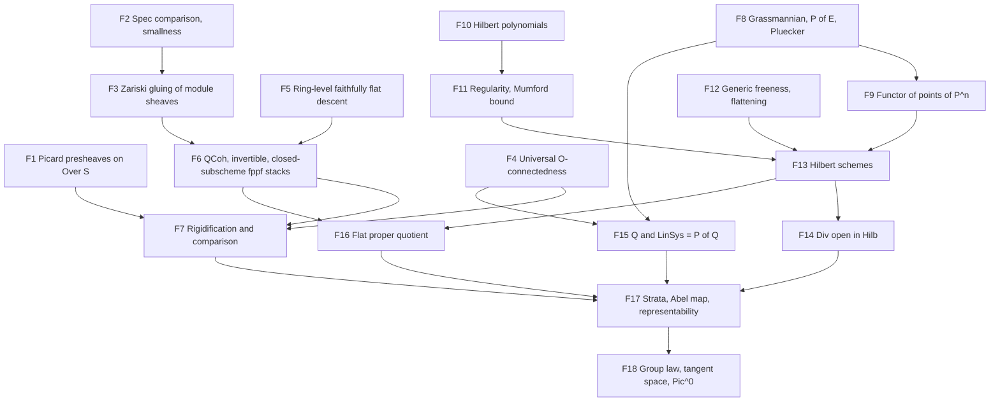

# Picard scheme development plan

This plan targets the relative Picard functor, the descent theory it needs,
representability of the fppf Picard functor by a scheme, and its basic
properties. It follows Grothendieck's theorem in Kleiman's exposition: projective
flat morphisms with geometrically integral fibres over a Noetherian base, proved
through Hilbert schemes of divisors and a quotient by a flat proper equivalence
relation. The generality is chosen for current and expected consumers. Excluded
generalizations are listed with the reason, so that later extensions start from
an explicit boundary rather than from a weakened endpoint.

The starting source is Aglib `e03da44bd8b139e3c0763cff7c555abcc770ddfd`
(R5Lab currently pins `197ca07`, which differs only by performance refactors of
unrelated cohomology leaves), Lean 4.34.1 and Mathlib
`d13f23b723b8a846827a245b89c10fc7d3f11612`. Locators below were inspected at
these revisions. Literature locators use the arXiv numbering of the cited
versions; the FGA Explained book numbering (chapter prefix) was not checked.

## Mathematical targets and acceptance

Throughout, `f : X → S` is a morphism of schemes and `X_T = X ×_S T`. The
functors are defined on all `S`-schemes. Representability, strata and
Hilbert-scheme statements quantify over locally Noetherian test schemes `T`,
nonreduced ones included. This is the convention of Kleiman and Nitsure, and it
was adopted for this plan on 2026-10-17. The downstream uses examined below only
evaluate on schemes locally of finite type over a field. Extending the final
theorem to all test schemes needs Noetherian approximation (F19) and is deferred.

1. **Picard functors.** The base and family presheaves `T ↦ Pic(T)`,
   `T ↦ Pic(X_T)` on `Over S`, the absolute relative functor
   `P_{X/S}(T) = Pic(X_T) / Pic(T)`, its fppf sheafification
   `Pic_{X/S,(fppf)}`, and, for a section `e : S → X`, the
   normalized functor `ker(e_T^*)` and the rigidified functor of pairs
   `(L, e_T^*L ≅ O_T)`. All maps are the actual Aglib pullbacks; group laws come
   from the existing additive pullback.
2. **Cohomological flatness in dimension zero.** If `S` is locally Noetherian and
   `f` is proper, flat, with geometrically integral fibres, then
   `O_T → f_{T*} O_{X_T}` is an isomorphism for every `T` (Kleiman, Ex. 3.11,
   p. 25, which allows geometrically reduced connected fibres).
3. **Descent.** Isomorphism and invertibility of quasi-coherent sheaves descend
   along faithfully flat maps; quasi-coherent sheaves, invertible sheaves and
   closed subschemes satisfy effective descent along fppf coverings; open
   subschemes descend along fppf coverings. The stack statements use Mathlib's
   `Pseudofunctor.IsStack` for `Scheme.fppfTopology` (Vistoli, Thm 4.23, p. 86,
   for the fpqc case; Stacks 023T, 05B2; Nitsure, Lemma 6.7). The fpqc topology
   is not needed: every covering the route uses is fppf.
4. **Comparison.** Under target 2, `P_{X/S} → Pic_{(fppf)}` is injective; with a
   section it is an isomorphism and agrees with the normalized and rigidified
   functors (Kleiman, Thm 2.5 with Lemmas 2.7, 2.9, 2.10, pp. 18–20; Stacks
   0B9N).
5. **Representability.** Let `S = Spec A` with `A` Noetherian and let `X` be a
   closed subscheme of Aglib's `ProjectiveSpace A (Fin (n+1))`, flat over `A`
   with geometrically integral fibres. Then, on locally Noetherian test
   schemes, `Pic_{X/S,(fppf)}` is represented by a separated `S`-scheme locally
   of finite type. It is the disjoint union of open and closed subschemes
   `Pic^φ` indexed by Hilbert polynomials, and each `Pic^φ` is an increasing
   union of quasi-projective open subschemes `Pic^φ_m` (Kleiman, Thm 4.8,
   pp. 27–30, with the stratum repair under Representability below). No section
   is assumed. Gluing to locally Noetherian nonaffine `S` with `f` projective
   Zariski-locally over `S` is an optional extension, added when a consumer
   needs a nonaffine base.
6. **Basic properties.** Commutative group scheme structure from the
   group-valued functor; base change `Pic_{X_T/T} ≅ Pic_{X/S} ×_S T` (Kleiman,
   Ex. 4.4, p. 27); the Hilbert-polynomial decomposition; with a section, the
   normalized functor is represented by the same scheme; over a field,
   `T_0 Pic_{X/k} ≅ H^1(X, O_X)` (Thm 5.11, p. 42); over a field the identity
   component `Pic^0` is an open and closed subgroup scheme of finite type
   (Lemma 5.1, Prop. 5.3, pp. 36–37). Optional, without a current consumer:
   `dim Pic_{X/k} ≤ h^1(O_X)` (Cor. 5.13, p. 44) and `Pic_{P^n_S/S} ≅ ℤ_S`
   (Ex. 4.15, p. 33). The smoothness criterion `dim = h^1` needs further
   group-scheme input and is deferred.

Each endpoint is accepted only on the original objects: actual line-bundle
classes and pullbacks, the actual Mathlib topologies and sheafification, and
a natural bijection with `Hom_S(T, P)` for the stated functor on the stated
test-scheme class (locally Noetherian `S`-schemes for target 5). A
representability theorem for a smaller class of test schemes, or for a functor
defined by a different construction without a proved comparison, does not
discharge target 5.

## Generality decision

| Aspect | Included | Deferred or excluded, and why |
| --- | --- | --- |
| Base | Noetherian affine `Spec A` | Nonaffine locally Noetherian bases by gluing are optional until a consumer needs them. Non-Noetherian bases need limit arguments throughout the Hilbert-scheme construction; Kleiman calls them standard but they double the surface. |
| Morphism | Closed subscheme of `P^n_A` | Zariski-local projectivity over a nonaffine base comes with the optional gluing. Proper non-projective morphisms need Murre's criterion or Artin's theorem (Kleiman 4.18.3, 4.18.6, stated without proof there). |
| Test schemes | Locally Noetherian, possibly nonreduced | All test schemes need Noetherian approximation of line bundles (F19); deferred. |
| Fibres | Flat, geometrically integral | Geometrically reduced and connected fibres are not enough: for Mumford's conic `x² + y² = t` over `ℝ[[t]]` the functor is not representable, and after `ℂ[[t]]` it is represented by a nonseparated scheme (Kleiman Ex. 4.14, pp. 31–33). Mumford's variant for reduced fibres with geometrically irreducible components (Kleiman 4.18.1, p. 33, stated without proof) and general reducible fibres, which need algebraic spaces, are excluded. |
| Topology | fppf functor and fppf descent | Zariski sheafification is not formalized separately. fpqc descent is unnecessary. The étale functor agrees with the fppf one with a section, or after étale-local sections of smooth surjections (EGA IV₄ 17.16.3(ii)); that theorem is an optional later extension. |
| Representing object | Schemes | Algebraic spaces (Artin; Stacks 0D2C) are excluded. |
| Sections | Not assumed by target 5 | The Kleiman proof uses no section, so the field case without a rational point needs no Galois descent. |
| Properties | Group law, separatedness, local finite type, strata, tangent space, `Pic^0` over fields | `Pic^τ` (Kleiman §6), properness/projectivity of `Pic^0` (Thm 5.4), smoothness from `H^2 = 0` (Prop. 5.19) and Cartier's theorem (Cor. 5.14) are later extensions. |

## Existing foundations

Paths are relative to the respective `Aglib/` or `Mathlib/` source root.

| Input | Owner and locator | Use |
| --- | --- | --- |
| Ring Picard group | Mathlib `RingTheory/PicardGroup.lean`: `Module.Invertible` (77), `CommRing.Pic` (429), local rings (536), `Pic.functor` (604) | Affine comparison, local triviality |
| Module sheaves | Mathlib `AlgebraicGeometry/Modules/Sheaf.lean`: `Scheme.Modules` (36), pullback/pushforward (165–188), `Scheme.Modules.pseudofunctor` (319) | Descent pseudofunctor |
| Topologies | Mathlib `AlgebraicGeometry/Sites/BigZariski.lean` (57), `Sites/Fpqc.lean`: precoverages (40), fpqc/fppf subcanonical (87, 97), effective epimorphisms (114, 123); `CategoryTheory/Sites/Over.lean` (240) | Representables are sheaves; quotients |
| Sheafification | Mathlib `CategoryTheory/Sites/LeftExact.lean` (313): `HasSheafify J (Type (max u v))`, hence values in `Type (u+1)` on `Over S` | `Pic_{(fppf)}` |
| Zariski representability | Mathlib `AlgebraicGeometry/Sites/Representability.lean` (208), for `Sheaf zariskiTopology (Type u)`; Aglib's `Sites/OverRepresentability` gives the `Over S` and locally Noetherian forms in any universe | Gluing `Pic^φ_m` |
| Descent formalism | Mathlib `CategoryTheory/Sites/Descent/`: `DescentData` (59), `IsStack` (49), `IsStack.of_precoverage` (`Precoverage.lean` 410); no concrete stack instance | Target 3 |
| Ring descent | Mathlib `Algebra/Category/ModuleCat/Descent.lean` (59): extension of scalars along a faithfully flat map is comonadic; effectivity is a TODO there. Aglib `RingTheory/Descent`: algebra descent data and faithfully flat invariants | Target 3 |
| Morphism descent | Mathlib `AlgebraicGeometry/Morphisms/LocalFlatDescent.lean` (35–47), `FlatDescent.lean` | Properties of `Pic` |
| Closed immersions | Mathlib `AlgebraicGeometry/ZariskisMainTheorem.lean`: `IsFinite.of_isProper_of_locallyQuasiFinite` (373), `IsClosedImmersion.iff_isProper_and_mono` (393) | Quotient theorem |
| Line bundles | Aglib `AlgebraicGeometry/Modules/Invertible`: `LineBundle` (`Basic` 47), `PicardGroup` (`Dual` 221), `PullbackTensor.Local.pullbackHom` (78), `UnitCocycle` gluing (`Gluing/Sections` 54, `Gluing` 95) | Target 1 |
| Divisors | Aglib `Modules/Invertible/ZeroLocus/Fibrewise.lean` (50): for flat locally finitely presented `f`, a geometric-fibre-regular map from a line bundle to `O` is mono with flat zero scheme. Its header records native proof validation as pending a coordinated build | Div open in Hilb |
| Cohomology and base change | Aglib `Cohomology/FiniteModel/Basic.lean` (48), `Proper/FiniteModel.lean` (46, 63, 102), `Proper/LocalCriterion.lean` (46), `Proper/Semicontinuity.lean` (40, 53), `Proper/EulerCharacteristic.lean` (39, 53), `Proper/Grauert/Global.lean` (45, 62), `Proper/Finiteness.lean` (136, 147) | Targets 2, 5 |
| Constants | Aglib `Geometrically/Integral/GlobalSections.lean` (111): constants of a proper geometrically integral field scheme | Target 2 |
| Projective space | Aglib `ProjectiveSpace`: `Proj` of `MvPolynomial`, charts, base change, `twistingSheaf` (`Twisting` 113, 122), `Hom.Sections`; `Cohomology/Projective/SerreVanishing.lean` (63), `ClosedImmersion.lean` (109, 135) | Hilbert schemes |

R5Lab already consumes these interfaces. `R5Lab/AlgebraicGeometry/Curves/RelativePicard.lean`
(42–140) defines the base, family and normalized functors on `Over S` with values
in `Type (u+1)`. `RelativePicard/Representability.lean` retains
`DegreeZeroPicardRepresentability`: for a curve over a field with a rational
origin, the normalized geometric-fibre-degree-zero functor is representable. About
ten K-theory and elliptic-curve modules carry it as a parameter.
`Curves/Picard/EtaleDescent.lean` (63–92) retains `EtaleLineBundleDescent`,
the étale stack property of line bundles. `Curves/Picard/LocalRing.lean` (38)
proves that line bundles on the spectrum of a local ring are trivial.

## Missing foundations

Weights are rough Lean-size classes calibrated against Aglib families
(`Cohomology/BaseChange` is about 5.6k lines, `Cohomology/Projective` about
5.1k): S < 1.5k, M 1.5–4k, L 4–8k, XL > 8k. They are planning estimates, not
commitments.

| ID | Foundation | Status | Weight |
| --- | --- | --- | --- |
| F1 | Picard presheaves on `Over S` (migrated from R5Lab), group structure, base and family maps | proved: `Picard/Presheaf`, `Picard/Normalized`, `Picard/Fppf` (namespace `Scheme.RelativePicard`), including the sheafified-family comparison | S |
| F2 | `PicardGroup (Spec A) ≃+ CommRing.Pic A`; local triviality; `Small.{u} (PicardGroup X)` | proved: `Modules/Invertible/Affine`, `LocalRing`, `ChartCocycle` | M |
| F3 | Zariski gluing of module sheaves with cocycle data (stack for `zariskiTopology`) | proved: `Descent/Modules` (`isStack_pullbackPseudofunctor_zariskiTopology`, `isStack_quasicoherentPseudofunctor_zariskiTopology`, `isStack_lineBundlePseudofunctor_zariskiTopology`) | M |
| F4 | Target 2: universal `O_T ≅ f_{T*}O_{X_T}` from the local criterion, the constants theorem and flat base change | proved: `Cohomology/Proper/StructureSheaf` | M |
| F5 | Ring-level effective faithfully flat descent of modules in descent-data form; descent of invertibility and isomorphism | proved: `Algebra/Category/ModuleCat/Descent` (`isStackFor_moduleCatExtendScalarsPseudofunctorOpOp_singleton`, for Mathlib's descent data on `CommRingCatᵒᵖ`) and `RingTheory/Descent/FinitePresentation`, `Invertible` | M |
| F6 | Quasi-coherent, invertible and closed-subscheme fppf stacks on schemes; descent of open subschemes along fppf coverings (saturated opens are preimages, since fppf morphisms are open) | proved: quasi-coherent sheaves and line bundles form fpqc and fppf stacks (`Descent/Modules/Fppf`); closed subschemes form Zariski, fpqc and fppf sheaves (`Descent/IdealSheaf/Fppf`, with the gluing `IdealSheaf/Glue`); open subschemes descend (`Descent/Opens`); composition of descent `IsStackFor.bind` (`CategoryTheory/Sites/Descent`) | L |
| F7 | Rigidified pairs, their automorphisms, comparison theorem (target 4) | proved on the big fppf site of `Over S` (`Picard/Comparison`): Kleiman Thm 2.5(1), injectivity of the fppf comparison map under target 2 (Stacks 0B9M), and Thm 2.5(2) with a section, the rigidified and relative functors are fppf sheaves and the comparison maps are isomorphisms (Stacks 0B9N); generic descent lemmas in `CategoryTheory/Sites/Descent`; open: the Zariski and étale comparison maps and the restriction to locally Noetherian test schemes | M |
| F8 | Grassmannian of rank-`r` quotients of a finite locally free module: charts, gluing, functor of points; `P(E) = Gr(E,1)`; Plücker closed embedding | partial: for free `R^n` over `Spec R`, `Grassmannian/Representability` (`representableIso`, Mathlib's `Module.Grassmannian.functor` on `R`-algebras), `Grassmannian/FunctorOfPoints` (the extension to all test schemes) and `Grassmannian/Quotient` (rank-`k` locally free quotients of `O_T^n` on all schemes over `Spec R`: `quotFunctorIso`, `quotFunctorRepresentableBy`, Stacks 089T, with a universal quotient), the kernel of a rank-`k` quotient (finite locally free of rank `n - k`, compatible with every pullback), the universal kernel, quotients of free sheaves on any finite index type and finiteness over a Noetherian base (`Grassmannian/Quotient/{Kernel,KernelRank,UniversalKernel,Reindex}`, `Grassmannian/Finiteness`), the Plücker closed immersion `Gr(R^n, k) → P(⋀^k R^n)` from the Plücker map on points, natural and injective (`Grassmannian/{Plucker,PluckerClosedImmersion}`), and `Gr(R^n, k)` smooth, flat, separated and proper over `Spec R` (`Grassmannian/{Flat,PluckerClosedImmersion}`); for `E` finite locally free of constant rank `n` on any scheme `S` (`Grassmannian/LocallyFree`): `Quot_k(E)` and its Zariski sheaf property on `Over S`, its restriction to trivializing affine charts (`Quot_k(O^n)`, represented by `Gr(R^n, k)`), representability by `Gr(E, k)` with universal quotient (through `Scheme.LocalRepresentability.overZariskiLocalRepresentability`), `P(E) = Gr(E, 1)` classifying rank-one (invertible) quotients through `E_{P(E)} ↠ O_{P(E)}(1)`, `Gr(E, k) ×_S Spec R ≅ Gr(R^n, k)` on trivializing charts, and `Gr(E, k) ⟶ S` quasi-compact and locally of finite type; open: the Plücker embedding for locally free `E`, and `E` of non-constant rank | L |
| F9 | Functor of points of `ProjectiveSpace A`, comparison with `Gr(A^{n+1},1)`, quasi-projective morphisms | partial: `Gr(R^m, 1) ≅ ProjectiveSpace R ι` over `Spec R` (`Grassmannian/ProjectiveSpace`; Stacks 089V), maps from any scheme over `Spec R` into projective space as natural transformations into the Grassmannian functor and as rank-one locally free quotients of `O^m` (`ProjectiveSpace.quotFunctorRepresentableBy`; Stacks 089V, 01NE), and the universal quotient chart by chart as `O^ι ↠ O(1)` by the coordinate sections; quasi-projective morphisms over an affine base: `IsHQuasiProjective`, `IsHProjective` (Stacks 01VW, 01W8; `ProjectiveSpace/QuasiProjective`), with comparisons to proper, separated and finite type, closure under quasi-compact immersions, closed immersions, Segre products and finite-type affine schemes, the Grassmannian H-projective by Plücker and the Hilbert scheme of `P^n_A` H-quasi-projective, finite disjoint unions of H-quasi-projective and H-projective schemes (`ProjectiveSpace/QuasiProjective/Coproduct`: `isHQuasiProjective_sigmaDesc`, `isHProjective_sigmaDesc`, from the linear embeddings `ProjectiveSpace/LinearEmbedding` and the finite-map embedding); open: the universal quotient as the sheaf map `O^ι ↠ O(1)` | M |
| F10 | Hilbert polynomial of coherent sheaves on `P^n` over a field, local constancy in flat families | partial: field case (`Cohomology/Projective/HilbertPolynomial`); local constancy in flat families and finiteness of the fibre Hilbert polynomials (Nitsure's (A)) over an affine Noetherian base (`HilbertPolynomial/{Fiber,FlatFamily,Finiteness}`); open: non-affine base | M |
| F11 | Castelnuovo–Mumford regularity and Mumford's bound (Nitsure, Lemma 2.1, Thm 2.3, pp. 10–11) | partial: Nitsure Lemma 2.1 proved over any ring (`Cohomology/Projective/Regularity`): (a) in coordinate-multiplication form, (b), and (c) as vanishing plus finite global generation; Mumford's bound (Thm 2.3) proved over every field, for subsheaves of `O^p` and ideal sheaves, with integer binomial coefficients of Hilbert functions (`Regularity/Mumford`, `HilbertPolynomial/Basic`); open: the literal tensor form of (a) | L |
| F12 | Generic freeness (Nitsure, Lemma 4.1, p. 18; Stacks 051R), generic flatness (Thm 4.2, p. 19) and flattening stratification on `P^n_A` (Thm 4.3, p. 19) | proved over an affine Noetherian base `Spec A`, for locally Noetherian test schemes: generic freeness (`RingTheory/GenericFreeness`), generic flatness (`Modules/Flat/Generic`), Fitting ideals (`RingTheory/FittingIdeal`) and the case `n = 0` (`Modules/FittingIdeal`, `FlatteningStratification/{Rank,Universal}`); over any base, the packaging `⊔ S_r ⟶ S` (Stacks 05P9, locally free form), the joint and refined strata and base change of `relativeFlat` (Stacks 01U8, global form); over `Spec A`, Nitsure Lemma 3.1 (with `r₀` depending on the base change), Lemma 3.2 (as an equivalence), (B) and (C) for any coherent `F` (`Cohomology/Projective/FiberBaseChange`), the strata `S_f` with Thm 4.3 (i)–(iii) and the universal property (ii) (`FlatteningStratification/{HilbertPolynomial,Flatness}`; "⇒" for every test scheme), and the monomorphism `∐ S_f ⟶ Spec A`, independent of the bound up to unique isomorphism; over a locally Noetherian base `S ⟶ Spec A` (`A` any ring), for `F` coherent on `P^n_A ×_{Spec A} S`: the strata `S_f`, glued from the affine strata (`IdealSheaf/GlueImmersion`), with Thm 4.3 (i)–(iii), (ii) for locally Noetherian test schemes, finitely many `S_f` for quasi-compact `S`, each `S_f` unique up to unique isomorphism and independent of the bound, and fibre Hilbert polynomials stable under base change of the base (`FlatteningStratification/{StratumFlatness,AffineBase,Global}`, `ProjectiveSpace/BaseChange/AffineOpen`); open: "⇐" for test schemes that are not locally Noetherian | L |
| F13 | Hilbert schemes on locally Noetherian test schemes: `Hilb^Φ` of closed subschemes of `P^n_A` represented by a locally closed subscheme of a Grassmannian (Nitsure, proof of Thm 5.2/5.3 up to the flattening step, pp. 24–26), and its open subfunctors for locally closed `X ⊂ P^N_A` (Thm 6.1 with trivial bundles, p. 28). Projectivity of `Hilb^Φ` uses the DVR valuative criterion (pp. 26–27), which Mathlib lists as future work (`AlgebraicGeometry/ValuativeCriterion.lean`, "Future projects"); the route does not need it | proved for `P^n_A` with `A` Noetherian, on locally Noetherian test schemes: `Hilb^Φ` is represented by a locally closed subscheme `G_Φ` of the Grassmannian of rank-`⌊Φ(r)⌋₊` quotients of `𝒪^N`, with its universal family (`HilbertScheme/Representability`: `locallyNoetherianHilbertFunctorRepresentableBy`; Nitsure §5, Thm 5.3, p. 24, in the locally closed form reached on p. 27, with `X = P^n_A`, `E = 𝒪`). Inputs: the Hilbert functor, the uniform regularity bound, direct images compatible with base change (`DirectImageSheaf*`, `IdealTwist/*`), relative global generation of `I_Z(r)`, the Grassmannian point and its naturality (`LocallyNoetherianPoint`, `LocallyNoetherianFunctor`), the universal subscheme (`UniversalSubscheme*`), pullback of closed subschemes (Stacks 01JU) and the image step through the flattening stratum (Nitsure's (F)); the open step of Thm 6.1 is proved: for an open `U ⊂ P^n_A`, the subfunctor `Hilb^Φ_U` of families contained in `U` is open and represented on locally Noetherian test schemes by an open subscheme of `G_Φ` with the restricted universal family (`HilbertScheme/OpenSubscheme`: `locallyNoetherianOpenHilbertSubfunctorRepresentableBy`; Nitsure §6, p. 28, Exercise A; general form for universally closed families in `Morphisms/UniversallyClosed/ImageComplement`); the closed step of Thm 6.1 is proved: for closed `C ⊆ P^n_A`, `Hilb^Φ_C` is represented on locally Noetherian test schemes by a closed subscheme of `hilbertScheme` (`HilbertScheme/ClosedSubscheme/Representability`: `locallyNoetherianClosedHilbertSubfunctorRepresentableBy`, `closedHilbertSchemeι`, `exists_closedHilbertScheme_representableBy`; Nitsure, Lemma 5.4 (ii), p. 25, and Theorem 5.3, p. 24, for `E = 𝒪_C`), through the zero scheme of a morphism into a finite locally free sheaf of constant rank, with its universal property on all test schemes and its pullback (`Modules/ZeroLocus/LocallyFree`; the Fitting zero scheme in place of Nitsure's vanishing scheme, Remark 3.6, p. 17); the identification behind Exercise B is proved for any preimmersion `i : Y ⟶ P^n_A` over `Spec A`: the Nitsure-form functor of `Y` (closed subschemes of `Y_T` proper over `T`, fibre polynomials through `i`) is isomorphic to the subfunctor of `Hilb^Φ` of the families factoring through `i_T` (`HilbertScheme/Immersed/Functor`: `immersedHilbertFunctor`, `immersedHilbertFunctorIso`; the comparison along a monomorphism in `IdealSheaf/Monomorphism`; implicit in Nitsure, p. 25 after Lemma 5.4 and p. 28, second Exercise); the locally closed combination and quasi-projectivity are proved: for a (quasi-compact, automatic over Noetherian `A`) immersion `i : Y ⟶ P^n_A` over `Spec A`, the families of `Hilb^Φ` contained in `Y` are `Hilb^Φ_{i.ker} ⊓ Hilb^Φ_{i.coborderRange}` (`HilbertScheme/Immersed/Subfunctor`: `immersedHilbertSubfunctor_eq_inf`, through Mathlib's `IsImmersion.isPullback_toImage_liftCoborder`; for closed immersions `immersedHilbertSubfunctor_eq_closedHilbertSubfunctor_ker`), and an open subscheme of the closed `H_{i.ker}` represents the Hilbert functor of `Y` on locally Noetherian test schemes, with its universal family, and is H-quasi-projective over `Spec A` (`HilbertScheme/Immersed/Representability`: `locallyNoetherianImmersedHilbertFunctorRepresentableBy`, `universalImmersedHilbertFamily`, `exists_immersedHilbertScheme_representableBy`; `HilbertScheme/Immersed/QuasiProjective`: `isHQuasiProjective_immersedHilbertSchemeOver_hom`; Nitsure, Thm 6.1, p. 28, for `E = 𝒪_Y` and trivial bundles); projectivity of `Hilb^Φ` is not needed | XL |
| F14 | Relative effective Cartier divisors, fibrewise criterion and `Div` open in `Hilb` (Kleiman, Lemma 3.4, Thm 3.7, pp. 22–24) | done: relative effective Cartier divisors and their base change (`EffectiveCartierDivisor/Relative`; Stacks 062T, 056Q), the fibrewise criterion over any base for flat, locally finitely presented families and under Kleiman's Noetherian hypotheses (Lemma 3.4; Stacks 062Y), and openness of the Cartier locus for flat, universally closed families over a locally Noetherian base, with its base-change and factorization form (proof of Thm 3.7); for a closed `X ⊆ P^n_A` flat over `A`, the X-first functor `Div^θ_X` with fibre Hilbert polynomial `θ` (`HilbertScheme/Divisor/Functor`) is open in the Hilbert functor of `X` on locally Noetherian test schemes and is represented by the open `fiberCartierLocus` of any representing scheme of `Hilb^θ_X`, with universal divisor (`HilbertScheme/Divisor/Representability`); over a Noetherian `A`, by an H-quasi-projective Noetherian scheme, the divisor locus of the closed Hilbert scheme of `i.ker` (`HilbertScheme/Divisor/ClosedHilbertScheme`) | M |
| F15 | The module `Q` with `Hom(Q,N) ≅ f_*(L ⊗ f^*N)` in the locally free regime; `LinSys = P(Q)` (Kleiman 3.10, Thm 3.13, pp. 24–26) | done in the locally free regime, per piece of constant `h^0 = r ≥ 1`: the finite model; the cohomological inputs (degree-zero projection formula, line subbundles from fibrewise nonzero maps, zero schemes on integral fibres, residue-field concentration, and 15a, the locally free direct image on the rank pieces); `LinSys_{L/X/S}` is represented by `Gr(E, r − 1)` (proper, smooth, flat over `S`) with universal divisor (`Picard/LinearSystem/Representability`), for `p` proper, flat, geometrically integral over a locally Noetherian base with every base-change map of `L` an isomorphism (15a); open, not needed by F17: representability by `∅` on the `r = 0` piece (emptiness is proved), gluing over the clopen `h^0` pieces, and the `O(D)` form of the divisor class | M |
| F16 | Quotient of a strongly quasi-projective scheme by a flat proper equivalence relation (Nitsure, Thm 6.9, p. 36, by the proof of Thm 6.8, pp. 33–35, with Thm 6.1 and Lemma 6.7) | inputs: locally Noetherian Yoneda (`Properties/Noetherian/Yoneda`), equivalence relations on locally Noetherian points (`Properties/Noetherian/EquivalenceRelation`), quasi-projectivity over `Spec A` (`ProjectiveSpace/QuasiProjective`) and of finite disjoint unions (`ProjectiveSpace/QuasiProjective/Coproduct`), the clopen decomposition of a flat family by fibre Hilbert polynomial and the glued family on a coproduct (`FlatteningStratification/FlatDecomposition`, `HilbertScheme/Coproduct`), nonvanishing of the Hilbert polynomial of a nonempty subscheme (`HilbertScheme/Nonempty`) and Lemma 6.7(2) (`Descent/IdealSheaf/FaithfullyFlat`); done: over a Noetherian ring `A`, for `πZ : Z ⟶ Spec A` H-quasi-projective and `p₁, p₂ : R ⟶ Z` over `Spec A` with `p₂` (or `p₁`) proper and flat, injective and an equivalence relation on locally Noetherian points, a `FlatProperQuotient` exists: `Q` H-quasi-projective over `Spec A`, `q : Z ⟶ Q` flat, surjective and proper over `Spec A`, and `R = Z ×_Q Z` through `(p₁, p₂)`; `q` is quasi-compact, locally of finite presentation, an effective epimorphism, a coequalizer of `p₁, p₂` and an fppf covering, and `Q` is locally Noetherian, separated and locally of finite type over `Spec A` (`HilbertScheme/Quotient/Existence`: `nonempty_flatProperQuotient`, `nonempty_flatProperQuotient_of_isProper_fst_of_flat_fst`; `HilbertScheme/Quotient/FlatProper`). Route: `(p₁, p₂) : R ⟶ Z ×_A Z` is a closed immersion (proper, injective on locally Noetherian points); an immersion `Z ⟶ P(ι)_A` with `ι ≃ Fin (n + 1)` (`ProjectiveSpace/QuasiProjective/EquivFin`); the fibre Hilbert polynomials of `R` over `Z` are finitely many and nonzero; the datum is `H_F = ∐_{Φ ∈ F} Hilb^Φ_Z`, which represents on locally Noetherian test schemes the closed subschemes of `Z_T` proper and flat over `T` with all fibre Hilbert polynomials in `F`, with universal family glued from those of the `Hilb^Φ_Z`, H-quasi-projective for finite `F` (`HilbertScheme/Coproduct/{Functor,Representability,QuasiProjective}`: `locallyNoetherianImmersedHilbertFunctorInRepresentableBy`, `exists_sigmaImmersedHilbertScheme_representableBy`, `isHQuasiProjective_sigmaImmersedHilbertSchemeOver_hom`), and the classifying morphism of `R`; the core `HilbertScheme/Quotient/{Datum,Points,Graph,Descent,FlatProper,Effective}` proves `(***)` on locally Noetherian points, `Γ_φ ⊂ D` with `p₁⁻¹Γ_φ = p₂⁻¹Γ_φ`, `Q = φ.image` by Lemma 6.7(2) and `R ≅ Z ×_Q Z`. Reviews of the core, of the datum from `H_F` and of the final assembly found no mathematical gap; their repairs are applied. Differences from Nitsure: the relation is tested on locally Noetherian points only, `q` is proved proper rather than strongly projective, and only one projection need be proper and flat | M |
| F17 | Strata `Pic^φ`, `Pic^φ_m`, the Abel map and assembly of target 5 | done: the generic open-subsheaf lemma for any `p : X ⟶ S` (`Picard/FiberCondition/{Subsheaf,OpenSubfunctor}`): a fiber condition (`RelativePicard.FiberCondition`: invariant under base change of the point, open in locally Noetherian families) cuts out an fppf subsheaf `Pic^C` of `Pic_{(fppf)}`, which is an open subfunctor on locally Noetherian test schemes, with `U_ξ` representing `Pic^C ×_Pic h_T`, and open and closed when the failure of the condition is also open; the fiber conditions of the strata (`Picard/Strata/FiberConditions`, on `Cohomology/Projective/EmbeddedFibers` and `Cohomology/Fibers/{FieldPoint,BaseChange}`): `C_φ` ((4.8.1), `χ(X_t, L_t^{-1}(n)) = φ(n)`) and the single condition `C_m` ((4.8.3) for `n ≥ m` with `H^0(X_t, L_t(m)) ≠ 0`), invariant under isomorphism and under base change along every morphism of `S`-schemes (`f` proper), `C_φ` open and closed and `C_m` open on locally Noetherian test schemes (`f` flat), each level `h^0(X_t, L_t(m)) = r` of the vanishing locus open, monotone in `m`, covering (geometrically integral fibres), with the pointwise twist identities for `Pic^φ_m ≅ Pic^{φ₀}_0`, `φ₀(n) = φ(n − m)`, and the twisting classes; the strata bundle (`Picard/Strata/{BaseAndRank,Conditions}`, `Picard/FiberCondition/RelativeCover`, `Cohomology/Projective/EmbeddedFibers/ZeroTwist`): the conditions `C_φ`, `C_ψ` (`χ(O_{X_t}(n)) = ψ(n)`) and `C_{m,r}` (vanishing for `n ≥ m` with `h^0(X_t, L_t(m)) = r`) as `FiberCondition` values with their conjunctions, the disjoint clopen covers by `φ` and by `ψ`, the nested cover of `Pic^φ` by the `Pic^φ_m` and the fine cover indexed by `(φ, ψ, m, k)` with `r = k + 1` (both for geometrically integral fibres), the twisting classes with the pointwise translation identity, and the point-fibre hypotheses of cohomology and base change at `m = 0` with the resulting locally free direct image commuting with base change on locally Noetherian test schemes; the twist isomorphism (`Picard/FiberCondition/Translation`, `Picard/Strata/Twist`): translation by the class of `O(m)` carries `Pic^{φ,ψ,r}_m` onto `Pic^{φ₀,ψ,r}_0`, `φ₀(n) = φ(n − m)`, on every `S`-scheme, with the induced isomorphisms (also `Pic^φ_m ≅ Pic^{φ₀}_0`) and the transport of representations on locally Noetherian test schemes; the Hilbert polynomial of a divisor on a stratum (`IdealSheaf/QuotientModule/Map`, `HilbertScheme/Immersed/Fiber`, `Picard/Strata/DivisorPolynomial`): at every field point the image in `P^N_A ×_{Spec A} T` of a closed `V ⊆ X_T` has Hilbert polynomial `n ↦ χ(X_x, O(n)) − χ(X_x, I_{V_x}(n))`, and for `V` flat over `T` and a line bundle `L` with `L^∨ ≅ I_V` satisfying `C_{φ₀}`, with `C_ψ` at every point, the image of `V` is a point of `Hilb^{ψ − φ₀}`; the Abel class `−[I_D]` with its naturality (`Picard/Abel/Basic`), the fppf form of Kleiman's Lemma 4.9 (`Sites/FppfQuotient`: `Q` represents a subfunctor `G` of an fppf sheaf through a flat surjective `q : Z ⟶ Q` locally of finite presentation), the separatedness of a scheme covered by separated opens any two of which are disjoint or lie in a third (`Morphisms/Separated/Cover`), and the Zariski sheaf input of the gluing (`Picard/ZariskiSheaf`); the Abel map and `Z` (`Picard/Abel/Divisor`, `Picard/Strata/DivisorLocus`): the Abel map `D ↦ [𝒪(D)]` out of `Div^θ_X` and its fppf form, the universal Abel class of a representation of `Div^θ_X` and its pullbacks, and for a fibre condition `C` the open subscheme `Pic^C ×_P Div^θ_X` of the representing scheme, H-quasi-projective and Noetherian over a Noetherian base when the representing scheme of `Div^θ_X` is H-quasi-projective; a divisor whose Abel class lies in `Pic^{φ₀,ψ,r}_m` has fibre Hilbert polynomial `ψ − φ₀`; the relation `R = Z ×_P Z` (`Picard/LinearSystem/AbelClass`, `Picard/Strata/Relation/*`; Kleiman, proof of Thm 4.8 and of Lemma 4.9, p. 30, with Thm 2.5(1)): on the fine stratum at `m = 0` with `r = k + 1 ≥ 1`, the pairs of points of `Z` with the same class are represented on locally Noetherian test schemes by the Grassmannian bundle `Gr(p_{Z*}𝒪(W_Z), k)` over `Z`, whose two projections are proper and flat, with `R ⟶ Z ×_S Z` a closed immersion (for `Div^θ` separated and locally of finite type) and an equivalence relation; the Abel-class form of `LinSys` and its transport along `X ×_S U ≅ X_V ×_V U`; the local sections of the Abel map (`Picard/Strata/LocalSections`, `Grassmannian/LocallyFree/Surjective`): on the fine stratum at `m = 0` with `r = k + 1 ≥ 1`, `Z ⟶ Pic^{φ₀,ψ,r}_0` is fppf-locally surjective on locally Noetherian test schemes, in the shape of hypothesis (h₃) of `Scheme.representableByOfFppfQuotient`, through the Grassmannian bundle `Gr(p_{V*} L, r − 1)` of the linear system over an fppf representative, which is surjective since `r ≥ 1`; the instance of Lemma 4.9 for the fine strata (`HilbertScheme/Quotient/LocallyNoetherianOver`, `Picard/Strata/{Quotient,Representability}`; Kleiman, end of the proof of Thm 4.8, p. 30, and Lemma 4.9, pp. 30–31): for `D` H-quasi-projective over a Noetherian `A`, the flat proper quotient `Q = Z / R` is H-quasi-projective, `Z ×_Q Z = Z ×_P Z` on locally Noetherian points, `α_Z` descends to a unique `λ ∈ Pic_{(fppf)}(Q)` in the stratum, and `Q` represents `Pic^{φ₀,ψ,k+1}_0` on locally Noetherian test schemes through `f ↦ f^* λ`; the gluing and target 5 (`Picard/Scheme/{Glue,Stratification,Separated}`, `Picard/Representability`, `Picard/Representability/FineStrata`, `Morphisms/Separated/DisjointUnion`; Kleiman, Thm 4.8, pp. 27–31): the cover of `Pic_{(fppf)}` on locally Noetherian test schemes by the fine strata `Pic^{φ,ψ,k+1}_m` indexed by `(φ, ψ, m, k)`, represented through the twist, glued to `picardScheme`, which represents `Pic_{(fppf)}`, is locally of finite type and separated (each `Pic^{φ,ψ}_m` a disjoint union of separated charts, then the disjoint-or-nested cover), with the clopen disjoint covering strata `Pic^φ`, the increasing levels `Pic^φ_m` with union `Pic^φ`, each H-quasi-projective over a Noetherian base (finitely many `(ψ, r)`: `ψ` by the Noetherian base, the ranks by the disjoint opens `Z_r` of one Noetherian `Div^{ψ − φ₀}`), and the functorial meaning of the strata; `exists_representableBy_fppfPicardSheaf` is target 5 with no premise | L |
| F18 | Tangent space via square-zero thickenings and `Sheaf.H` of `𝒪_X` (`structureCohomology`); identity component of a group scheme locally of finite type over a field (open and closed, finite type, geometrically irreducible). Optional: Krull dimension of a local ring bounded by its embedding dimension (not checked in Mathlib), `Pic(P^n_K) ≅ ℤ` for fields `K` | done (the optional items are open): tangent-space core (`Picard/Tangent/{Thickening,Generator,DualNumbers}`): the split truncated exponential sequence for `X[ε]` over any ring with its `Sheaf.H` splitting in every degree and `Pic(X[ε]) ≃+ Pic(X) × ker(i^*)`; `ker(i^*) ≃+ H^1(X, 𝒪_X)` without premise, by Čech cocycles on an affine cover of a separated `X` over a field, linear under `µ_a` (`Picard/Tangent/Cech`: `DualNumbers.picardKerEquivCech`, `picardKerEquivCech_dualScale`), so the conditional `picardKerEquiv` (premise `UnitsCohomologyComparison`) is off the main line; the vertical maps of Kleiman's Square (5.11.4) for `Pic_{X/k,(fppf)}` (`Picard/Tangent/Comparison`): the square commutes, its vertical maps are injective for `p` proper and flat with geometrically integral fibres, and with a section `ker(Pic_{X/k,(fppf)}(k_ε) → Pic_{X/k,(fppf)}(k)) ≃+ ker(Pic(X_ε) → Pic(X))`, compatibly with `µ_a` (Kleiman, Thm 2.5(1)–(2), p. 18, in place of Ex. 2.3); Kleiman's `v : H^1(X, 𝒪_X) → ker(Pic_{X/k,(fppf)}(k_ε) → Pic_{X/k,(fppf)}(k))` (`Picard/Tangent/KernelMap`), additive, `µ_a`-linear, injective, and bijective with a section; identity component, first part (`Group/IdentityComponent/{Basic,BaseChange}`): for a group scheme locally of finite type over a field, `G^0` is open and closed, a subgroup and geometrically connected, and `(G_K)^0` is the preimage of `G^0` for every field extension `K` (Kleiman, Lemma 5.1(3), pp. 36–37); second part (`Topology/Irreducible/LocallyFinite`, `CategoryTheory/Monoidal/GrpObjShear`, `Geometrically/Irreducible/FieldExtension`, `Group/IdentityComponent/{Irreducible,QuasiCompact,FiniteType}`): `G^0` is geometrically irreducible, quasi-compact and of finite type, over an arbitrary field (Stacks 0B7Q, 0B7P, 0B7R(3)(4)); for `S = Spec k` and the representation `e` as an argument, `Pic^0` (the identity component of `P` with `picardCommGrpObj p P e`) is an open and closed group subscheme of finite type, geometrically irreducible, and its formation commutes with extending `k` in group-scheme form (`Picard/IdentityComponent`; Kleiman, Prop. 5.3, p. 37); for a representation `e` of `Pic_{X/S,(fppf)}` on locally Noetherian test schemes by `P` locally of finite type over a locally Noetherian `S`, with `e` an argument (target 5): `P` is a commutative group object of `Over S` and `e` is additive on points (`Picard/GroupLaw`, `Sites/OverRepresentability/CommGrpObj`), and, for `p` proper and flat with geometrically integral fibres, `P` also represents the normalized and rigidified functors (with a section) and `P_{X/S}` (with `IsSplitEpi p`) (`Picard/Comparison/RepresentableBy`; Kleiman, Thm 2.5(2), p. 18, Lemma 2.9, p. 19); for `g : S' ⟶ S`, `Pic((X ×_S S') ×_{S'} T) ≅ Pic(X ×_S T)` naturally in `T` and compatibly with the base pullbacks (`Picard/FamilyBaseChange`; Kleiman, Ex. 4.4, p. 27, Answer 4.4, p. 65); for a functor `F` of abelian groups on `k`-schemes whose restriction to locally Noetherian test schemes is represented by `P`, with the representation an argument, and every field `L` over `k`: `ker(F(L[ε]) → F(L)) ≃+ Hom_k(𝔪/𝔪², L)` for the maximal ideal `𝔪` of the local ring of `P` at the unit point, `L`-linear for `a • t = F(µ_a) t`, with `finrank_L = finrank_k (𝔪/𝔪²)` finite (`Picard/Tangent/Points`, with `RingTheory/LocalRing/SquareZeroLift` and `RingTheory/TrivSqZeroExt`; Kleiman, proof of Thm 5.11, (5.11.1)–(5.11.3), pp. 42–43); fppf base change (`Picard/{BaseChange,BaseChangeRepresentableBy,BaseChangeGroupLaw}`; Kleiman, Ex. 4.4, p. 27, Answer 4.4, p. 65): `Pic_{X_{S'}/S',(fppf)} ≅ (Over.map g)^* Pic_{X/S,(fppf)}` naturally in `T` and compatibly with the units, with the kernels of restriction maps; for `S'` locally Noetherian, `P ×_S S'` represents `Pic_{X_{S'}/S',(fppf)}` on locally Noetherian test schemes, and for `S` also locally Noetherian its group law is the base-changed one; the tangent space at the unit of the Picard scheme (with the representation `e` an argument): for `X` proper and flat over a field `k` with geometrically integral fibres, `ker(Pic_{X/k,(fppf)}(k_ε) → Pic_{X/k,(fppf)}(k)) ≃ₗ[k] H^1(X, 𝒪_X)` for `a • t = F(µ_a) t`, its Zariski form `(𝔪/𝔪²)^∨ ≃ₗ[k] H^1(X, 𝒪_X)`, and `dim_k H^1(X, 𝒪_X) = dim_k 𝔪/𝔪²` finite (`Picard/Tangent/{FieldExtension,StructureCohomology}`, `Cohomology/BaseChange/FieldSection`; Kleiman, Thm 5.11, pp. 42–44, Thm 2.5, p. 18, Ex. 4.4, p. 27, Answer 4.4, p. 65; the field-extension step replaced by a dimension count over a residue field of `X`); target 6 at the Picard scheme of target 5 (`Picard/Scheme/{FieldProperties,Properties}`, with `ProjectiveSpace.isProper_comp_toSpec_of_isClosedImmersion`): `exists_representableBy_fppfPicardSheaf_basicProperties` with no premise (group law and additivity; the normalized, rigidified and relative representations with a section; base change with its group law and the uniqueness of the representing scheme; the strata; over every field point `T_0 = H^1(X_K, 𝒪)` in the tangent-kernel and Zariski forms at the unit, and `Pic^0` open and closed, a group subscheme of finite type, geometrically irreducible, compatible with field extension) and, over a field `k` for `X` itself, `exists_representableBy_fppfPicardSheaf_fieldProperties` (Kleiman, Def. 4.1, p. 26, Thm 2.5(2), p. 18, Ex. 4.4, p. 27, Thm 4.8, pp. 27–31, Lemma 5.1(3) and Prop. 5.3, pp. 36–37, Thm 5.11, p. 42) | M |
| F19 | Deferred. Noetherian approximation: for `X` of finite type over `A` and `B = colim B_i` a filtered colimit of finitely generated `A`-algebras, every line bundle on `X_B` comes from some `X_{B_i}`, uniquely up to enlarging `i` (standard limit argument; source locator not yet checked) | absent; Mathlib has `Scheme.preservesColimit_yoneda` (`AlgebraicGeometry/AffineTransitionLimit.lean` 1339) for the representing side | M |

Mathlib PRs that overlap these rows were open on 2026-10-17: #24434 (effectiveness
of descent, draft), #14686 (Grassmannian scheme, draft), #44200 (Picard group in
algebraic geometry), #39989 (pullback of quasi-coherent sheaves). They are not
in the pinned snapshot. Design F5, F6 and F8 to the same Mathlib interfaces, so a
later coordinated pin update can retarget them.

## Proof route

### Functor layer and comparison

The functors of target 1 live on `Over S` with values in `Type (u+1)`, because
`PicardGroup X` is a quotient of objects of `SheafOfModules.{u}`; R5Lab already
uses `Functor.RepresentableBy` for such functors. `Small.{u} (PicardGroup X)`
(local trivializations and unit cocycles) gives `Type u` models wherever a Mathlib
lemma requires them. `Pic_{(fppf)}` is Mathlib's sheafification for
`Scheme.fppfTopology.over S`; the existing instance gives values in `Type (u+1)`.

Target 2 follows from the proved local criterion: for a local Noetherian ring
`R` and a proper flat `X → Spec R` with geometrically integral closed fibre, the
constants theorem makes the degree-zero residue comparison surjective. The
criterion then gives base-change isomorphisms after every ring map and makes
`H^0(X, O_X)` free; its closed-fibre rank is one, so the structure map
`R → H^0(X, O_X)` is an isomorphism by Nakayama. Localization and flat base change
pass to Noetherian affine bases and arbitrary affine test schemes, and Zariski
locality to all `T`. The retained `LocalFreeCohomologyBaseChange` family is not a
premise of this route.

Target 4 follows Stacks 0B9M and 0B9N, which prove Kleiman's Thm 2.5
(pp. 18–20) without the projection formula or flat base change. Injectivity:
under target 2, global units of `X_T` come from `T` (F4), so a class on `X_T`
that is trivial after an fppf covering of `T` descends to `T`, by full
faithfulness of descent (Stacks 023T) and the fppf stack of line bundles (F6).
Surjectivity with a section: rigidified pairs have no automorphisms (Lemmas 2.9,
2.10), so a compatible family of rigidified classes is a descent datum, which
the same stack makes effective.

### Descent

Effective faithfully flat descent of modules over rings is proved from Mathlib's
comonadicity. Its form is `Pseudofunctor.IsStackFor` of Mathlib's
extension-of-scalars pseudofunctor for the singleton presieve of `f.op` in
`CommRingCatᵒᵖ` (F5). F6 still needs two things. First, a comparison of
quasi-coherent sheaves on affine schemes with this `ModuleCat` pseudofunctor,
through the tilde construction. Second, the transfer of `IsStackFor` from
`CommRingCatᵒᵖ` to `Scheme`, where descent data range over all test schemes.
Build the quasi-coherent pseudofunctor from `Scheme.Modules.pseudofunctor`, as
R5Lab's `Picard.EtaleDescent.modules` already does for all module sheaves;
first check whether Aglib already proves that pullback preserves
quasi-coherence. Prove `IsStack` for `Scheme.fppfTopology` with
`IsStack.of_precoverage`, reducing an fppf family to Zariski gluing (F3) and one
faithfully flat morphism of affine schemes (the argument of Vistoli 4.23 and
Stacks 023T, without the fpqc quasi-compactness bookkeeping).
Invertibility descends (`Module.Invertible.iff_invertible_tensorProduct_of_faithfullyFlat`;
compare Vistoli Ex. 4.19 and Stacks 05B2), so line bundles form a substack. Closed
subschemes descend as quasi-coherent quotients of `O` (Nitsure, Lemma 6.7); the
quotient theorem uses this, so effective quasi-coherent descent, or a direct
proof for ideals, is on the representability path. Open subschemes descend along
fppf coverings because fppf morphisms are open; the strata use this. The
étale stack statement retained in R5Lab follows, since étale coverings are fppf
coverings. Descent of affine or polarized schemes (Vistoli 4.33, 4.38) and
Galois descent are not needed by this plan.

### Projective toolkit

The Grassmannian `Gr(E, r)` of rank-`r` locally free quotients of a finite
locally free module is the single projective-bundle implementation. Build it
from affine charts and gluing (Nitsure pp. 7–8; Stacks 089T) and prove its
functor of points on all test schemes; set `P(E) := Gr(E, 1)` and construct the
Plücker closed embedding. Aglib's `ProjectiveSpace A (Fin (n+1))` keeps its role
as the owner of twisting sheaves and cohomology. A single comparison
`Gr(A^{n+1}, 1) ≅ ProjectiveSpace A (Fin (n+1))` supplies the functor of points of
projective space; do not construct a second twisting sheaf. For locally free `E`, the universal
rank-one quotient `E_{P(E)} ↠ O_{P(E)}(1)` of `P(E) = Gr(E, 1)` belongs to the functor of points;
it is not a second twisting sheaf, and for `E = O^m` its identification with `O(1)` on
`ProjectiveSpace` is the open part of row F9. Polynomiality of
`n ↦ χ(F(n))` on `P^n` over a field needs its own argument (hyperplane exact
sequences, or Serre vanishing with the Hilbert polynomial of the graded section
module); local constancy in flat families is Aglib's Euler local constancy.

### Hilbert schemes

Follow Nitsure over a Noetherian base, on locally Noetherian test schemes:
regularity (Lemma 2.1) and Mumford's bound (Thm 2.3) give a uniform `m` for ideal
sheaves with Hilbert polynomial `Φ`; cohomology and base change (Thms 3.3–3.7,
largely in Aglib) embed the Hilbert functor into `Gr(Sym^m(A^{n+1}), Φ(m))`; the
flattening stratification (Thms 4.2, 4.3) makes the image a locally closed
subscheme representing `Hilb^Φ`. The route needs only this strongly
quasi-projective representation, its closed-subscheme restriction and the open
subfunctors for locally closed `X ⊂ P^N_A` (Thm 6.1 with trivial bundles and
`E = O`). Projectivity of `Hilb^Φ` (the valuative step, p. 27) and Quot
schemes are not needed. Mumford's bound uses general hyperplane sections, so it
passes to an infinite field extension with Aglib's field base change.

### Representability

The steps follow the proof of Kleiman's Theorem 4.8 (pp. 28–30), adapted to the
fppf functor.

1. Work over `S = Spec A` with `A` Noetherian and `X ⊂ P^n_A` closed. The
   optional nonaffine extension uses that representability of a Zariski sheaf
   is local on `S` (Kleiman p. 28).
2. Strata follow Kleiman's convention. `Pic^φ` is the open and closed
   subfunctor where `χ(X_t, L_t^{-1}(n)) = φ(n)`; this fixes the Hilbert
   polynomial `θ(n) = χ(O_{X_t}(n)) − φ(n)` of every divisor `D` with
   `O(D) ≅ L`. `Pic^φ_m ⊂ Pic^φ` is the open subfunctor where
   `H^i(X_t, L_t(n)) = 0` for `i ≥ 1`, `n ≥ m`, and `H^0(X_t, L_t(m)) ≠ 0`. On
   the vanishing locus `h^0(L_t(m)) = χ(L_t(m))` is locally constant, so the
   last condition is open and closed. The `Pic^φ_m` increase with `m` (multiply by a general section of `O(1)` after extending the residue field
   to an algebraic closure; no integrality is needed) and cover `Pic^φ` by Serre
   vanishing. Twisting by `O(m)` identifies `Pic^φ_m` with `Pic^{φ₀}_0` for
   `φ₀(n) = φ(n − m)`. The nonvanishing condition is necessary: on `P^1`,
   `O(−1)` satisfies the vanishing for `m = 0` and has no sections. Kleiman's
   proof (p. 30) omits this condition, and his twist formula on p. 29 reads
   `φ(m + n)`; the independent review of 2026-10-17 found both. The generic open-subfunctor argument
   (Kleiman pp. 28–29) is `RelativePicard.FiberCondition.isOpenSubfunctor`; its open is the locus of
   points where the section satisfies the condition, so no overlap descent of opens is needed. The
   nonvanishing condition is bundled with the vanishing condition into one fiber condition `C_m`,
   since it is open only inside the vanishing locus; `Pic^φ_m = (C_φ ⊓ C_m).subfunctor`.
3. `Z := Pic^{φ₀}_0 ×_Pic Div` is open in `Div^θ ⊂ Hilb^θ`. `Hilb^θ` is
   locally closed in a Grassmannian, which the Plücker embedding places in a
   projective space, so `Z` is strongly quasi-projective.
4. At locally Noetherian test schemes, `Z → Pic^{φ₀}_0` is fppf-locally
   surjective. Locally `L` is a line bundle and `f_*L` is locally free of
   positive rank, compatible with base change. A local basis vector is
   fibrewise nonzero, hence fibrewise injective on geometrically integral
   fibres, and its zero scheme lies in `Z` by Aglib's fibrewise criterion.
   Zariski-local sections suffice; étale-local sections of smooth maps are not
   needed.
5. `R := Z ×_Pic Z` is represented over `Z` by `P(Q')` for the universal
   divisor bundle (Kleiman 3.13), proper and flat. That bundle is pulled back
   from the Noetherian scheme `Z`, so Aglib's base change after arbitrary ring
   maps gives this on all test schemes. `R → Z ×_S Z` is a proper monomorphism,
   hence a closed immersion (Mathlib `IsClosedImmersion.iff_isProper_and_mono`).
   Nitsure's Theorem 6.9 then gives a strongly quasi-projective quotient
   `Z → Q`, faithfully flat and strongly projective, with `R ≅ Z ×_Q Z`.
6. The class of the universal divisor bundle in `Pic_(fppf)(Z)` has equal
   pullbacks to `R`, so it descends along the fppf covering `Z → Q`. This
   defines `h_Q → Pic^{φ₀}_{0,(fppf)}` on all test schemes. At locally
   Noetherian `T` the map is injective. The two `T`-points lift to `Z`
   fppf-locally. Lifts with equal classes in the sheafification have
   fppf-locally equal classes in
   `P_{X/S}`, so they are fppf-locally related by `R`. They are then related by
   `R` itself, because `h_R` is an fppf sheaf and `R → Z ×_S Z` is a
   monomorphism. Target 4 injectivity is not needed here, and for the same
   reason `R ≅ Z ×_{Pic_(fppf)} Z`. It is surjective: step 4 lifts a class fppf-locally to `Z`, and the
   local preimages glue, because `h_Q` is an fppf sheaf and injectivity holds on
   the overlaps. Fppf coverings of a locally Noetherian scheme are locally
   Noetherian, so the argument stays in that class.
7. Glue the quasi-projective opens `Pic^φ_m` with Mathlib's Zariski
   representability. Separatedness holds because any two points lie in a common
   separated open of the increasing union; local finite type comes from the
   quasi-projective pieces.
8. The divisor, Hilbert and stratum functors are represented only on locally
   Noetherian test schemes. This suffices inside the quotient theorem, whose
   conclusions concern the locally Noetherian schemes `R`, `Z` and `Q`, and for
   the final endpoint under the adopted convention. Extending step 6 to all test
   schemes would use F19 with `Scheme.preservesColimit_yoneda`; it is deferred.

Properties then use the representing scheme `P`. Over a locally Noetherian base,
`S`-schemes locally of finite type are locally Noetherian and closed under fibre
products, and `P` is one of them. Yoneda in that full subcategory, through
Mathlib's `CommGrpObj.ofRepresentableBy` once the subcategory carries its
cartesian monoidal structure, gives the commutative group law on `P` as
morphisms of `S`-schemes. For the tangent space over a field `k`, Čech cocycles
`1 + εb` on an affine cover give `ker(Pic X_ε → Pic X) ≃+ H^1(X, O_X)`, linear
under `µ_a`, hence an injective `k`-linear map `H^1(X, O_X) → T_0`, using target
4 injectivity. Over the residue field `K` of any point of `X`, `X_K` has a
section, so the corresponding map for `X_K` is bijective by target 4; with the
base change of `Pic_{X/S,(fppf)}` (Kleiman, Ex. 4.4) and of `H^1(X, O_X)`, both
sides have the same finite dimension, so the injective map is bijective. No
finiteness of `K/k` and no base change of `P` is needed. The optional
`Pic_{P^n_S/S} ≅ ℤ_S` needs `Pic(P^n_K) ≅ ℤ` for fields `K` and cohomology and
base change.

## Dependency graph

## Milestones and parallel ownership

| Milestone | Products | Starts after | Exit criterion |
| --- | --- | --- | --- |
| M0 interface checks | Focused `AglibTest` probes: fppf sheafification on `Over S` in `Type (u+1)`, `RepresentableBy` for such functors, Zariski-local representability on `Over S`, quasi-coherent pullback | none | Each probe elaborates; failures change the design before M1. A scratch probe on 2026-10-17 (R5Lab environment, Aglib `197ca07`, same Mathlib) already elaborated `HasSheafify (Scheme.fppfTopology.over S)` for `Type (u+1)` and `AddCommGrpCat.{u+1}`, `RepresentableBy` for `Type (u+1)`-valued presheaves on `Over S`, and `PicardGroup X : Type (u+1)`. Mathlib's Zariski theorem is stated for `Sheaf Scheme.zariskiTopology (Type u)` on absolute schemes, so the `Over S` adapter and smallness remain |
| M1 functor layer | F1, F2, F4 | M0 | Functors with additive maps; target 2 on the original structure map |
| M2 descent and comparison | F3, F5, F6, F7 | F1 | Target 3 as `IsStack` instances; target 4; R5Lab `EtaleLineBundleDescent` supplied |
| M3 projective toolkit | F8, F9, F10 | M0 | Grassmannian and `P^n` functors of points on all test schemes; Plücker embedding |
| M4 Hilbert schemes | F11–F14 | M3 (F11, F12 may start at M0) | `Hilb^Φ` represented on locally Noetherian test schemes by a locally closed subscheme of a Grassmannian; `Div^θ` open in it |
| M5 representability | F15–F17 | M2, M4 | Target 5 for the actual `Pic_{(fppf)}` on locally Noetherian test schemes |
| M6 properties and consumers | F18, normalized representability, R5Lab retargeting | M5 (tangent-space algebra may start after M2) | Target 6; R5Lab parameter supplied or reduced to curve-specific inputs |

M1, M3 and the commutative algebra of F11 and F12 have disjoint write scopes
and can run in parallel. Write ownership is by family:
`AlgebraicGeometry/Picard/` for F1, F7, F15, F17 and F18;
`AlgebraicGeometry/Descent/Modules/` and `Algebra/Category/ModuleCat/Descent/`
for F3, F5 and F6, with `AlgebraicGeometry/Descent/IdealSheaf/` and
`RingTheory/Descent/Ideal` for closed-subscheme descent; `AlgebraicGeometry/Grassmannian/` and
`AlgebraicGeometry/ProjectiveSpace/` for F8 and F9; `AlgebraicGeometry/HilbertScheme/`
for F13, F14 and F16, with `RingTheory/GenericFreeness/` and
`AlgebraicGeometry/Modules/Flat/Generic/` for F12 and new subfamilies of
`AlgebraicGeometry/Cohomology/Projective/` for F10 and F11. Paths are proposals relative to `Aglib/`; final names
follow [NAMING.md](NAMING.md) after inspecting neighbours. Only the integrator
changes common facades, `docs/INTERFACES.md`, `docs/README.md` and this plan.

Verification follows the cohomology plan's incremental rules. Build one leaf at a
time with its strictly necessary prerequisites. Give each milestone a focused
external consumer that checks the original maps, exact hypotheses and universes,
and inspect standard axioms. Update the family guide with proved statements and
remaining conditions. An intermediate result never changes an endpoint's
completion status.

## Consumers and migration

R5Lab's `Curves.RelativePicard` functors move to Aglib with native names, and
R5Lab retargets its imports in the same change that pins the accepted Aglib
revision. `EtaleLineBundleDescent` is supplied by M2.

`DegreeZeroPicardRepresentability` quantifies over all test schemes. The
representing scheme and equivalence are used only in `GenusOneGroupLaw`,
`Abel/Morphism` and `Abel/Inverse`; the K-theory modules pass the parameter on.
Those uses need the functor on schemes locally of finite type over the field:
the Abel morphism is evaluated at the curve, and the group law can come from
Yoneda in that subcategory, which is closed under finite products. Weakening the
parameter to locally Noetherian test schemes is therefore a downstream R5Lab
change, not a reason to strengthen Aglib's endpoint. This was traced from the
declarations that use the parameter, not re-proved. After M5
the weakened parameter reduces to curve-specific inputs: a curve with
`CurveProperties` is projective, and on curves the degree-zero condition is a
Hilbert-polynomial stratum by Riemann–Roch. An open and closed subfunctor of a
representable functor is then representable. Research uses of
Picard varieties over fields and of `Pic_{X/O_v}` with geometrically integral
fibres fall under targets 5 and 6. Néron models, `Pic^τ` and the abelian
variety `Pic^0_red` remain later extensions.

## Risks and design decisions

- **Universes.** Values in `Type (u+1)` match R5Lab and the existing sheafification
  instance. Mathlib's Zariski representability theorem is stated for `Type u`
  sheaves on `Scheme.{u}`; F2 smallness and an `Over S` adapter are checked in M0.
- **Test schemes.** Endpoints quantify over locally Noetherian test schemes, the
  convention of the sources, adopted on 2026-10-17. Functors stay defined on all
  of `Over S`, so a later F19 extension changes no definition. Statements must
  name the test-scheme class explicitly; a representability claim on all
  `S`-schemes is a different endpoint.
- **Sheafification as data.** If the fppf sheafification on `Over S` is unusable,
  characterize the representing scheme by local injectivity and local
  surjectivity of the map from `P_{X/S}`, which avoids constructing it.
- **Two projective models.** `Proj` owns cohomology and twists; `Gr(E, r)` owns
  functors of points. One comparison isomorphism joins them.
- **Hilbert-scheme size.** F13 is the largest item. Restrict it to what the route
  uses: closed subschemes of `P^n_A`, represented by a locally closed subscheme
  of a Grassmannian, with closed-subscheme and locally closed variants. Record
  Quot schemes and projectivity of `Hilb^Φ` as out of scope.
- **Plücker is load-bearing.** The quotient theorem applies the Hilbert scheme to
  `Z ⊂ Hilb^θ`, which needs `Hilb^θ` embedded in projective space.
- **Upstream overlap.** Reconcile with Mathlib PRs #24434, #14686, #44200 and
  #39989 at the next coordinated pin update.

## Primary mathematical references

- S. Kleiman, *The Picard scheme*, arXiv:math/0504020v1 (FGA Explained ch. 9):
  §2 (Thm 2.5, Lemmas 2.7, 2.9, 2.10, Remark 2.11), §3 (Lemma 3.4, Thm 3.7, 3.10, Ex.
  3.11, Thm 3.13), §4 (Thm 4.8, Lemma 4.9, Ex. 4.4, 4.14, 4.15, Prop. 4.17), §5
  (Lemma 5.1, Prop. 5.3, Thm 5.11, Cor. 5.13).
- N. Nitsure, *Construction of Hilbert and Quot schemes*, arXiv:math/0504590v1:
  Lemma 2.1, Thm 2.3, Thms 3.3–3.7, Lemma 4.1, Thms 4.2–4.3, Thms 5.2–5.3, Thm 6.1,
  Lemma 6.7, Thms 6.8–6.9.
- A. Vistoli, *Notes on Grothendieck topologies, fibered categories and descent
  theory*, arXiv:math/0412512v4: Thm 2.55, Ex. 4.19, Thm 4.21, Thm 4.23.
- [Stacks 023T](https://stacks.math.columbia.edu/tag/023T) (fpqc descent of
  quasi-coherent sheaves), [023N](https://stacks.math.columbia.edu/tag/023N)
  (descent of modules along faithfully flat ring maps),
  [03C4](https://stacks.math.columbia.edu/tag/03C4) (descent of finite presentation),
  [051R](https://stacks.math.columbia.edu/tag/051R) (generic freeness),
  [05B2](https://stacks.math.columbia.edu/tag/05B2) (descent of local freeness), [0B9N](https://stacks.math.columbia.edu/tag/0B9N)
  (rigidified comparison), [089T](https://stacks.math.columbia.edu/tag/089T)
  (Grassmannian), [0D2C](https://stacks.math.columbia.edu/tag/0D2C) (the excluded
  algebraic-space route).
- J. S. Milne, *Jacobian Varieties* (2021), Thm 1.1: the source of R5Lab's retained
  curve parameter.

## Current status

Status on branch `claude/picard-scheme`, 2026-10-24. F5, F3 and the closed-subscheme
descent of F6 are also on Aglib `main` (9819d40, d4202b1, 8fc143f).

- **M0 done.** The probes are in `AglibTest/AlgebraicGeometry/Picard/Interfaces.lean`.
  Aglib already proves quasi-coherent pullback along arbitrary morphisms
  (`Scheme.Modules.quasicoherent_pullback`).
- **M1 done.**
  - F1: `Picard/Presheaf`, `Picard/Normalized` and `Picard/Fppf`, including
    `fppfFamilyPicardSheafIso`.
  - F2: `Modules/Invertible/LocalRing`, `Affine` and `ChartCocycle`.
  - F4 (target 2): `Cohomology/Proper/StructureSheaf`, with endpoint
    `isIso_c_pullback_snd_of_isProper_of_flat_of_geometricallyIntegral`.
  - An independent statement and source-correspondence review on 2026-10-17
    found every checked definition and statement corresponding. Its
    documentation repairs are applied.
  - The `Over S` Zariski-representability adapter is done (`Sites/OverRepresentability`):
    it glues directly in `Over S`, so the values may lie in any universe and no smallness
    is needed. It has a variant on full subcategories of a property that passes to open
    immersions and is local for open covers (C8: locally Noetherian test schemes) and a
    form over an open cover of the base (Stacks 01JJ relative to `S`).
  - Open from M1: generic helpers to move to lower owners:
    `Split.quotientEquiv`, `Scheme.Modules.isIso_of_forall_bijective_app` and
    the module helpers of `StructureSheaf/Coefficient`.
- **M2 in progress.**
  - F5 done: effective descent of modules along faithfully flat ring maps for
    Mathlib's descent data on `CommRingCatᵒᵖ`, plus descent of finite
    presentation and invertibility. An independent statement review found it
    corresponding; its documentation repairs are applied.
  - F3 done: module sheaves, quasi-coherent sheaves and line bundles form stacks
    for `Scheme.zariskiTopology` (unconditional instances in `Descent/Modules`).
    An independent statement review, which recompiled the frozen copy, found it
    corresponding.
  - F6, closed subschemes: Nitsure Lemma 6.7(2) for one flat, surjective,
    quasi-compact morphism, in ideal-sheaf form (`Descent/IdealSheaf`, with the
    ring-level `RingTheory/Descent/Ideal`). An independent statement review found
    it corresponding.
  - F6, affine quasi-coherent descent: for a faithfully flat ring map `f`,
    `quasicoherentPseudofunctor.IsStackFor (Presieve.singleton (Spec.map f))`
    (`Descent/Modules/Fppf/AffineStack`), by transferring F5 along the tilde
    comparison (`CategoryTheory/Sites/Descent`). An independent statement review
    found it corresponding; its repairs are applied.
  - F6 done: fpqc and fppf stacks of quasi-coherent sheaves and line bundles, through the
    composition theorem `IsStackFor.bind` for prestacks (Vistoli, Thm 4.23 and Lemma 4.25);
    Zariski, fpqc and fppf sheaves of closed subschemes, through the Zariski gluing of ideal
    sheaves; fppf descent of open subschemes (Stacks 03N0). Independent statement reviews
    found them corresponding; their repairs are applied.
  - F7 done (target 4): Kleiman Thm 2.5(1) through Stacks 0B9M and Thm 2.5(2) with a
    section through Stacks 0B9N, on the big fppf site of `Over S`. The gluing of
    rigidified classes uses Lemma 2.10 at every test scheme and the F6 line-bundle
    stack. Independent statement reviews found it corresponding; their repairs are
    applied. Not formalized: the Zariski and étale maps, and the comparison with
    Kleiman's locally Noetherian test schemes.
- **M4 in progress.**
  - F12, first half, done: generic freeness (Nitsure Lemma 4.1, Stacks 051R) and
    generic flatness (Thm 4.2). An independent statement review found it
    corresponding.
  - F12, Fitting ideals done (`RingTheory/FittingIdeal`, Stacks 07Z6–07ZD): presentation
    independence, base change, stalkwise freeness criteria, fibre-rank strata and the
    algebraic universal property of the Fitting stratum. An independent statement review
    found it corresponding; its repairs are applied.
  - F10, field case, done: `χ(O(m) ⊗ F)` is a polynomial in `m ∈ ℤ` for every
    coherent `F` on `P^n_k` over a field (Stacks 08AC), with its
    `projectiveHilbertPolynomial`. An independent statement review found it
    corresponding; its repairs are applied. Local constancy in flat families and
    Nitsure's finiteness (A) of the fibre Hilbert polynomials are done over an affine
    Noetherian base (`HilbertPolynomial/{Fiber,FlatFamily,Finiteness}`).
  - F11, Nitsure Lemma 2.1 done over any commutative ring: (b) by the syzygy of the
    coordinate epimorphism, (a) and (c) by exactness of the Koszul complex of the
    coordinates (`Regularity/{Monotone,Koszul,KoszulExact,Surjectivity,GlobalGeneration}`).
    An independent statement review found it corresponding; its repairs are applied.
    Open: the literal `H⁰(O(1)) ⊗ H⁰` form of (a).
  - F11, Mumford's bound (Nitsure Thm 2.3) done over every field: every coherent
    subsheaf of `O^p` on `P^n_k` with Hilbert function `Σ aᵢ C(r, i)` is
    `mumfordBound n p (n+1)`-regular at `a`, an integer polynomial depending only on
    `n` and `p` (`Regularity/Mumford/ArbitraryField`). The proof passes to the
    algebraic closure, using general hyperplane sections over infinite fields and the
    base change of the twisting sheaves along any ring map
    (`ProjectiveSpace/BaseChange/Twisting`). Integer coefficients `aᵢ` exist for every
    coherent sheaf (`HilbertPolynomial/Basic`). Independent statement reviews found it
    corresponding; their repairs are applied. Nitsure's own index on p. 13 is off by
    one and his bound has rational coefficients; the Lean route avoids both.
  - F12, the case `n = 0` of the flattening stratification done: Fitting ideal sheaves
    and their pullback (Stacks 0C3C, 0C3D), the locally closed rank strata and their
    universal property (05P8, 0C3G), and the local form of 05P9. An independent
    statement review found it corresponding; its repairs are applied.
  - F12, inputs for general `n` done. Over any base: the packaging `⊔ S_r ⟶ S` and the
    joint and refined strata (`FlatteningStratification`), and base change of relative
    flatness for any pullback square (`Modules/Flat/Relative`). Over an affine Noetherian
    base: cohomology and base change for flat families (`Cohomology/Projective/Vanishing*`,
    `FlatTwist`), Nitsure's Lemma 3.1 (`LargeTwistBaseChange`) and Lemma 3.2 with its
    converse (`FlatOfSections`). Independent statement reviews found them corresponding;
    their repairs are applied. Lemma 3.1 holds as printed, with `r₀` depending on the base
    change: no bound is uniform even over Artinian bases (the blow-up of the origin of
    `k[s,t]`). Nitsure's four-term sequences on p. 14 are exact at `π_* F(r)` for every
    `r`, but at `π_* ⊕ O(b + r)` in general only for large `r`.
  - F12, the flattening stratification done over an affine Noetherian base: (B) and (C)
    for any coherent `F`, by Noetherian induction with generic flatness and Lemma 3.1 on
    finitely many pieces (`Cohomology/Projective/FiberBaseChange`); the strata `S_f` with
    Thm 4.3 (i)–(iii); and the universal property (ii) for locally Noetherian test schemes
    (`FlatteningStratification/{HilbertPolynomial,Flatness}`). Independent statement
    reviews found them corresponding; their repairs are applied.
    - The printed proof omits, at the end of p. 22, the comparison
      `φ^* π_* F(m) ≅ π_{T*} F_T(m)` for every `m ≥ N`. It is supplied on affine opens of
      `T` from (C) for `F`, cohomology and base change for the flat `F_T`, and Nakayama
      (`Cohomology/Projective/BaseChangeComparison`).
  - F12 over a locally Noetherian base done: the affine strata glue along their universal
    property into strata `S_f` of any locally Noetherian `S ⟶ Spec A`
    (`IdealSheaf/GlueImmersion`, `FlatteningStratification/Global`), with Thm 4.3
    (i)–(iii) and the fibre polynomials of `F_T` at points of `T` (the form F13 uses).
    An independent statement review found it corresponding; its repairs are applied.
    Open: "⇐" for test schemes that are not locally Noetherian.
  - F9, projective space as `Gr(R^m, 1)` done (`Grassmannian/ProjectiveSpace`): the
    charts, overlaps and transitions of both constructions match, so projective space
    represents the Grassmannian functor of rank-one quotients, and the universal point
    restricts on each chart to the coordinate quotient `O^ι ↠ O(1)`. An independent
    statement review found it corresponding; its repairs are applied. With the F8
    quotient description, projective space represents rank-one locally free quotients
    of `O^m` (`ProjectiveSpace.quotFunctorRepresentableBy`). Open: the universal
    quotient as the sheaf map `O^ι ↠ O(1)`.
  - F14, relative effective Cartier divisors done: the fibrewise criterion (Kleiman
    Lemma 3.4, Stacks 062Y), openness of the Cartier locus for flat, universally closed
    families (proof of Thm 3.7), and the factorization of any base change through that
    locus, for arbitrary cartesian squares. An independent statement review found it
    corresponding; its repairs are applied. `Div^θ_X` open in `Hilb^θ_X`, with universal divisor
    and H-quasi-projectivity, is done (`HilbertScheme/Divisor`); its review found every
    load-bearing inference holding, and its repairs are applied.
  - F13, first phase done (`HilbertScheme`): the Hilbert functor of `P^n_A` with Nitsure's
    fiber condition, the uniform regularity bound, the direct images for `r` at least the
    bound, the Grassmannian point with its injectivity and naturality on Noetherian affine
    test schemes, pullback of closed subschemes without flatness (Stacks 01JU), and the
    image step through the flattening stratum (Nitsure's (F)). Independent statement
    reviews found them corresponding; their repairs are applied.
  - F13 main theorem done (`HilbertScheme`): over a Noetherian `A`, on locally Noetherian
    test schemes, `Hilb^Φ` of `P^n_A` is represented by a locally closed subscheme `G_Φ`
    of a Grassmannian, the flattening stratum of the universal subscheme (Nitsure §5,
    p. 27). Inputs: the Grassmannian point over locally Noetherian test schemes through
    cohomology and base change, relative global generation of `I_Z(r)`, the universal
    subscheme and its pullbacks, and the equal-rank step. Independent statement reviews
    found it corresponding; their repairs are applied. Open: the Thm 6.1 subfunctors.
  - F13, Thm 6.1 open step done (`HilbertScheme/OpenSubfunctor`, `HilbertScheme/OpenSubscheme`):
    for an open `U ⊆ P^n_A`, the families contained in `U_T` form an open subfunctor of
    `Hilb^Φ` on all schemes over `Spec A`, represented on locally Noetherian test schemes by the
    open subscheme of `G_Φ` over which the universal family lies in `U` (Nitsure §6, p. 28,
    Exercise A). The general form for universally closed families (`Scheme.Hom.complImage`)
    needs no flatness or Noetherian hypothesis and is available to F17.
  - F13, Thm 6.1 closed step done (`HilbertScheme/ClosedSubscheme`, `Modules/ZeroLocus/LocallyFree`):
    for closed `C ⊆ P^n_A`, not necessarily flat, `Hilb^Φ_C` is represented on locally Noetherian
    test schemes by a closed, Noetherian subscheme of `G_Φ`, the zero scheme of the images of
    generating sections of `I_C(r)` in `π_* 𝒪_W(r)` (Nitsure, Lemma 5.4 (ii), p. 25, and Thm 5.3,
    p. 24, with `E = 𝒪_C`). The zero scheme of a morphism into a finite locally free sheaf of
    constant rank is the Fitting zero scheme `V(Fitt_{d−1}(coker σ))`, with its universal property
    on all test schemes. A review found no blocking gap; its repairs are applied. Open: H-lc (with
    the Exercise B identification), H-qp.
- **Tensor layer (supports M4).** `Modules/Tensor/Monoidal` gives a symmetric
  monoidal structure on `X.Modules` whose data are Aglib's tensor maps, with a general
  associator; its input is that local isomorphisms of module presheaves are stable
  under tensor (`presheafLocalIso_isMonoidal`). `ProjectiveSpace/Tensor/Monoidal`
  makes the twisting sheaves a braided monoidal functor `Discrete ℤ ⥤ P.Modules`,
  writes multiplication by sections as whiskering and proves the composite twist
  comparisons by coherence.
- **M3 in progress.**
  - Done for the free module `R^n` over `Spec R`:
    - Grassmannian charts, chart representability on `Over (Spec R)`, and the
      chart gluing as a `Scheme.GlueData`;
    - `representableIso`: representability of Mathlib's
      `Module.Grassmannian.functor` on `R`-algebras;
    - `localFunctorIso`: its extension to all test schemes;
    - `Grassmannian/Quotient`: rank-`k` locally free quotients of `O_T^n` on all
      schemes over `Spec R` (`quotFunctorIso`, `quotFunctorRepresentableBy`; Stacks
      089T), with a universal quotient. An independent statement review found it
      corresponding; its repairs are applied.
    - `Grassmannian/Quotient/{Kernel,KernelRank,UniversalKernel,Reindex}` and
      `Grassmannian/Finiteness`: the kernel of a rank-`k` quotient is finite locally free
      of rank `n - k` and commutes with every pullback; the universal kernel and its
      pullbacks; quotients of free sheaves on any finite index type; over a Noetherian
      ring the Grassmannian is Noetherian and of finite type. An independent statement
      review found it corresponding; its repairs are applied.
    - `Grassmannian/{Plucker,PluckerClosedImmersion,Flat}`: the Plücker map on points,
      natural and injective; the Plücker morphism `Gr(R^n, k) → P(⋀^k R^n)` is a closed
      immersion; the Grassmannian is smooth, flat, separated and proper over `Spec R`.
      A review found no blocking gap; its repair is applied.
  - The values of Mathlib's `map` use the formula class `BaseChangeMkQFormula`,
    because Mathlib does not expose `baseChangeMkQ`. The instance is supplied by
    `RingTheory/Grassmannian/BaseChangeFormula`. That leaf is the only one
    allowed a private `import all`, as a one-file exception in
    `scripts/check_library_layout.py`. Remove both once Mathlib exposes
    `baseChangeMkQ`.
  - An independent statement review found the slice corresponding; its
    documentation repairs are applied.
  - Done for `E` finite locally free of constant rank `n` on any scheme `S` (`Grassmannian/LocallyFree`):
    - `Quot_k(E)`, a Zariski sheaf on `Over S` whose restrictions to trivializing affine charts are
      `Quot_k(O^n)`; representability by `Gr(E, k)` with universal quotient, through the M1 adapter
      `Scheme.LocalRepresentability.overZariskiLocalRepresentability`;
    - `P(E) := Gr(E, 1)`, with `E_{P(E)} ↠ O_{P(E)}(1)` classifying rank-one (invertible) quotients;
    - `Gr(E, k) ×_S Spec R ≅ Gr(R^n, k)` on trivializing charts; `Gr(E, k) ⟶ S` is quasi-compact
      and locally of finite type.
    - A review found no blocking gap; its repairs are applied.
  - Open:
    - the Plücker embedding for locally free `E`;
    - `E` of non-constant rank.
- **M5 done.** Target 5 is `exists_representableBy_fppfPicardSheaf`
  (`Picard/Representability/FineStrata`).
  - F15, cohomological inputs done (Kleiman 3.10 and Thm 3.13, pp. 24–26):
    - `Modules/ProjectionFormula/PushforwardTensorPullback`: the degree-zero projection
      formula `f_*(L ⊗ f^*N) ≅ f_*L ⊗ N` for finite locally free `N`, natural in `N`
      (3.10 (iii));
    - `Modules/LocallyFree/LineSubbundle`: a map from a locally rank-one sheaf to a finite
      locally free one that is nonzero on every field fibre is locally split, with finite
      locally free cokernel (the Nakayama step of Thm 3.13);
    - `EffectiveCartierDivisor/Relative/ZeroScheme`: on geometrically integral fibres the
      zero scheme of a fibrewise nonzero map `L ⟶ O` is a relative effective Cartier divisor
      (the regularity step of Thm 3.13);
    - `Cohomology/BaseChange/{ResidueFieldConcentration,ResidueFieldPushforward}`: point-fibre
      vanishing gives geometric concentration, and on the rank-`r` pieces where all higher
      fibre cohomology vanishes ((4.8.3) with `m = 0`) the direct image is locally free of
      rank `r` and commutes with every base change (statement 15a).
    - A review found no blocking gap; its citation and registration repairs are applied.
  - F17, generic open-subsheaf lemma done (`Picard/FiberCondition/{Subsheaf,OpenSubfunctor}`;
    Kleiman, proof of Thm 4.8, pp. 28–29, with fppf coverings): on locally Noetherian test schemes,
    with the open and closed variant, conjunction of conditions and the representation of
    `Pic^C ×_Pic h_T` by the open; no hypothesis on `p` or `S`. A review found no blocking gap; its
    repairs are applied.
  - F15b done (`Picard/LinearSystem/{Basic,Evaluation,Divisor,Bijection,Representability}`,
    `Grassmannian/LocallyFree/{Proper,KernelRank}`; Kleiman, Def. 3.12, Thm 3.13 and Ex. 3.14, pp.
    25–26): `LinSys_{L/X/S}` in ideal form is represented by `Gr(E, r − 1)`, proper, smooth and flat
    over `S`, with its universal divisor, on all schemes over `S` and on locally Noetherian test
    schemes. The divisor of one quotient and the nonvanishing lemma serve F17 (P9). A review found
    no blocking gap; its repairs are applied.
  - F17, strata bundle done (`Picard/Strata/{BaseAndRank,Conditions}`,
    `Picard/FiberCondition/RelativeCover`, `Cohomology/Projective/EmbeddedFibers/ZeroTwist`;
    Kleiman, proof of Thm 4.8, pp. 28–30): the conditions on `χ(L_t^{-1}(n))`, `χ(O_{X_t}(n))` and
    (4.8.3) with `h^0(X_t, L_t(m)) = r` as fiber conditions, the disjoint clopen and nested covers,
    the fine cover indexed by `(φ, ψ, m, k)` with `r = k + 1`, the twisting classes, and, on the
    stratum at `m = 0`, a locally free direct image of rank `r` commuting with base change (the
    input of F15b). A review found no blocking gap; its repairs are applied.
  - F17, twist isomorphism done (`Picard/FiberCondition/Translation`, `Picard/Strata/Twist`;
    Kleiman, proof of Thm 4.8, pp. 29–30, with `φ₀(n) = φ(n − m)` in place of the printed `φ(m +
    n)`): translation by the class of `O(m)` carries `Pic^{φ,ψ,r}_m` onto `Pic^{φ₀,ψ,r}_0` on every
    `S`-scheme, with the induced isomorphisms and the transport of representations on locally
    Noetherian test schemes. A review found no blocking gap; its repairs are applied.
  - F17, divisor Hilbert polynomial done (`IdealSheaf/QuotientModule/Map`,
    `HilbertScheme/Immersed/Fiber`, `Picard/Strata/DivisorPolynomial`; Kleiman, proof of Thm 4.8, p.
    30): for a closed `X ⊆ P^N_A` the fibre Hilbert polynomial of the image of a closed `V ⊆ X_T` is
    `χ(X_x, O(n)) − χ(X_x, I_{V_x}(n))` at every field point, with no flatness; for `V` flat over
    `T` and `L^∨ ≅ I_V` with `C_{φ₀}` and `C_ψ` at every point it is `ψ − φ₀`, in the
    fibre-hypothesis shape of `IsRelativeDivisorFamily.of_isRelativeEffectiveCartier`. A review
    found no blocking gap.
  - F17, quotient lemma, Abel class, separatedness and Zariski sheaf done (`Sites/FppfQuotient`,
    `Picard/Abel/Basic`, `Picard/FiberCondition/Surjective`, `Morphisms/Separated/Cover`,
    `Sites/OverRepresentability/Fppf`, `Picard/ZariskiSheaf`; Kleiman, Lemma 4.9, p. 30, with Ex.
    4.10 replaced by the sheaf condition along the single fppf covering `q`, `EffectiveEpi` and the
    fppf sheaf of points of `Q`; Def. 4.6, p. 27). A review found no blocking gap; its repairs are
    applied.
  - F17, the Abel map and the open subscheme `Z` done (`Picard/Abel/Divisor`,
    `Picard/Strata/DivisorLocus`; Kleiman, Def. 4.6, p. 27, and proof of Thm 4.8, p. 30): the Abel
    map out of `Div^θ_X` (lifted to `Type (u + 1)`) and its fppf form; for a representation of
    `Div^θ_X` the pullbacks of the universal Abel class; for any fibre condition, the open subscheme
    `Pic^C ×_P Div^θ_X` representing it on locally Noetherian test schemes, H-quasi-projective and
    Noetherian over a Noetherian base when the representing scheme of `Div^θ_X` is
    H-quasi-projective; on the fine stratum every divisor has fibre Hilbert polynomial `ψ − φ₀`, and
    `Z = Pic^{φ₀,ψ,r}_0 ×_P Div^{ψ − φ₀}_X` exists. A review found no blocking gap; its repairs are
    applied.
  - F17, relation `R = Z ×_P Z` done (`Picard/LinearSystem/AbelClass`,
    `Picard/Strata/Relation/{Basic,LinearSystem,Representability,Properties}`; Kleiman, proof of
    Thm 4.8, p. 30, "Virtually by definition, the product `T′ ×_{P_0^{φ0}} Z` is equal to
    `LinSys_{L′/X_{T′}/T′}`", with Thm 2.5(1), p. 18, and the first two paragraphs of the proof of
    Lemma 4.9, p. 30): `R` is the Grassmannian bundle `Gr(p_{Z*}𝒪(W_Z), r − 1)` over `Z`, it
    represents the pairs with the same class in `Pic_{(fppf)}` on locally Noetherian test schemes,
    both projections are proper and flat (the second through the symmetry of `R`), and the pairs
    form an equivalence relation on locally Noetherian points; when the representing scheme of
    `Div^{ψ − φ₀}_X` is separated and locally of finite type, `R ⟶ Z ×_S Z` is a closed immersion
    and `R` is an internal equivalence relation. Inputs (h₁), (h₂) of
    `representableByOfFppfQuotient` follow once the F16 quotient gives `R ≅ Z ×_Q Z`. A review
    found no mathematical gap; its repairs are applied.
  - F17, local sections done (`Picard/Strata/LocalSections`, `Grassmannian/LocallyFree/Surjective`;
    Kleiman, proof of Thm 4.8, p. 30, with Thm 3.13, pp. 25–26, in the fppf topology): for a section
    of `Pic^{φ₀,ψ,k+1}_0` over a locally Noetherian `T` and a point of `T`, a flat morphism locally
    of finite presentation through the point and a lift to
    `Z = Pic^{φ₀,ψ,k+1}_0 ×_P Div^{ψ − φ₀}_X`, hypothesis (h₃) of
    `Scheme.representableByOfFppfQuotient`; the cover is the Grassmannian bundle representing the
    linear system over an fppf representative, surjective because `Gr(E, k) ⟶ S` is surjective for
    `k ≤ rank E` (new generic leaf). A review found no mathematical gap; its repairs are applied.
  - F17, the instance of Lemma 4.9 done (`HilbertScheme/Quotient/LocallyNoetherianOver`,
    `Picard/Strata/{Quotient,Representability}`; Kleiman, end of the proof of Thm 4.8, p. 30, and
    Lemma 4.9, pp. 30–31, fppf form): over a Noetherian `A` with the representing scheme of
    `Div^{ψ − φ₀}_X` H-quasi-projective, `nonempty_flatProperQuotient` applies to `R ⇉ Z`; the
    chosen quotient `Q` is H-quasi-projective, `q` is flat, surjective and proper with
    `R = Z ×_Q Z`, `a ≫ q = b ≫ q ↔ a^* α_Z = b^* α_Z` on locally Noetherian points, and `α_Z`
    descends to a unique `λ ∈ Pic_{(fppf)}(Q)`, which lies in `Pic^{φ₀,ψ,k+1}_0(Q)`. With the local
    sections, `Q` represents `Pic^{φ₀,ψ,k+1}_0` on locally Noetherian test schemes through
    `f ↦ f^* λ`, and `q` corresponds to `α_Z`. No coequalizer statement and no effective descent of
    line bundles is used. A review found no mathematical gap; its repairs are applied.
  - F17, gluing and target 5 done (`Morphisms/Separated/DisjointUnion`,
    `Picard/Scheme/{Glue,Stratification,Separated}`, `Picard/Representability`,
    `Picard/Representability/FineStrata`; Kleiman, Thm 4.8, pp. 27–31): `picardScheme` glued from
    the fine strata at all levels through the twist, representing `Pic_{(fppf)}` on locally
    Noetherian test schemes, separated and locally of finite type over `Spec A`; `Pic^φ` open and
    closed, disjoint, covering; `Pic^φ_m` increasing with union `Pic^φ` and H-quasi-projective over
    a Noetherian `A`; the strata are the loci of the subsheaves. The per-rank representations give
    no bound on the ranks; the finiteness of the ranks `r` at fixed `(φ₀, ψ)` comes from the
    pairwise disjoint opens `Z_r ⊆ Div^{ψ − φ₀}` (one Noetherian scheme) and the surjections
    `Z_r ⟶ Q_r`. The premise-free statement `exists_representableBy_fppfPicardSheaf` uses the local
    sections and the quotient of `Picard/Strata/{LocalSections,Quotient,Representability}`. A review
    found no mathematical gap; its repairs are applied.
  - F16 done (`HilbertScheme/Quotient/{Datum,Points,Graph,Descent,FlatProper,Effective,Existence}`,
    `HilbertScheme/Coproduct/{Functor,Representability,QuasiProjective}`,
    `ProjectiveSpace/QuasiProjective/EquivFin`; Nitsure, Thm 6.9, p. 36, by the proof of Thm 6.8,
    pp. 33–35): over a Noetherian ring, the quotient of an H-quasi-projective `Z` by a relation
    `R ⇉ Z` with one projection proper and flat, injective and an equivalence relation on locally
    Noetherian points, is an H-quasi-projective `Q` with `q : Z ⟶ Q` flat, surjective and proper,
    `R = Z ×_Q Z`, `q` an effective epimorphism and an fppf covering
    (`nonempty_flatProperQuotient`). Reviews of the core, of the Hilbert datum and of the final
    assembly found no mathematical gap; their repairs are applied.
- **M6 in progress.**
  - F18, tangent-space core done (`Picard/Tangent/{Thickening,Generator,DualNumbers}`; Kleiman,
    proof of Thm 5.11, p. 43): the split truncated exponential sequence for `X[ε]` over any
    commutative ring, its `Sheaf.H` splitting in every degree, the retraction splitting
    `Pic(X[ε]) ≃+ Pic(X) × ker(i^*)`, and `ker(Pic(X[ε]) → Pic(X)) ≃+ H^1(X, 𝒪_X)` under the
    premise `UnitsCohomologyComparison`. Generic inputs went to new leaves
    (`CategoryTheory/Sites/SheafCohomology/Splitting`, `Algebra/Group/Subgroup/KerEquiv`,
    `Properties/AffineLocalSections`, `Modules/Invertible/SquareZero/KernelOpens`). A review
    found no blocking gap; its repairs are applied.
  - F18, identity component, first part done (`Topology/Connected/LocallyConnected`,
    `Properties/Noetherian/LocallyConnected`, `Geometrically/Connected/RationalPoint`,
    `CategoryTheory/Monoidal/GrpObjOfMono`, `Group/IdentityComponent/{Basic,BaseChange}`; Stacks
    04MF, 04KV, 0B7R; Kleiman, Lemma 5.1(3), pp. 36–37): locally Noetherian spaces and schemes are
    locally connected; a connected scheme over a field with a rational point is geometrically
    connected, with no finiteness hypothesis; for a group scheme `G` locally of finite type over a
    field, `G^0` is open and closed, a subgroup and geometrically connected, and `(G_K)^0` is the
    preimage of `G^0`.
  - F18, identity component, second part done (`Topology/Irreducible/LocallyFinite`,
    `CategoryTheory/Monoidal/GrpObjShear`, `Geometrically/Irreducible/FieldExtension`,
    `Group/IdentityComponent/{Irreducible,QuasiCompact,FiniteType}`, `Picard/IdentityComponent`;
    Stacks 047K, 054P, 0B7P, 0B7Q, 0B7R; Kleiman, Lemma 5.1(3), pp. 36–37, Prop. 5.3, p. 37): the
    irreducible components of a locally Noetherian space are locally finite; a connected group
    scheme locally of finite type over an algebraically closed field is irreducible (translations
    and the Jacobson property; no reduced subgroup, no generic smoothness), and an irreducible one
    is quasi-compact (Stacks 0B7P, with the openness of the image and the Jacobson step that Kleiman
    omits); over any field `G^0` is geometrically irreducible, quasi-compact and of finite type; for
    the representation `e` as an argument, `Pic^0_{X/k}` is an open and closed group subscheme of
    finite type, geometrically irreducible, and its formation commutes with extending `k` in
    group-scheme form. A review found no mathematical gap; its repairs are applied.
  - F18, Route Č done (`Picard/Tangent/Cech`, with
    `Modules/Invertible/Gluing/{Cohomologous,Tensor,PullbackCocycle}` and
    `Cohomology/Cech/{PairCocycles,DegreeOnePairs}`; Kleiman, proof of Thm 5.11, pp. 42–43):
    `ker(Pic(X[ε]) → Pic(X)) ≃+ PairCohomology U` over any commutative ring, for an affine cover
    with affine pairwise intersections, and
    `DualNumbers.picardKerEquivCech : ker(Pic(X[ε]) → Pic(X)) ≃+ H^1(X, 𝒪_X)` for `X` separated over
    a field and any affine cover, linear under `µ_a` (`picardKerEquivCech_dualScale`). The premise
    `UnitsCohomologyComparison` and the conditional `picardKerEquiv` leave the main line. A review
    found no blocking gap; its repairs are applied.
  - F18, group law, normalized functor and presheaf base change done, with the representation `e` of
    target 5 as an argument (`Properties/Noetherian/LocallyOfFiniteTypeOver`,
    `CategoryTheory/ObjectProperty/{RepresentableBy,GrpObj}`,
    `Sites/OverRepresentability/CommGrpObj`, `Picard/{GroupLaw,FamilyBaseChange}`,
    `Picard/Comparison/RepresentableBy`; Stacks 01T6, 022S, 0B9N; Kleiman, Thm 2.5(2), p. 18, Lemma
    2.9, p. 19, Ex. 4.4, p. 27, Answer 4.4, p. 65): for `S` locally Noetherian and `P` locally of
    finite type over `S` representing `Pic_{X/S,(fppf)}` on locally Noetherian test schemes, `P` is
    a commutative group object of `Over S`, built in the full subcategory of `S`-schemes locally of
    finite type, and the representation is additive on points; for `p` proper and flat with
    geometrically integral fibres the same `P` represents the normalized and rigidified functors
    and, with `IsSplitEpi p`, `P_{X/S}`; the family Picard presheaf commutes with base change along
    `Over.map g`, compatibly with the base pullbacks. A review found no blocking gap; its repairs
    are applied.
  - F18, fppf base change done, with the representation `e` of target 5 as an argument
    (`CategoryTheory/Sites/OverMapCovering`,
    `CategoryTheory/ObjectProperty/RepresentableByAdjunction`,
    `CategoryTheory/Monoidal/AdjunctionHomMulEquiv`,
    `Properties/Noetherian/LocallyNoetherianOverBaseChange`,
    `Picard/{BaseChange,BaseChangeRepresentableBy,BaseChangeGroupLaw}`; Kleiman, Ex. 4.4, p. 27,
    Answer 4.4, p. 65): for `g : S' ⟶ S`, the fppf Picard sheaf of `X ×_S S' ⟶ S'` is the
    restriction along `Over.map g` of that of `X ⟶ S`, naturally in `T`, compatibly with the
    sheafification units and on kernels of restriction maps (by Mathlib's compatibility of
    sheafification with a continuous and cocontinuous functor; coverings of `S'`-schemes are
    coverings over `S`); for `S'` locally Noetherian and `P` locally of finite type over `S`
    representing `Pic_{X/S,(fppf)}` on locally Noetherian test schemes, `P ×_S S'` represents
    `Pic_{X_{S'}/S',(fppf)}` on locally Noetherian test schemes; for `S` and `S'` locally Noetherian
    its group law is the base change of that of `P`. A review found no blocking gap; its repairs are
    applied.
  - F18, tangent space at the unit of a represented functor done (`Picard/Tangent/Points`, with
    `RingTheory/LocalRing/SquareZeroLift` and `RingTheory/TrivSqZeroExt`; Kleiman, proof of
    Thm 5.11, (5.11.1)–(5.11.3), pp. 42–43): for a functor `F` of abelian groups on `k`-schemes
    whose restriction to locally Noetherian test schemes is represented by `P`, with the
    representation an argument, and every field `L` over `k`,
    `ker(F(L[ε]) → F(L)) ≃+ Hom_k(𝔪/𝔪², L)` for the maximal ideal `𝔪` of the local ring of `P`
    at the unit point; it is `L`-linear for `a • t = F(µ_a) t`, and
    `finrank_L = finrank_k (𝔪/𝔪²)` is finite. No group scheme and no finite-type hypothesis on
    `P` is used. A review found no blocking gap; its repairs are applied.
  - F18, the vertical maps of Square (5.11.4) and Kleiman's `v` done
    (`Picard/Tangent/{Comparison,KernelMap}`; Kleiman, proof of Thm 5.11, pp. 43–44, Thm 2.5, p.
    18): for a field `k` and `X/k`, the square `Pic(X_ε) → Pic(X)` over
    `Pic_{X/k,(fppf)}(k_ε) → Pic_{X/k,(fppf)}(k)` commutes by naturality of the sheafification unit;
    for `p` proper and flat with geometrically integral fibres its vertical maps are injective (Thm
    2.5(1) and `Pic(k) = Pic(k_ε) = 0`), and with a section bijective (Thm 2.5(2)), which gives
    `ker(Pic_{X/k,(fppf)}(k_ε) → Pic_{X/k,(fppf)}(k)) ≃+ ker(Pic(X_ε) → Pic(X))` compatibly with
    `µ_a`; `v : H^1(X, 𝒪_X) → ker(…)`, the inverse Čech comparison followed by the map of kernels,
    is additive, satisfies `v (a • c) = F(µ_a)(v c)`, is injective, and is bijective with a section.
    Kleiman's Ex. 2.3 over `k̄` is replaced by Thm 2.5(2) with a section. A review found no blocking
    gap; its repairs are applied.
  - F18, tangent space at the unit of the Picard scheme done
    (`Picard/Tangent/{FieldExtension,StructureCohomology}`, `Cohomology/BaseChange/FieldSection`;
    Kleiman, Thm 5.11, pp. 42–44, Thm 2.5, p. 18, Ex. 4.4, p. 27, Answer 4.4, p. 65): for `X` proper
    and flat over a field `k` with geometrically integral fibres and a representation `e` of
    `Pic_{X/k,(fppf)}` on locally Noetherian test schemes by `P` (an argument),
    `ker(F(k[ε]) → F(k)) ≃ₗ[k] H^1(X, 𝒪_X)` for `a • t = F(µ_a) t`, its inverse Kleiman's `v`, the
    Zariski form `(𝔪/𝔪²)^∨ ≃ₗ[k] H^1(X, 𝒪_X)`, and `dim_k H^1(X, 𝒪_X) = dim_k 𝔪/𝔪²` finite.
    Kleiman's passage to an algebraically closed field is replaced by a dimension count: over a
    residue field `K` of `X`, `X_K` has a section, so Thm 2.5(2) and the base change of the Picard
    sheaf give `ker(F(K[ε]) → F(K)) ≃ₗ[K] H^1(X_K, 𝒪_{X_K})`, and flat base change of `H^1` and the
    rank formula of the tangent kernel compare dimensions. Target 4 enters through Thm 2.5(1) for
    `X` and Thm 2.5(2) for `X_K`; no finite extension, no base change of `P` and no compatibility of
    `v` with base change is needed. No group scheme, finite-type or separatedness hypothesis on `P`
    is used. A review found no blocking gap; its repairs are applied.
  - F18, target 6 done (`Picard/Scheme/{FieldProperties,Properties}`, with
    `ProjectiveSpace.isProper_comp_toSpec_of_isClosedImmersion`; Kleiman, Def. 4.1, p. 26, Thm
    2.5(2), p. 18, Ex. 4.4, p. 27, Answer 4.4, p. 65, Lemma 5.1(3) and Prop. 5.3, pp. 36–37, Thm
    5.11, p. 42): the group law, the representations with a section, base change, the tangent space
    and the identity component are instantiated at `picardScheme h` and
    `picardSchemeRepresentableBy h`, with no premise beyond the setting of target 5.
    `exists_representableBy_fppfPicardSheaf_basicProperties` collects target 6 over `Spec A`, with
    the field statements for the fibres over all field points of `Spec A`;
    `exists_representableBy_fppfPicardSheaf_fieldProperties` collects the field statements for `X`
    itself over a field `k`, with `X = Over.mk (i ≫ toSpec k ι)`: `T_0 Pic_{X/k} ≃ₗ[k] H^1(X, 𝒪_X)`
    and its Zariski form (`picardSchemeTangentKernelLinearEquiv`,
    `picardSchemeCotangentSpaceDualLinearEquiv`), the point of the Zariski form is the unit of the
    group law (`unitPoint_eq_unitPoint_picardCommGrpObj`), `Pic⁰_{X/k}` is an open and closed group
    subscheme of finite type, geometrically irreducible, and the identity component of the Picard
    scheme `P_K` of `X_K`, for the group law of `baseChangeRepresentableBy`, is the preimage of
    `Pic⁰_{X/k}` (`identityComponent_baseChangeRepresentableBy`,
    `picardIdentityComponentBaseChangeIso`). Instance search does not find `unitStalkAlgebra` at
    `picardScheme h` (measured; reducibility of `picardScheme` is a candidate cause), so it is
    supplied with `letI`. A review found no mathematical gap; its repairs are applied.
- **Next.**
  - Paused after target 6 (2026-10-25). M6 exit criterion, the R5Lab retargeting ("Consumers and
    migration"): weaken `DegreeZeroPicardRepresentability` to locally Noetherian test schemes and
    supply it from targets 5 and 6, or reduce it to curve-specific inputs. The optional F18 items
    (Cor. 5.13, `Pic(P^n_K) ≅ ℤ`) and the deferred F19 have no current consumer.
