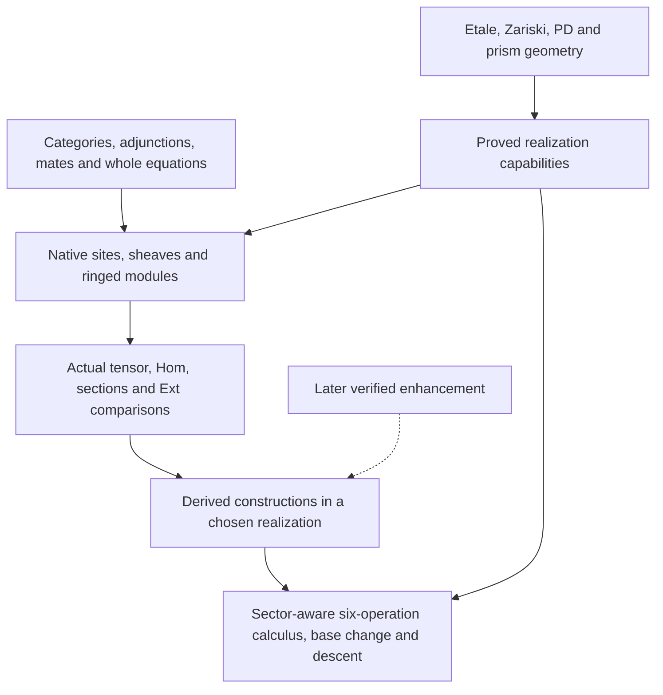

# Shared sheaf and cohomology core: implementation plan

Updated plan, 2026-10-26; research began on 2026-10-25. P1 is complete in its
recorded scope. The user has authorized foundation-first P2–P5 work with
simultaneous thin migration of actual existing consumers. The active foundation
scope is complete with source-bound final native validation. Genuinely new full-six and higher-descent existence packages follow
those foundations with their proof obligations intact. This status update
admits no held C/D intake, changes no pins and authorizes no downstream build
or publication. Original and amendment review scopes remain recorded below.

## 1. Decision and fixed basis

Build a substantial common category/site/ringed-site/derived layer, and make
étale and existing Zariski mathematics its first two real clients. The common
layer must construct the actual functors, adjunctions, transformations, cones,
triangles and whole equations. Geometry then supplies proved site and
geometric inputs and realizes those same constructions. A generic theorem
beside a separately rebuilt Scheme map does not meet this objective. “Thin”
describes formal realization glue; normalization, approximation,
constructibility, cohomological dimension and compactification proofs remain
substantial mathematics in their geometric owners.

Use the current ordinary foundations for the initial implementation. Design
an explicit later enhancement boundary, without making an external infinity
library or a foundation change a prerequisite. Target the complete six
operations and their basic laws now, while recording which operations exist
in each coefficient, boundedness and morphism range. Do not introduce a giant
inferred `SixFunctor` typeclass or count fields asserting desired theorems as
construction progress.

The native research basis is N at
`0ba24db0ca05a863d7d5630834316be36f03b7bf`, Lean 4.34.1 and Mathlib
`d13f23b723b8a846827a245b89c10fc7d3f11612`.
[The brief](../../../RESEARCH_BRIEF.md), [input identities](../../../INPUTS.json) and
[principal outline v0](../../../reports/principal-plan-outline.md) fix the question. The
[inventory](../../../reports/module-inventory.md) counts 928 étale-cohomology, 979 scheme
cohomology and 639 scheme-module source files; these are scoped owner counts,
with overlaps and regex declaration counts retaining the report's meaning.
They are a migration surface, not evidence that every proof is generic.

C and D remain frozen research inputs. C's archive SHA is
`60162ac1e93f022a11968110f31fd734668e455cef06f5175d256c4ba841e4cb`;
its held 160-source candidate includes four later uncompiled repairs. Earlier
successful leaves and ordinary source reviews retain their actual versions;
they do not accept those repairs or complete C1–C4. The current latest-D
input is `exceptional-model-basechange-source-20261025T160854Z`, SHA
`e0a0c786446d69ddd22373d81b44d67e6628d6ba977cffe416a00ed3a029fbd5`,
recovered in [the latest-D report](../../../reports/d-latest-recovery.md).
It has 45 hash/log-matched claimed passing leaves and five current drafts:
`Compactification/{BaseChangeCompatibility,BaseChangeGeometry}`,
`Derived/OpenComparisonCube`, and `ProperOpen/{Comparison,MateNormalization}`
under `EtaleCohomology/Exceptional`. Enclosing batches include successes,
failures and a stale running descriptor.
Exact-byte historical linkage retains the source-owner freeze assertion;
these are not fresh N admission or whole-batch acceptance. Refinement,
compactification independence and coefficient-natural fixed-model base change
are now present as candidate source. The earlier D1458 SHA
`e4a7202c5cb232157b8f1ad0e78bfd6d3e33b06edd990cdf7f1055e92f22ce11`
is historical input, not the latest inventory. Archive directives do not
govern this work; intake remains separate from active P1.

The [released mathematical architecture](../../../reports/six-operations-mathematical-architecture.md),
SHA `ed2ccba3ca3588cd916ad2403b540eda7a9b7d74910f92b9e392e204b6b6c701`,
is incorporated as a research input. The
[independent design review, version 3, §9](../../../reports/independent-design-review.md#9-version-3-final-ordinary-design-review-of-the-fixed-assembled-draft)
accepted the mathematical/design content of the frozen draft
`1f2bd1385007386f4e7189bf6eaa315bfd49783943b901bdcd433e62114065ca`
for presentation, subject to its §9.3 notation, owner and delivery cleanup.
That report has SHA
`f44bcb196dedd9f5b7385fd949ee6c06194c35a97994df0ecee547a582d19868`.
The source/API reports establish available declarations and inspected
constructions, not fresh compilation, implementation acceptance or an
established-status verdict. The subsequent
[base-change/descent amendment](../../../reports/basechange-descent-spine.md)
(SHA `f9fd444ab76bb05444ce0b8536c6ed463a01adeec8d443e5b78e7646f8cbb87a`)
was independently [accepted for incorporation](../../../reports/independent-basechange-descent-review.md),
review SHA `c339fec7a2dbe4b6407e3cb9d8668e378917751034a435c3aab308781f5f5f15`,
with its exact coefficient, boundedness, size and latest-D evidence conditions.
The [downstream survey](../../../reports/motivic-quillen-consumers.md) is
bounded source/API evidence. This assembled revision remains subject to the
principal's correspondence check against those inputs.

## 2. Recommended layers and construction discipline

Keep the base category general: schemes, ringed spaces, PD pairs and prisms
must be possible clients. An indexed family of sites or ringed sites over
that base supplies presentations. Enough points, terminal evaluation,
localization, compactification, completion and finite cohomological dimension
are optional proved capabilities. A missing capability must not prevent use
of unrelated sheaf or derived constructions.

The user's minimal-implementation rule applies to every proof. Prefer
intrinsic objects, universal properties and natural maps in statements. Keep
one selected realization per underlying category, resolution or localization
and reuse it. Ordinary cohomology should use Ext and natural-degree right
derivation when those interfaces suffice. A second realization belongs only
to a genuine comparison or independence obligation at its actual consumer.
Different mathematical categories and necessary base-change paths remain
distinct; routine constructions do not require a universal model-transport
theorem. Concrete entries use a consistent standard choice locally, while
generic leaves retain only the chosen models needed to name their categories.

At the bottom, reuse Mathlib's actual sheaf, sheafification, continuous
pushforward and chosen pullback constructions. Native ringed-site
`SheafOfModules.pushforward`, `pullback` and their adjunction already include
the actual ring map. Their composition laws are the starting implementation,
not assumptions to recreate. [The sheaf API report, §§2–6](../../../reports/sheaf-site-module-api.md)
identifies these constructors and their size/exactness hypotheses.

Above them, centralize actual ring-linear internal Hom, evaluation, currying
and chosen monoidal coherence. Reuse the existing generic sheafified tensor.
Much of the Hom construction and evaluation is currently Scheme-owned and
must be extracted mathematically, including locality and size proofs. An
abstract closed-category instance does not identify the particular Hom and
evaluation used by existing callers.

The derived layer owns localization-based functors, transformations,
operation comparisons, units and homology laws in the selected realizations.
Implementation transport is a separate boundary when a current consumer
requires it. The operation
calculus then owns formal consequences of adjunction, monoidality,
localization and refinement. Geometry supplies the hypotheses making a
canonical comparison invertible or an exceptional adjoint available. A
record may package already-proved capabilities after construction; it may
not ask for `properBaseChange`, refinement invertibility or projection formula
and advertise those fields as a newly constructed realization.

Every migrated interface has a correspondence entry: old constructor, shared
constructor, actual comparison/value equation, whole unit/counit or evaluation
law, and affected consumers. Prefer literal equality when the factorization
is retained. Otherwise prove the specified transport equation. Preserve
square orientations, inverse coefficient comparisons, stage/germ legs and
localization connecting maps. Object isomorphisms alone are insufficient.

## 3. Coefficients, derived ranges and sizes

Recommend the full **unbounded commutative torsion-coefficient-ring** sector
as the initial complete closed six-operation target, for the appropriate
geometric morphism classes. Here “torsion ring” means a unital ring killed by
one positive integer; it need not be finite. The closed derived tensor/Hom
construction and its coherence still require implementation. Keep the broader
arbitrary-ring D+ torsion-homology exchange as a separate operation/property
interface, rather than weakening it to this chosen full-six target.

Fix the first full target concretely: a commutative ring Λ with one positive
integer killing `1`, unbounded derived étale Λ-modules on qcqs schemes, all
pullbacks within that base category, and separated finite-type morphisms as
the admissible `!` class, with base changes within the category. Noetherianity
of Λ and invertibility of its annihilator on the base are not global
assumptions of this target. Preserve any additional hypotheses required by an
actual theorem; constructibility and purity have further conditions of their
own. Other sites may realize only some operations or different ranges.

| Sector | Available or retained scope | Required boundary |
| --- | --- | --- |
| Abelian sheaves | Original `Sheaf.H`, exact site inverse image where proved, ordinary/higher/D+ maps | Independent Ext and site-size hypotheses remain visible |
| Fixed left modules over arbitrary `Ring Λ` | Native constant-coefficient images; additive four-operation direction where existence is proved | No symmetric tensor of two left modules without commutativity or a separate bimodule design |
| Arbitrary-ring D+ with torsion homology | Existing abelian proper exchange; D's separate module claim and shared `IsIsoOn` pattern | No ambient unit/RHom closure or completed exceptional calculus inferred |
| General ringed modules | Native ringed image adjunction | Nonflat pullback requires genuine `Lf*`; constant étale exactness is not inherited |
| Zariski D− | Existing flat-model `derivedPullbackMinus` | Preserve this bounded-above interface and its actual models; do not replace it by an exact D+ pullback |
| Zariski D+ exact-tensor slices | Existing finite-locally-free projection formula and closed-right-adjoint comparisons | Exact tensor by the specified coefficient, not a monoidal structure on all D+ |
| Full unbounded commutative modules | Intended ambient derived tensor/internal Hom | Construct resolutions/localization, evaluation, adjunction and range laws |
| Fixed commutative torsion ring | Recommended full-six ambient target | Prove geometric bounds, exceptional existence and coherence; no automatic full realization |
| Constructible/bounded constructible objects | Retained finiteness outputs with original ring hypotheses | Noetherian finite generation does not imply finite cardinality, finite Tor dimension or dualizability |
| Derived-complete objects | Future completed sector | Construct completion, completed unit/tensor/pullback and preservation separately |

The existing [Zariski D− pullback](../../Aglib/AlgebraicGeometry/Modules/DerivedCategory/Minus/Pullback.lean)
is a real flat-model construction to preserve alongside the D+ and unbounded
interfaces, not a name for the exact constant-coefficient inverse image.

These restrictions exclude false interfaces. For `T=Q/Z`, the identity in
`H⁰ RHom_Z(T,T)` has infinite additive order, and the ambient unit Z is not
torsion. Over `k[ε]/(ε²)`, `Tor_i(k,k)` is nonzero for every i, so degree-zero
objects can have derived tensor unbounded below. D+ is also not generally
closed under internal RHom, even over a field. The mathematical report gives
the explicit arguments; the plan uses them as design constraints.

An intrinsic torsion closed structure would change the unit and Hom: in the
report's rational-localization model these are `Γ(R)` and `Γ(RHom(A,B))`.
That is a separate construction with site and comparison obligations, not
the immediate recommendation and not a replacement for the current additive
torsion API. Likewise, derived completion, Postnikov completeness and
hypercompletion are three different questions.

Keep `Sheaf J (ModuleCat Λ)` distinct from
`SheafOfModules (constantRing J Λ)`. Use their existing equivalence with its
underlying/unit laws. Forgetting coefficients neither preserves injectives in
general nor identifies arbitrary module Ext with abelian Ext: the valid
cohomology comparison is from the original coefficient unit and uses
acyclicity. Preserve the current acyclic-composition branch.

`HasDerivedCategory` is chosen localization data; `HasExt` is a smallness
proposition. Retain separate site-object/Hom, ring, carrier, Ext and the
derived universe actually required by each category. Reuse one selected
model for that category throughout a construction. Do not install a global
standard-model instance or collapse callers' worlds. Existing standard-model
Zariski entries remain exact compatibility adapters. An explicit model change
is proved only when its consumer needs it, with the corresponding Q, shift,
homology, unit and exchange equations. Ordinary composition and base-change
coherence remain obligations for the chosen operations. Large-site Hom can
require an explicit universe lift or smallness comparison.

## 4. Reuse, extraction and exact proposed owners

The [derived API report, §§2–3](../../../reports/derived-cohomology-exceptional-api.md) finds
actual unbounded right derivation from constructed K-injective replacements,
and an existing D+/unbounded comparison with its unit law. Reuse
[UnboundedRightDerived/Grothendieck](../../Aglib/Algebra/Homology/DerivedCategory/UnboundedRightDerived/Grothendieck.lean)
and `PlusComparison`; do not assign K-injective existence again. This does
not supply unbounded proper exchange, derived tensor, sector preservation or
the extraordinary adjoint.

Similarly, [ComparisonPasting](../../Aglib/CategoryTheory/Functor/ComparisonPasting.lean)
already constructs the section/coefficient comparison and whole `CommSq`.
Reuse it, Mathlib `TwoSquare`, mates and existing mate-cube algebra. Do not
introduce another square framework. The following table names the completed P1 owner and active/proposed foundation
owners. Current foundation edits are separate from the immutable baseline
inventory. Their actual status is recorded in §9 and the implementation packets;
a path or interface field does not by itself establish completion.

| Proposed owner | Reuse/source and actual output |
| --- | --- |
| [Completed P1: Comparison/ThreeFactor](../../Aglib/Algebra/Homology/DerivedCategory/RightDerivedFunctorPlus/Comparison/ThreeFactor.lean) | Shared derived comparison and whole unit law from the original composition comparisons and ordinary NatIso; retain the approved caller scope |
| `Aglib/CategoryTheory/Adjunction/Mates/Whole.lean` | Move only purely categorical mate uniqueness/identity/pasting algebra currently under derived base change; keep original constructors |
| `Aglib/Algebra/Category/ModuleCat/Sheaf/ConstantRing/{Presheaf,Equivalence,Images}.lean` | Extract arbitrary-ring conversion from historical `Sites/Torsion/ZMod/Ringed`; construct the actual constant-ring morphism and image/equivalence transport |
| `Aglib/Algebra/Category/ModuleCat/Sheaf/InternalHom/{Basic,Functor,Evaluation,TensorAdjunction}.lean` | Extract actual slice Hom, local linearity, evaluation and currying from Scheme modules and `Invertible/Dual` |
| `Aglib/Algebra/Category/ModuleCat/Sheaf/Tensor/Monoidal/{Associator,Basic,Symmetric}.lean` | Lift the chosen Scheme coherence to the existing generic tensor, preserving its actual maps |
| `Aglib/Algebra/Category/ModuleCat/Sheaf/Pullback/{Tensor,InternalHom}.lean` | Construct canonical comparisons from native adjunction and evaluation; prove tensor coherence and separately scoped Hom invertibility |
| `Aglib/CategoryTheory/Sites/SheafCohomology/Global/Comparison.lean` | Construct intrinsic global-sections/represented-Ext/right-derived families from the actual representing objects and maps |
| `Aglib/CategoryTheory/Sites/SheafCohomology/Terminal/Comparison.lean` | Optional evaluation-at-terminal view, proved when that site presentation has a chosen terminal object; no universal terminal assumption |
| [Held optional model-comparison work](../../../held-model-comparison/RESTORATION.json) | Seven candidate source files and their exact evidence are preserved outside production. Paired arbitrary realizations are not a dependency of the current foundation. |
| [Actual P5 owner: CategoryTheory/Triangulated/LocalizationTriangle](../../Aglib/CategoryTheory/Triangulated/LocalizationTriangle.lean) | Pure localization/triangle factory and specified-arrow normalization, refining the earlier derived-owner proposal; actual D+ and unbounded clients use it |
| `Aglib/CategoryTheory/Functor/RefinementComparison.lean` | Formal refinement maps, orientation, identity/composition and cofiltered comparison coherence; geometry separately proves invertibility |
| `Aglib/Algebra/Homology/DerivedCategory/Monoidal/{Tensor,InternalHom,Closed}.lean` | Genuine later unbounded derived bifunctors, adjunction and coherence, with specified coefficient/range hypotheses |

The ordinary tensor-pullback isomorphism is scoped to a **morphism of ringed
topoi**, or a site presentation with an actual left-exact **set-valued**
inverse image (or its geometric/representably-flat presentation hypotheses)
and the native existence hypotheses.
Continuity alone is insufficient, even with an isomorphic ring comparison.
The [principal's elementary preparation](../../../foundations/tensor-pullback-site-boundary.md)
explains that boundary; it is not a newly closed Lean theorem. Opens preimage
for an actual scheme morphism has the required site property, so this adds no
flatness or Noetherian hypothesis on that scheme morphism. Scalar extension
may remain nonexact while a valid ordinary tensor comparison is invertible;
those are separate facts.

Keep intrinsic global sections separate from a chosen terminal object of a
site presentation. Preserve the original representing constant/free object,
resolution augmentation and coefficient maps. For ringed coefficients, the
representing rank-one module does not make arbitrary coefficient forgetting
strong monoidal. Pure abelian right-derived postcomposition currently inside
`ModuleCoefficients/DerivedGamma` belongs in a lower abelian/derived owner.

The four misplaced Scheme adapters have moved upward, preserving their
declaration names and exact statements:

| Removed lower path under `Sites/SheafCohomology` | Actual canonical geometric owner under `EtaleCohomology` |
| --- | --- |
| `Slice/Etale.lean` | [Cohomology/SliceComparison.lean](../../Aglib/AlgebraicGeometry/EtaleCohomology/Cohomology/SliceComparison.lean) |
| `ModuleCoefficients/Etale.lean` | [Coefficients/Cohomology.lean](../../Aglib/AlgebraicGeometry/EtaleCohomology/Coefficients/Cohomology.lean) |
| `ModuleCoefficients/DerivedEtale.lean` | [Coefficients/DerivedCohomology.lean](../../Aglib/AlgebraicGeometry/EtaleCohomology/Coefficients/DerivedCohomology.lean) |
| `ModuleCoefficients/DerivedEtaleSlice.lean` | [Coefficients/DerivedSliceCohomology.lean](../../Aglib/AlgebraicGeometry/EtaleCohomology/Coefficients/DerivedSliceCohomology.lean) |

Their generic suppliers stay below. All four canonical leaves have native
passes. The exact known-source scan found zero old-path references in R5,
Motivic, Quillen and the latest-D delta; the principal removed the four
forwarders and updated the actual consumer. No generic-facade exception is
needed. Root/topic entry regeneration remains pending at foundation integration.
The [relocation packet's principal decision](../../../foundation-p4/README.md#principal-integration-decision)
supersedes its earlier temporary-forwarder description. The completed core must
have no dependency on Scheme realizations, held archives, notes or research
artifacts.

## 5. Complete six-operation and coherence target

Availability is indexed by a coefficient sector and morphism class. The
initial scheme exceptional target is separated finite-type maps over qcqs
bases, with the precise torsion/D+ or torsion-ring unbounded range of the
chosen theorem. General ringed-site clients do not inherit this geometry.

| Operation/basic property | Shared construction or formal proof | Remaining proof dependency |
| --- | --- | --- |
| `f* ⊣ Rf_*`, or `Lf* ⊣ Rf_*` | Native image adjunction, derived units/counits and triangle identities | Exactness or actual left-derived construction; sizes, resolution and range hypotheses |
| `⊗^L ⊣ RInternalHom` | Actual bifunctors, evaluation/currying, associator/unit/symmetry | Commutative or bimodule sector; genuine derivation and closure |
| Identity/composition | Original composition comparisons, mate identities, pentagons and unit compatibility | Branch-specific composition hypotheses; coherence in the selected realizations and necessary boundary comparisons |
| Ordinary/higher/derived `BC_*` | Mate of the original inverse-image square, single/homology transports, whole horizontal/vertical pasting | Cartesian geometry and sector-specific invertibility; canonical construction itself needs no properness |
| Open/closed localization | Actual short exact sequence and adjunction arrows; complex triangle, localization descent, connecting map, joint detection | Open/closed realization and exactness; the support/right-adjoint triangle is an additional construction |
| `Rf_!` and open/proper normalizations | `Rp_* j_!` plus original refinement maps, inverse comparisons and cocycles | Compactification/refinement geometry and proved refinement invertibility |
| Composition and `BC_!` | Descent through compatible compactifications; open/proper exchange and all unit/pentagon equations | Exact geometric/coefficient range; choice independence |
| `Rf_! ⊣ f^!` and trace | Apply a valid adjoint theorem after proving preservation; trace is the actual counit | Suitable unbounded ambient category and coproduct/colimit proof, not Brown applied to all D+ or bounded constructibles |
| Projection formula | Construct canonical map from adjunction and monoidality; prove dualizable-input case once | Extension to unrestricted coefficients needs geometry, generators or colimits |
| Relative duality | Tensor-Hom adjunction plus image adjunctions and projection formula identify the original map | Every operation must land in the stated sectors |
| Purity, twists, absolute duality/biduality | Canonical classes, trace compatibility and dualizing-object comparisons | Smooth/regular geometry, characteristic/Tor/finiteness and biduality theorems |

For a refinement `a:C→D`, retain the original orientation
`F(D)→F(C)` and the unit-defined map
`j_D!K→Ra_*j_C!K`. Prove invertibility from the actual mate-unit equation,
proper exchange, complement vanishing and open/closed detection. Then prove
identity/composition, independence of common refinement and the composition
pentagon. Common-refinement existence alone does not establish independence;
Latest D already contains candidate refinement invertibility, canonical
compactification comparisons and a torsion-valued D+ exceptional image.
Its `moduleNormalizedCompactificationBaseChangeIso` is already a NatIso in
the coefficient complex for a specified dense compactification, base map and
explicit derived models. The
remaining problem is compatibility as those choices and squares vary, plus
full exceptional composition, identity, normalizations and pasting. Preserve
its existing progress; do not rebuild an unrelated endpoint isomorphism.

The correct right-adjoint mate of `BC_!` is
`Rg'_* f'^! ≅ f^! Rg_*`. Do not list unrestricted
`g'^* f^! ≅ f'^! g*` as a basic isomorphism. Similarly, the canonical
`f*B ⊗ f^!C → f^!(B ⊗ C)` is formally invertible for suitable dualizable B,
not for all B merely because adjoints exist. Construction, formal consequence
and geometric isomorphism must remain separate rows in implementation reports.

The classical dependency route is supported by Stacks
[Tag 0F7H, §63.9](https://stacks.math.columbia.edu/tag/0F7H) for compactification
descent, [Tag 0A5I, Lemmas 59.92.2–3](https://stacks.math.columbia.edu/tag/0A5I)
for the unbounded proper-bound route, and
[Tags 0G28](https://stacks.math.columbia.edu/tag/0G28) and
[0G2B](https://stacks.math.columbia.edu/tag/0G2B) for coproducts and the
exceptional right adjoint. These are proof routes with hypotheses; current
curve vanishing does not supply the missing general relative bound.

### Base change: construction, correspondence, invertibility and coherence

For the square with `f:X→Y`, `g:Y′→Y`, `f′:X′→Y′`, `g′:X′→X`, fix the
actual inverse-image comparison `α:f′*g*≅g′*f*`. In conventional
right-to-left notation the ordinary exchange is the specified composite

`g*f_* → f′_*f′*g*f_* → f′_*g′*f*f_* → f′_*g′*`,

using the f′ unit, α and the f counit. Derived structural coefficients use
actual `Lf*`. Reuse mates, `TwoSquare` and `ComparisonPasting`, and identify
this map with every legacy exchange before proving Beck–Chevalley. A partial
mate of an isomorphism need not be invertible: the transpose of `id_(LX)` is
an adjunction unit, which need not be an isomorphism. Construction of a square
therefore does not prove its exchange invertible.

| Beck–Chevalley range | Exact condition retained |
| --- | --- |
| Slice/étale restriction and finite images | Use the original localization/finite theorem with its actual coefficients and ring comparison; a Cartesian square alone is insufficient |
| Derived versus higher images | `g*R^qf_*` describes homology only in the exact-pullback branch with its single/homology comparisons; all-degree conservativity concerns the same fixed derived map |
| Étale proper | Preserve arbitrary-ring D+ internally torsion cohomology; the torsion-ring unbounded upgrade still requires P7's relative bounds/computation |
| Étale smooth | Smooth base map g, qcqs f and geometric-stalk torsion orders invertible on the base; flatness is not a substitute ([Tag 0EYU, Theorem 59.89.2](https://stacks.math.columbia.edu/tag/0EYU)) |
| Zariski flat/derived | Flat g, qcqs f and quasi-coherent F for higher images; qcqs f, a Tor-independent square and `E∈D_QCoh` for derived BC ([02KE](https://stacks.math.columbia.edu/tag/02KE), [08ET](https://stacks.math.columbia.edu/tag/08ET)) |
| Compact-support/model transport | Fixed-model coefficient-natural pieces exist in latest D; choice-compatible geometric `BC_!`, its full pasting and sector preservation remain separate obligations |

For each constructed exchange prove identity, horizontal and vertical
pasting, iterated/reassociated pasting, unit/counit and coefficient/scalar,
site-presentation and derived-model cube equations. Add compatibility with
the actual tensor, closed-Hom and projection maps at their proved amplitude
range. For exceptional images also prove refinement/densification and
proper/open-normalization compatibility. These equations are not fields
assuming invertibility. Full right-adjoint transposition of `BC_!` preserves
an isomorphism where the adjoints exist; it gives the mixed-variance mate in
§5, not unrestricted upper-shriek pullback exchange.

### Five descent strata and the actual totalization

| Stratum | Required output | Insufficient substitute |
| --- | --- | --- |
| Ordinary object/morphism descent | Actual restriction to overlap/cocycle data, fully faithful and essentially surjective as appropriate | A sheaf of isomorphism classes or object gluing alone |
| Cohomological Čech/hypercover descent | Original augmentation/unit quasi-isomorphism and a correctly modeled derived totalization | Ordinary sections on nonacyclic intersections, or only a nerve/finite 1-hypercover |
| Enhanced category descent | An actual enhanced diagram and category-limit equivalence, including mapping objects and coherence | A 2-limit of triangulated categories or degreewise cohomology |
| Descent of operations | Coherent exchange transformations between descent diagrams, inducing the original functors, adjunctions and comparisons on limits | Category descent plus unrelated levelwise isomorphisms |
| Compactification choice independence | Cofiltered refinements, transition isomorphisms and identity/cocycle/common-refinement laws | Cover descent; choice independence does not prove hyperdescent either |

Mathlib's ordinary `IsPrestackFor`/`IsStackFor` describes the first row through
`toDescentData`. Even bounded derived objects require care: in the derived
category of **sheaves of k-modules** on the circle,
`Hom_D(k,k[1])=H¹(S¹,k)=k`, while these morphisms restrict to zero on
contractible arcs. Naive ordinary-category descent loses the mapping homotopies.
Global D+ bounds also do not glue across unrestricted infinite covers: on
`⊔ Spec k`, the local objects `Λ[n]` have no common lower bound. Use a common
bound, a justified finite refinement or a genuinely locally bounded category.
This example is not the initial qcqs exceptional base itself.

Retain the positive theorem: for a site with fiber products and an actual
hypercover, the unit `E→Ra_*a⁻¹E` and derived-global-section comparison hold
for **all unbounded abelian complexes**; the cartesian-cohomology
essential-image equivalence is separately D+
([Tag 09X8, Lemmas 85.21.1–4](https://stacks.math.columbia.edu/tag/09X8)).
Do not turn that unbounded unit theorem into an unbounded cartesian
essential-image equivalence.
The proof uses the actual free-abelian resolution, augmentation, K-injectives
and product total complexes ([Tag 0D8G](https://stacks.math.columbia.edu/tag/0D8G));
no enough-points hypothesis is introduced. Module transport needs its own
ring/underlying comparison; nonexact ringed pullback is not that `a⁻¹`.
Uniformly bounded-below diagonals support the usual convergent spectral
sequence. Unbounded product totalization and its augmentation theorem do
not assert every spectral-sequence convergence statement ([Tag 0D76](https://stacks.math.columbia.edu/tag/0D76)).

Reuse existing Čech nerves/cochains, represented hypercohomology and the
first-quadrant total-complex results, but respect their actual types.
`PreOneHypercover` is levels 0/1; finite-hypercover sheaf-colimit results are
not cohomological hyperdescent. Derived Čech terms cannot be replaced by
ordinary sections without acyclicity. Enhanced descent separately requires
its actual enhancement, cover class, sizes and limit-preservation criterion.
Liu–Zheng v4 §§9.2–9.4 provides range-sensitive route references; resolve its
recorded general-stack affine-test notation issue before any literal import.
No guessed correction or all-site hyperdescent theorem is adopted here.

## 6. Whole-family migration and retention

The refactor covers the full subject through coherent slices, not a single
mass move of 928 files. The inventory's import graph selects actual affected
closures. Keep hard geometric proofs and previously published results while
changing their reusable formal inputs.

| Family/client | Shared construction to migrate | Mathematics retained in its owner and compatibility obligation |
| --- | --- | --- |
| Sheaves, coefficients, ordinary images | Native categories, constant bridge, image adjunctions and scalar maps | Actual étale/Zariski sites, structural rings, flatness/exactness and original units |
| Ext/global cohomology and derived images | Represented-Ext/sections factories, composition and normalization in the selected realizations | Original `Sheaf.H`, resolution/cocycle formulas, all independent worlds |
| Points, stalks and higher exchange | Generic point/germ functors, comparison families and whole pasting | Actual geometric-point conservativity, marked neighborhoods, coefficient inverse square and original germs |
| H0/H1, Kummer, Picard, Artin–Schreier and strictly local inputs | Original coefficient sequences, torsor/Ext comparisons and their natural maps | Henselian, root/level, characteristic, field and regularity hypotheses remain attached to their actual geometric theorems |
| Continuity and filtered presentations | Coherent coefficient-system diagrams, cofinality, exact-colimit and dimension-shift constructions | Finite-presentation/limit geometry, degree-zero continuity and injective-colimit acyclicity; AB5 alone is insufficient |
| Constructibility and finite images | Generic closure/descent/image and object-property transport | C's finite-module ring hypotheses, partitions, splitting geometry and finite-lfp conditions; no finite-group substitution |
| Finiteness, vanishing, curves and fields | Original localization, exactness and devissage constructions | C's actual curve/primary/H1 bounds, normalization, field and compactification arguments; no general 2d/SBC conclusion |
| Finite/proper/smooth comparison | Same canonical mate/higher map and formal reductions | Published torsion proper BC stays available; finite geometry and future smooth affine-line theorem remain genuine inputs |
| Open extension/localization | Actual lower shriek, complex/derived triangle and detection | Site/open equivalence, support and geometric exact sequence |
| Exceptional refinement and latest D | Whole object property, unit-defined refinement, independence and coefficient-natural model BC candidates | Reconcile 45 claimed passing sources, five current draft dependencies, geometric-choice compatibility and full calculus; no native admission inferred |
| Zariski modules/cohomology/duality | Same ringed constructors, actual Hom/evaluation, derived comparison and restricted projection formula | Existing D− pullback, quasicoherent/coherent/perfect conditions, formal functions, projective/relative duality |
| Étale quasicoherent/structure coefficients | Original change-of-topology, scalar and Zariski-module comparison families | Affine vanishing and quasicoherence hypotheses; preserve the actual Zariski comparison rather than create another cohomology carrier |
| C formal completion samples | Functor-to-limit unit and finite-additive/universal-kernel transport | Actual scalar/stage isomorphisms, Noetherian/open hypotheses and finite local freeness; held repairs remain held |

This includes both C and D without accepting their entire archives. Select
exact sources for each later slice, reconcile changed current-main interfaces,
and keep old alternate PBC drafts outside production. Existing Zariski
projective duality and completion APIs are consumers to preserve, not blank
future work to replace.

## 7. Multiple sites and the enhancement boundary

### Big sites and presentation changes

Use a capability matrix rather than one étale-shaped site record. Support big
sites directly: `C:Type uC` with `Category.{vC} C`, topology J, and separate
ring/carrier, cover-index, Ext-smallness and chosen-derived-model universes.
A universe-bounded `Scheme.{u}` or `Over S` is legitimate; all schemes in all
universes are not one such type. State needed sums/products, Kan extensions,
sheafification and Grothendieck/injective hypotheses at those sizes.

Pinned big Zariski, étale and pro-étale topologies are actual inputs, alongside
small-site and affine-basis APIs. A realization must prove its small-basis,
essential-smallness or other adequate existence result; conditional
`HasSheafify` is not universal existence. Transport the original units,
exchanges, cohomology and descent augmentations through proved presentation
comparisons. Big/small restriction is not universally an equivalence: over
`Spec F_p`, big representables for A¹ and p disjoint points agree on the small
Zariski site but differ on a dual-number test. The actual affine-small-étale
and affine-Zariski basis equivalences retain their coefficient hypotheses.
See the [big-site API ledger](../../../reports/basechange-descent-api.md#added-big-site-common-language-survey).

| Client | Shared part and current availability | Separate obligations before more operations |
| --- | --- | --- |
| Étale constant coefficients | Existing site, exact images, points, Ext, derived images and published torsion proper BC | Smooth comparison, general dimension/constructibility bounds, exceptional gluing and purity |
| Zariski structural modules | Existing ringed images, D− pullback, tensor/Hom, D+ exact-tensor projection and duality clients | Tor/range hypotheses, coherent base change, sector-preserving exceptional theory |
| fpqc quasi-coherent modules | Existing ordinary module descent and scalar transitions | Effective descent has its precise quasi-coherent range; enhanced/bounded derived descent is additional work ([023R](https://stacks.math.columbia.edu/tag/023R)) |
| Pro-étale | Pinned Mathlib has actual big/relative `Proetale` sites and initial ℓ-adic objects | Size/repleteness, complete/constructible coefficients, étale comparison and operation-preservation ranges |
| Crystalline over PD bases | Reusable ordinary ringed-site/derived layer; divided-power algebra exists | Actual PD site and base functoriality, crystals as invertible transition maps, p-nilpotence, Frobenius and geometric comparison |
| Prismatic over bounded prisms | Future ringed-site and derived-complete modules, completed tensor/pullback | Prism/δ geometry, derived `(p,I)` completion, crystals/Frobenius, smooth p-adic formal range and comparison theorems |

Two tests constrain the Zariski realization. Structural-module proper base
change for the self-square of `Spec F_p→Spec Z` would compare
`F_p⊗_Z^L F_p` with `F_p`; the Tor term prevents the unrestricted isomorphism.
Ordinary sheaf extension by zero of `O_D(t)` inside `Spec k[t]` is not
quasicoherent. Thus `D_qc` does not inherit the étale compactification recipe.
Keep its genuine duality and sector-preservation theorems separate.

Completion is a useful shared future layer with its own mathematics:
[Stacks Tag 0995, Lemma 52.6.5, Proposition 52.6.12, Remark 52.6.15 and
Lemma 52.6.18](https://stacks.math.columbia.edu/tag/0995) give precise complete
Hom, completed tensor and pullback targets. Crystals require actual transition
isomorphisms ([Tag 07IS, Definition 60.11.1](https://stacks.math.columbia.edu/tag/07IS));
PD site/functoriality conditions remain at Tags 07IF/07IC/07IK. These are
capabilities to prove, not decorative fields.

Geometric hyperdescent is capability-specific. Integral crystalline cohomology
cannot inherit arbitrary proper hypercover descent from étale theory:
Frobenius on P¹/F_p acts by p on its degree-two Z_p cohomology. This is the
first example in [de Jong's primary note, 2012-03-03](https://www.math.columbia.edu/~dejong/wordpress/?p=2201).
It does not contradict site-level descent for hypercovers of the chosen
crystalline topology.

For prisms, Bhatt–Scholze's
[Theorem 1.8 and §4, arXiv v4](https://arxiv.org/abs/1905.08229v4) concern
bounded prisms and smooth p-adic formal schemes, with completed base change
and additional hypotheses for comparisons. They do not supply an arbitrary
prismatic six-operation package. For pro-étale coefficients, their
[2014 v2, §§3.3, 5.3 and 6.7](https://arxiv.org/abs/1309.1198v2) distinguishes
repleteness, left completion and adic/constructible operation ranges.

Reserve enhancement as a separately approved milestone. The immediate target
is explicit ordinary natural transformations, pseudofunctor laws, mates and
pentagons. A stable coefficient category of sheaves of spectra is not itself
an infinity-topos. A genuine enhanced correspondence functor needs an actual
model, mapping-space/coherence foundations and an ordinary-shadow comparison;
triangulated data do not automatically recover it. Liu–Zheng
[v4, §§3.1–3.5, 6.1–6.4, 7 and 9](https://arxiv.org/abs/1211.5948v4) is a
route reference with distinct torsion, Artin-stack, constructible and adic
hypotheses. Lurie's [HA, Proposition 1.3.5.21 and Warning 1.3.5.22](https://www.math.ias.edu/~lurie/papers/HA.pdf)
also prevents equating presentability with every completeness property.

The inspected Infinity Cosmos revision
`545d64b7a132566505c58c8486b172e99aa51af4` has genuine cosmos/quasicategory
code, but uses Lean 4.34.0-rc1 and Mathlib `1fe0a51a...`, not this project's
pins. Its `warn.sorry=false` setting means warning-free output would not
establish transitive proof closure. The source investigation is not adoption,
compatibility or axiom-audit evidence. Keep all dependencies and foundations
unchanged; an external-library experiment requires its own later bounded
approval. Metadata and exact inspected scope are in
[the primary-source report](../../../reports/primary-sources-and-formalization.md) and
[verified bibliography](../../../reports/primary-sources.bib).

### Downstream Motivic and Quillen consumers

The [52-source/16-mapping survey](../../../reports/motivic-quillen-consumers.md)
is source/API evidence, not a downstream build or a new proof verdict.
Keep actual checkout heads, R5 pins and each library's own Aglib dependency
separate:

| Library | Inspected HEAD | R5 pin and correspondence | Own Aglib pin |
| --- | --- | --- | --- |
| Motivic | `bf031c5c9790dbb23c72604b1862e4a4716507c6` | `be8e17f5286874bd44942f796b96860b4b924993`; three intervening commits change docs/scripts, so inspected Lean/configuration bytes match the pin, not runtime state | `2c34f185fa859e862661f939cd216b07bcccfb26` |
| Quillen | `c73a12d54e59297d8acf3a7f0046fcf87e5f0ebb` | `778bbb81b9fb449e49452a98ea0f8b0c26e6fdb5` is absent locally; no pin-byte correspondence claimed | `40af743ab794d607f566cec0c5417d8e4d02a735` |

Both live libraries use Mathlib `d13f23...`, but their Aglib pins differ from
each other and N. Quillen's recorded dirty files are documentation/tooling,
not Lean sources. No pin upgrade, recovery fetch, downstream validation or
compatibility certification follows from this survey.

The dependency direction is common Mathlib/Aglib constructions → geometric
realizations → Motivic/Quillen adapters → application endpoints. Keep finite
correspondences, A1/stabilization, exact/perfect/Waldhausen and K-theory
structure above the common language.

| Actual consumer | Shared mechanism and application boundary |
| --- | --- |
| Quillen `DerivedOpenBaseChange.lean:41,55` | A real three-factor comparison and original unit law, for an open base-change leg and arbitrary direct image. It is a later compatibility target, not another current P1 caller |
| Motivic Nisnevich site restriction/sheafification | The actual comparison and sheafification-unit equation, with affine-base/right-Kan hypotheses. Transfer-preserving sheafification additionally needs its finite-correspondence action, additivity and descent proofs |
| Motivic finite coefficients and strict A1 | Finite coefficients are literally `cone(n·id)`; no derived-tensor identification is supplied. Strict A1 retains perfect-field, transfers, coefficient homotopy invariance and Ext hypotheses; A1 localization/Tate or P1 stabilization is separate |
| Quillen finite-flat/perfect image and open gluing | Preserve bounded finite-locally-free, stated locally-Noetherian/finite-flat and Waldhausen exactness hypotheses. Extended sheaf terms need not individually stay perfect; K-theory localization/cofinality remains application work |
| Quillen stable-group localization | An actual categorical localization at stable equivalences exists; it is not thereby a stable model structure, stable infinity-category or spectral-sheaf six-operation package |

Later bounded application adapters can reuse the common comparison/unit,
sheafification and square-descent constructors after version reconciliation.
They must retain signed complexes, coefficient actions, perfectness and actual
K-boundary maps. No arbitrary K-theory hyperdescent or stabilized-motive
construction is inferred, and no downstream build is added to the active
in-package P1 checks.

## 8. Completed first pilot: three factors, two real clients

P1 is complete at its recorded five-origin/three-terminal scope: the shared
D+ comparison, three original callers and the value-law mate consumer have
matching compilation, ordinary source/mathematical review and completed
scoped native checks. The [result record](../../../RESEARCH_RESULT.json)
retains exact sources, commands and coverage. The
[matched case](../performance/right-derived-three-factor-comparisons.md)
contains two single-observation file/version comparisons under the same pinned
setup. P1 completion and those observations do not establish a whole-library
speedup or acceptance of later changed dependencies. Let `F:A→B`, `G:B→D`, `H:A→C`, `I:C→D` be the actual
additive functors and let `e:F⋙G≅H⋙I` be the original ordinary NatIso. The
existing canonical composition comparison has direction
`R(F⋙G)→RF⋙RG`. Prove its invertibility with the applicable existing branch:
preservation of homology, preservation of injectives, or acyclicity of the
original injective images. These are distinct sufficient conditions.

Construct

`Φ = c_FG⁻¹ ≪≫ R(e) ≪≫ c_HI : RF⋙RG ≅ RH⋙RI`.

The generic output must include the **whole** natural-transformation equation
with the existing composition reassociations:

`η_FG ≫ (Q_A ◁ Φ.hom) = (mapComplex(e).hom ▷ Q_D) ≫ η_HI`.

Its value on an actual complex K is

`η_FG(K) ≫ Φ.hom(QK) = Q(mapComplex(e).hom(K)) ≫ η_HI(K)`.

Here `η_FG` is the installed composite unit
`rightDerivedFunctorPlusCompUnit F G`, distinct from the installed
right-derived unit of `F⋙G`; the same convention applies to `η_HI`.
The comparisons and units are the original ones. The producer receives
ordinary functors, e and proved branch hypotheses; it does not ask
the realization for Φ or this target equation. A native comparison made by
`rightDerivedUnique` is matched by its original unit/uniqueness law before
any claim of literal constructor equality.

Use the existing étale
[scalar-forgetting comparison](../../Aglib/AlgebraicGeometry/EtaleCohomology/Exceptional/Derived/Underlying.lean)
and Zariski
[projection formula](../../Aglib/AlgebraicGeometry/Cohomology/ProjectionFormula/Basic.lean)
as the first actual consumers. The former must retain its acyclicity branch;
the latter retains its finite-locally-free coefficient and local standard
models. The existing
[closed-right-adjoint open comparison](../../Aglib/AlgebraicGeometry/Cohomology/ClosedImmersion/RightAdjoint.lean)
is a small third consumer exercising different branches. Preserve their old
public definitions, map equations and units through compatibility adapters.

Pilot success means both real sectors consume the same constructed Φ and
whole law, with no new premise, hidden model identification or reconstructed
local three-factor definition. Compile changed owners and the actual affected in-package caller closure,
including original-value-law compatibility consumers, under the normal workflow. Record matched source/profile
costs after a valid baseline exists. A generic-only pass, synthetic mock site
or a theorem about two rebuilt maps is insufficient. If conversion is worse,
retain the old caller and revise this boundary before expanding the migration.

## 9. Active foundations and subsequent dependency order

| Package | Concrete output and dependencies | Completion boundary |
| --- | --- | --- |
| P0: approved source/map contracts | Fix sectors, actual constructors, old APIs, worlds and matched consumer inputs from this research | Principal-approved implementation scope; C/D remain separately identified |
| P1: completed derived pilot | `Comparison/ThreeFactor`, original unit law, étale and Zariski callers | Same actual maps and caller closure; assess measured cost without a fabricated ratio |
| P2: active constant-ring bridge | General constant ring/map/equivalence/image construction using existing native ringed APIs | Whole units, counits, composition and old-carrier value laws; arbitrary Ring scope retained |
| P3: active Hom and monoidal foundation | Actual ring-linear Hom/evaluation/currying; chosen tensor coherence; pullback comparisons | Size proofs and both clients; Hom invertibility retains its source hypotheses |
| P4: ownership and intrinsic cohomology | Intrinsic Global comparison, optional Terminal evaluation, Ext/right-derived families, four upward moves and native square laws | Original maps, units, degree-zero values and necessary universes preserved; one realization per category, with existing direct compatibility proofs retained |
| P5: active continuity/localization foundation | Actual compatible diagrams, colimit comparisons and complex/derived triangle producer | Original connecting maps and acyclicity inputs; D+/unbounded triangle comparison |
| P6: D+ torsion refinement/gluing | Reconcile latest-D refinement/independence/torsion-valued and fixed-model BC candidates; retain their existing laws | Finish the five current drafts and full geometric-choice/composition/normalization/pasting compatibility; actual admission is separate, and no unbounded use occurs yet |
| P7: full unbounded target | Reuse right derivation; construct monoidal derived theory, relative bounds, unbounded proper exchange, colimits and exceptional adjoint | Actual full-six operations/coherences in the chosen torsion-ring sector; no D+ shortcut |
| P8: broad migration/extensions | Coherent DAG slices of C/D and existing geometric families; later completion/site/enhancement clients | Each capability and preservation theorem proved before activation |

### Current foundation scope and evidence boundary

Foundation construction and actual existing-result migration proceed together
in each coherent slice; the consumer migration is not all deferred to P8.
[RESEARCH_RESULT.json](../../../RESEARCH_RESULT.json) retains completed P1
coverage and the active foundation authorization. The following distinctions
are deliberate; the final native validation is recorded in the
[completed integration report](../../../foundations/final-integration-report.md).

| Slice | Current bounded status |
| --- | --- |
| P2 | The frozen nineteen-source constant-ring/image/underlying bridge, native units and composition, and actual Coefficients/Open/Constructible consumers are [independently accepted](../../../foundation-p2/independent-review.md). The additional [RingCat pullback branch](../../../foundation-p2/ring-pullback-plan.md) retains explicit terminal-presentation data and its separate source/evidence boundary. |
| P3a | Generic Hom and seven-source Zariski realization are accepted by [ordinary review](../../../foundation-p3/internal-hom-independent-review.md). The output carrier is `max uC vC uM`, with ring universe uR independent; historical leaf passes retain their actual input/provenance limits, and no arbitrary same-uM closedness follows |
| P3b | The chosen monoidal/symmetric construction and actual Scheme Sections consumer have native closure and [independent acceptance](../../../foundation-p3/tensor-coherence-independent-review.md). The generic construction retains `W.IsMonoidal`; its module/ring carrier sector is shared, with independent site object/Hom worlds. |
| P3c | Actual evaluation, right-tensor currying and tensor stability in the explicit carrier `max uC vC r`, together with the original Dual, LocalIso and Scheme monoidal consumers, have native closure and [independent acceptance](../../../foundation-p3/evaluation-independent-review.md). Plain Hom retains its independent ring/module worlds. |
| P3d | Native ringed-slice restriction, original-unit Hom comparison and canonical binary tensor pullback inversion, together with both original Scheme consumers, have native closure and [independent complex acceptance](../../../foundation-p3/pullback-independent-review.md). Their actual product, continuity and native-adjoint conditions remain explicit; no extra Scheme-flatness premise is added. |
| P4 | Four geometric relocations have native passes and old unused forwarders are removed. Pure mates and additive postcomposition have lower owners. Global/optional-Terminal/Ext and original-value consumers are [independently accepted](../../../foundation-p4/global-independent-review.md). The direct baseline ModelTransport proof is restored byte-for-byte, retaining its old four-output interface without a simultaneous reference-model cube. Its direct proof has a matching post-migration native pass; final integrated checks remain separate. |
| P5 | The pure [triangle factory](../../../foundations/localization-plan.md) and D+/unbounded clients have native closure and [independent acceptance](../../../foundations/localization-independent-review.md). The [represented Ext diagram and actual étale consumers](../../../foundation-p5/continuity-result.md) also have native closure and [independent acceptance](../../../foundation-p5/continuity-independent-review.md), preserving original maps and Ext worlds. |

These are scoped constructions and observations, not completion claims from
field counts, new global assumptions or adoption of the held C/D archives.
Successful leaves in failed mixed cohorts are not a whole-foundation pass.
Mathematical and native evidence retain their separate boundaries. The active
scope has completed entry/source guards, production and three existing tests,
text style on 91 origins, 15 declaration linters, 21 builtin terminal bindings
and the native AX3 audit of 14,854 declarations. Builtin environment registries
were empty where reported; this is not nonempty environment-linter coverage.
The additional RingCat terminal-presentation branch is separately accepted
under its explicit conditions.

The optional eight-record experiment has been removed from active imports
after verified preservation in [the held inventory](../../../held-model-comparison/inventory.json).
Its passing generic leaves, failed concrete specializations and uncompiled
last candidate retain their original evidence status. No completion of a
model-change pseudofunctor or unbounded model coherence is claimed. Current
proofs follow the minimal-implementation rule above.

The following are cross-cutting milestones attached to these phases, not
seven new immediate implementation packages. P1 needs no new proper/smooth/
flat theorem, hypercover, totalization or enhancement. Latest D's
`derivedMate_eq_derivedIso` identifies a supplied comparison with the original
mate; it complements P1's factory rather than replacing or expanding it.

| Milestone | Existing phase connection | Acceptance output |
| --- | --- | --- |
| BC0 | [P0/P2/P4](#9-active-foundations-and-subsequent-dependency-order) | Exact square/map, sector, small/big presentation, units and sizes; construction separated from invertibility |
| BC1 | [P1 then P4](#9-active-foundations-and-subsequent-dependency-order) | Factory/unit and original-mate equality, including scalar/model/site comparisons |
| BC2 | [P4/P5; P7 for unbounded use](#9-active-foundations-and-subsequent-dependency-order) | Exact-map geometric BC with h/v/identity/iterated, transport and tensor/PF equations in its stated range |
| D0 | [P2/P5](#9-active-foundations-and-subsequent-dependency-order) | Actual ordinary restriction/descent equivalence and literal Čech/augmentation maps |
| D1 | [P4/P5, coordinated with P7](#9-active-foundations-and-subsequent-dependency-order) | Full resolution and augmentation quasi-isomorphism with the chosen total-site/product-total model; module transport and convergence separately proved |
| BC! | [P6; P7 for unbounded use](#9-active-foundations-and-subsequent-dependency-order) | Recovered fixed-model pieces become a geometric-choice-compatible exceptional family with full normalization and pasting |
| D2 | [P8 enhancement/application work](#9-active-foundations-and-subsequent-dependency-order) | Actual enhanced category descent and coherent descended operations, with original ordinary shadows; no inference from `IsStack` alone |

A noncircular order is site resolution/totalization → cohomological descent;
original mates plus geometric proper/smooth/flat inputs → Beck–Chevalley;
these supply compatible operation diagrams. Proper/open exchange and
refinement laws supply compactification calculus. Actual enhanced descent
then descends those operations. Do not use the desired exceptional exchange
to supply the proper exchange on which its own construction depends.

P1 has fixed the shared-constructor discipline in its accepted range.
P2–P5 are now active foundation-first slices, each paired with actual existing
consumers and exact original-map laws. Dependent callers wait for their actual
inputs; compatible P1 evidence is retained and only affected dependencies or
coverage gaps are rechecked. Do not merge held intakes to obtain source.
C/D adoption remains separate. High-dimensional bounds and genuinely absent
full-six/higher-descent existence still follow the foundations as real proof
packages, rather than being removed by this execution order.

P6 is explicitly limited to bounded-below torsion compactification,
refinement and gluing. Its unbounded use waits for P7's actual relative bounds,
unbounded proper exchange and corresponding range/composition proofs.
Unbounded K-injective right derivation already exists and is reused at that
stage; rebuilding it is not a prerequisite package. The first full-six sector
is the uniform-torsion-ring target fixed in §3, not a rebranding of the broader
arbitrary-ring D+ partial interface.

## 10. Performance evidence and acceptance

The [compiler report](../../../reports/compiler-boundaries.md) retains eight distinct cases:

| Evidence | What it supports and what it does not |
| --- | --- |
| Whole PBC section/transfer | Shared actual value and whole law before eight-model specialization; changed failed/passing graphs give no speed ratio |
| Indexed germs and exact Ext | Whole law at variable pointed object, then evaluation; name collisions and projected dictionaries remain separate API fixes |
| Private witness/simp rule | Subtype and generic-family representations regressed; retained constructor plus `[simp↓]` succeeded, excluding a blanket generic-record heuristic |
| 83 GB checker phases | Repeated environment import was tooling overhead; header cache/fewer jobs alone failed; no proof-language speedup follows |
| C initial batch | 174 of 175 frontends succeeded; a namespace error was not a mathematical or abstraction-performance failure |
| C scalar/Hom/vector completion | Genuine Zariski carrier/unit/tower boundaries coexist with missing API inputs; later repairs have no matching native pass |
| Historical D1458 shared `IsIsoOn` | Same regular object-property head helped that caller; profiles/versions are not controlled comparisons, and later recovery is a separate source phase |
| Historical D1458 refinement | That snapshot failed refinement. Latest D subsequently supplies refinement/independence and model BC candidates; five current drafts and full geometric coherence remain separately identified |

The profiles differ materially: PBC proof work generally used jobs16/threads2,
C jobs8/threads4, and the historical D1458 receipts used one active Lean with different
memory limits despite echoed wrapper arguments. Preserve these distinctions,
existing local allowances, and complete source/run identities. No higher
formalism or enlarged parameter record has a free speed benefit.

For each approved slice, verify the actual primitive-to-constructor proof,
old/new whole map correspondence, model/universe scope and dependency layer.
Run the existing incremental build on changed owners and real affected
in-package consumers; reuse compatible cached evidence. At coherent final
boundaries retain source policy, native text checks, all configured declaration
predicates including private/generated declarations, actual axiom closure and
scope-correct builtin checks. An empty native environment registry is not a
nonempty linter pass. Add no global budget raise, suppression, kernel replay,
separate client test or certification chain.

Use the normal layout/import checks to keep generic owners independent of
Scheme and research artifacts. Retain exact temporary compatibility exceptions
with consumers and removal criteria. A slice is not accepted merely because
files moved, a build passed or an interface record typechecks: its construction
and original-map obligations must also be discharged. Source and performance
review do not assign established exposé status.

Keep a rollback boundary per owner/client slice. Preserve the old implementation
behind a temporary compatibility adapter until its actual consumers close;
serialize index/HEAD work and preserve foreign changes. If a slice introduces
a new premise, changes a canonical map, loses a universe/model parameter,
creates an import cycle or transfers unexplained cost to a caller, stop that
dependent slice, retain the concrete evidence and return the mathematical or
construction obligation to its owner. Independent slices may continue.

The scoped foundation constructions and thin existing-result migrations are
implemented in their recorded ranges. Final integration checked the actual
upper consumers and native source, test, lint and axiom closures, retaining
compatible successes; the source-bound final result is complete. The optional paired-model experiment
is outside this active dependency graph. Hom size bounds and chosen tensor
coherence retain the exact sectors recorded above. Subsequent work must prove P6's
bounded-below torsion range and refinement
gluing from the latest recovered candidates; supply P7's actual relative
bounds, unbounded exchange, closed operations and exceptional adjoint; and
construct the selected D0/D1/D2 descent models and their original-map laws. The full-six sector, base and admissible
classes are already selected in §3. Realization and preservation proofs for
that selection remain work, not assumed conclusions. The original plan and the mathematical amendment have their source-bound
independent reviews. The current assembly must retain those exact conditions;
its correspondence is checked separately from code/native acceptance.

The user has authorized abstract foundations first, with simultaneous thin
migration of existing results. P1 and the active P2–P5 foundation scope are complete
under the principal's source/check ownership. The genuinely new full-six,
higher-descent and application-existence packages retain their subsequent
proof and realization conditions. No archive-wide adoption, pin change,
downstream build or push follows from this status update; no full-six or
all-site completion is claimed.

## 11. Research record and bibliography

The fixed synthesis is supported by the
[principal outline v0](../../../reports/principal-plan-outline.md),
[module and import inventory](../../../reports/module-inventory.md),
[sheaf/site/module API investigation](../../../reports/sheaf-site-module-api.md),
[derived/cohomology/exceptional API investigation](../../../reports/derived-cohomology-exceptional-api.md),
[mathematical architecture](../../../reports/six-operations-mathematical-architecture.md),
[eight-case compiler analysis](../../../reports/compiler-boundaries.md), and
[primary-source/formalization investigation](../../../reports/primary-sources-and-formalization.md).
The [version-3 independent review, §9](../../../reports/independent-design-review.md#9-version-3-final-ordinary-design-review-of-the-fixed-assembled-draft)
records the fixed-draft conclusions, direct P1 source check and export cleanup.
The added [base-change/descent API ledger](../../../reports/basechange-descent-api.md),
[mathematical amendment](../../../reports/basechange-descent-spine.md),
[independent amendment review](../../../reports/independent-basechange-descent-review.md),
[latest-D recovery](../../../reports/d-latest-recovery.md), and
[Motivic/Quillen survey](../../../reports/motivic-quillen-consumers.md)
record the new source phases and their conditions. Current implementation status is in
[RESEARCH_RESULT.json](../../../RESEARCH_RESULT.json), the P2/P3/P4 packets and
[foundation localization plan](../../../foundations/localization-plan.md).
The [tensor-pullback site preparation](../../../foundations/tensor-pullback-site-boundary.md)
records its mathematical scope clarification without claiming a new Lean result.
Research data and archived inputs remain outside production source.

Scholarly metadata are retained in
[primary-sources.bib](../../../reports/primary-sources.bib) and
[six-operations-sources.bib](../../../reports/six-operations-sources.bib).
The exact Stacks tags and paper/version locators used by this plan are stated
in §§5 and 7 and in those source reports. Original source inspections remain
dated 2026-10-25; the added base-change/descent primary-source inspection is
dated 2026-10-26. These references supply bounded source and route evidence; they do
not turn the future construction packages into implemented Lean theorems.
